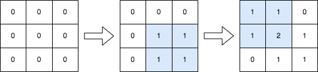

# 2536. 子矩阵元素加 1

Medium · 难度分 1583 · [力扣原题](https://leetcode.cn/problems/increment-submatrices-by-one/)

所在刷题路径：灵神题单·常用数据结构

| 作者 | 题解 | 动画讲解 |
|---|---|---|
| 灵茶山艾府 | [📄 题解](灵茶山艾府.md) | [▶︎ 2536 子矩阵元素加 1 · 灵茶山艾府.mp4](2536%20子矩阵元素加%201%20·%20灵茶山艾府.mp4) |
| yiduobo | [📄 题解](yiduobo.md) | [▶︎ 2536 子矩阵元素加 1 · yiduobo.mp4](2536%20子矩阵元素加%201%20·%20yiduobo.mp4) |

## 题目描述

给你一个正整数 `n` ，表示最初有一个 `n x n` 、下标从 **0** 开始的整数矩阵 `mat` ，矩阵中填满了 0 。

另给你一个二维整数数组 `query` 。针对每个查询 `query[i] = [row1_i, col1_i, row2_i, col2_i]` ，请你执行下述操作：

- 找出 **左上角** 为 `(row1_i, col1_i)` 且 **右下角** 为 `(row2_i, col2_i)` 的子矩阵，将子矩阵中的 **每个元素** 加 `1` 。也就是给所有满足 `row1_i <= x <= row2_i` 和 `col1_i <= y <= col2_i` 的 `mat[x][y]` 加 `1` 。

返回执行完所有操作后得到的矩阵 `mat` 。

**示例 1：**



```

输入：n = 3, queries = [[1,1,2,2],[0,0,1,1]]
输出：[[1,1,0],[1,2,1],[0,1,1]]
解释：上图所展示的分别是：初始矩阵、执行完第一个操作后的矩阵、执行完第二个操作后的矩阵。
- 第一个操作：将左上角为 (1, 1) 且右下角为 (2, 2) 的子矩阵中的每个元素加 1 。
- 第二个操作：将左上角为 (0, 0) 且右下角为 (1, 1) 的子矩阵中的每个元素加 1 。
```

**示例 2：**


```

输入：n = 2, queries = [[0,0,1,1]]
输出：[[1,1],[1,1]]
解释：上图所展示的分别是：初始矩阵、执行完第一个操作后的矩阵。
- 第一个操作：将矩阵中的每个元素加 1 。
```

**提示：**

- `1 <= n <= 500`

- `1 <= queries.length <= 10⁴`

- `0 <= row1_i <= row2_i < n`

- `0 <= col1_i <= col2_i < n`

---
[↑ 返回 2500-2599](../README.md) · [总索引](../../../索引.md) · [仓库首页](../../../README.md)
