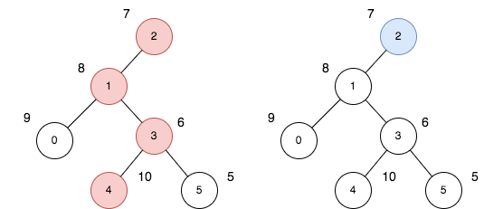
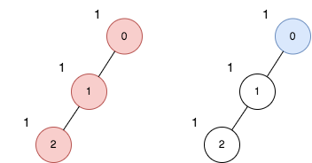

# 2538. 最大价值和与最小价值和的差值

Hard · 难度分 2398 · [力扣原题](https://leetcode.cn/problems/difference-between-maximum-and-minimum-price-sum/)

所在刷题路径：灵神题单·动态规划、灵神题单·链表树与回溯

| 作者 | 题解 | 动画讲解 |
|---|---|---|
| 灵茶山艾府 | [📄 题解](灵茶山艾府.md) | [▶︎ 动画（GIF）](2538%20最大价值和与最小价值和的差值%20·%20灵茶山艾府.gif) · [mp4 文件](2538%20最大价值和与最小价值和的差值%20·%20灵茶山艾府.mp4) |
| yiduobo | [📄 题解](yiduobo.md) | [▶︎ 动画（GIF）](2538%20最大价值和与最小价值和的差值%20·%20yiduobo.gif) · [mp4 文件](2538%20最大价值和与最小价值和的差值%20·%20yiduobo.mp4) |

## 动画讲解

> 动图会循环播放；想暂停、拖进度条请下载上面表格里的 mp4 文件。

### 灵茶山艾府


### yiduobo


## 题目描述

给你一个 `n` 个节点的无向无根图，节点编号为 `0` 到 `n - 1` 。给你一个整数 `n` 和一个长度为 `n - 1` 的二维整数数组 `edges` ，其中 `edges[i] = [a_i, b_i]` 表示树中节点 `a_i` 和 `b_i` 之间有一条边。

每个节点都有一个价值。给你一个整数数组 `price` ，其中 `price[i]` 是第 `i` 个节点的价值。

一条路径的 **价值和** 是这条路径上所有节点的价值之和。

你可以选择树中任意一个节点作为根节点 `root` 。选择 `root` 为根的 **开销** 是以 `root` 为起点的所有路径中，**价值和** 最大的一条路径与最小的一条路径的差值。

请你返回所有节点作为根节点的选择中，**最大** 的 **开销** 为多少。

**示例 1：**



```

输入：n = 6, edges = [[0,1],[1,2],[1,3],[3,4],[3,5]], price = [9,8,7,6,10,5]
输出：24
解释：上图展示了以节点 2 为根的树。左图（红色的节点）是最大价值和路径，右图（蓝色的节点）是最小价值和路径。
- 第一条路径节点为 [2,1,3,4]：价值为 [7,8,6,10] ，价值和为 31 。
- 第二条路径节点为 [2] ，价值为 [7] 。
最大路径和与最小路径和的差值为 24 。24 是所有方案中的最大开销。
```

**示例 2：**



```

输入：n = 3, edges = [[0,1],[1,2]], price = [1,1,1]
输出：2
解释：上图展示了以节点 0 为根的树。左图（红色的节点）是最大价值和路径，右图（蓝色的节点）是最小价值和路径。
- 第一条路径包含节点 [0,1,2]：价值为 [1,1,1] ，价值和为 3 。
- 第二条路径节点为 [0] ，价值为 [1] 。
最大路径和与最小路径和的差值为 2 。2 是所有方案中的最大开销。
```

**提示：**

- `1 <= n <= 10⁵`

- `edges.length == n - 1`

- `0 <= a_i, b_i <= n - 1`

- `edges` 表示一棵符合题面要求的树。

- `price.length == n`

- `1 <= price[i] <= 10⁵`

---
[↑ 返回 2500-2599](../README.md) · [总索引](../../../索引.md) · [仓库首页](../../../README.md)
