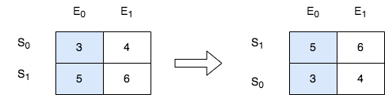

# 自定义排序，简洁写法（Python/Java/C++/C/Go/JS/Rust）

> **[2545. 根据第 K 场考试的分数排序](https://leetcode.cn/problems/sort-the-students-by-their-kth-score/solutions/2072732/yu-fa-ti-by-endlesscheng-lako/) · Medium**

> **题目描述**
> 班里有 `m` 位学生，共计划组织 `n` 场考试。给你一个下标从 **0** 开始、大小为 `m x n` 的整数矩阵 `score` ，其中每一行对应一位学生，而 `score[i][j]` 表示第 `i` 位学生在第 `j` 场考试取得的分数。矩阵 `score` 包含的整数 **互不相同** 。
>
> 另给你一个整数 `k` 。请你按第 `k` 场考试分数从高到低完成对这些学生（矩阵中的行）的排序。
>
> 返回排序后的矩阵。
>
> **示例 1：**
>
> 
>
> ```
>
> 输入：score = [[10,6,9,1],[7,5,11,2],[4,8,3,15]], k = 2
> 输出：[[7,5,11,2],[10,6,9,1],[4,8,3,15]]
> 解释：在上图中，S 表示学生，E 表示考试。
> - 下标为 1 的学生在第 2 场考试取得的分数为 11 ，这是考试的最高分，所以 TA 需要排在第一。
> - 下标为 0 的学生在第 2 场考试取得的分数为 9 ，这是考试的第二高分，所以 TA 需要排在第二。
> - 下标为 2 的学生在第 2 场考试取得的分数为 3 ，这是考试的最低分，所以 TA 需要排在第三。
> ```
>
> **示例 2：**
>
> 
>
> ```
>
> 输入：score = [[3,4],[5,6]], k = 0
> 输出：[[5,6],[3,4]]
> 解释：在上图中，S 表示学生，E 表示考试。
> - 下标为 1 的学生在第 0 场考试取得的分数为 5 ，这是考试的最高分，所以 TA 需要排在第一。
> - 下标为 0 的学生在第 0 场考试取得的分数为 3 ，这是考试的最低分，所以 TA 需要排在第二。
> ```
>
> **提示：**
>
> - `m == score.length`
>
> - `n == score[i].length`
>
> - `1 <= m, n <= 250`
>
> - `1 <= score[i][j] <= 10⁵`
>
> - `score` 由 **不同** 的整数组成
>
> - `0 <= k < n`

> **题解**
> 自定义排序，按照每一行的下标为 $k$ 的元素从大到小排序。
>
> ```python
> class Solution:
>     def sortTheStudents(self, score: List[List[int]], k: int) -> List[List[int]]:
>         score.sort(key=lambda row: -row[k])
>         return score
> ```
>
>
> ### 复杂度分析
>
> - 时间复杂度：$\mathcal{O}(m\log m)$，其中 $m$ 为 $\textit{score}$ 的长度。
> - 空间复杂度：$\mathcal{O}(1)$，忽略排序时的栈开销，仅用到若干额外变量。
>
> ## 分类题单
>
> [如何科学刷题？](https://leetcode.cn/circle/discuss/RvFUtj/)
>
> 1. [滑动窗口与双指针（定长/不定长/单序列/双序列/三指针/分组循环）](https://leetcode.cn/circle/discuss/0viNMK/)
> 2. [二分算法（二分答案/最小化最大值/最大化最小值/第K小）](https://leetcode.cn/circle/discuss/SqopEo/)
> 3. [单调栈（基础/矩形面积/贡献法/最小字典序）](https://leetcode.cn/circle/discuss/9oZFK9/)
> 4. [网格图（DFS/BFS/综合应用）](https://leetcode.cn/circle/discuss/YiXPXW/)
> 5. [位运算（基础/性质/拆位/试填/恒等式/思维）](https://leetcode.cn/circle/discuss/dHn9Vk/)
> 6. [图论算法（DFS/BFS/拓扑排序/最短路/最小生成树/二分图/基环树/欧拉路径）](https://leetcode.cn/circle/discuss/01LUak/)
> 7. [动态规划（入门/背包/状态机/划分/区间/状压/数位/数据结构优化/树形/博弈/概率期望）](https://leetcode.cn/circle/discuss/tXLS3i/)
> 8. [常用数据结构（前缀和/差分/栈/队列/堆/字典树/并查集/树状数组/线段树）](https://leetcode.cn/circle/discuss/mOr1u6/)
> 9. [数学算法（数论/组合/概率期望/博弈/计算几何/随机算法）](https://leetcode.cn/circle/discuss/IYT3ss/)
> 10. [贪心与思维（基本贪心策略/反悔/区间/字典序/数学/思维/脑筋急转弯/构造）](https://leetcode.cn/circle/discuss/g6KTKL/)
> 11. [链表、二叉树与回溯（前后指针/快慢指针/DFS/BFS/直径/LCA/一般树）](https://leetcode.cn/circle/discuss/K0n2gO/)
> 12. [字符串（KMP/Z函数/Manacher/字符串哈希/AC自动机/后缀数组/子序列自动机）](https://leetcode.cn/circle/discuss/SJFwQI/)
>
> [我的题解精选（已分类）](https://github.com/EndlessCheng/codeforces-go/blob/master/leetcode/SOLUTIONS.md)
>
> 欢迎关注 [B站@灵茶山艾府](https://space.bilibili.com/206214)
