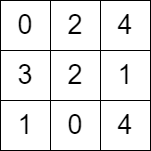

# 两种方法：Dijkstra/二分答案+BFS（Python/Java/C++/Go）

> **[2577. 在网格图中访问一个格子的最少时间](https://leetcode.cn/problems/minimum-time-to-visit-a-cell-in-a-grid/solutions/2134200/er-fen-da-an-bfspythonjavacgo-by-endless-j10w/) · Hard · 难度分 2382**

> **所属题单**
> - [网格图 · 五、综合应用](../../../刷题路径/灵神原版题单/网格图/五、综合应用.md)
> - [图论算法 · 三、最短路](../../../刷题路径/灵神原版题单/图论算法/三、最短路.md) · §3.1 单源最短路：Dijkstra 算法

> **题目描述**
> 给你一个 `m x n` 的矩阵 `grid` ，每个元素都为 **非负** 整数，其中 `grid[row][col]` 表示可以访问格子 `(row, col)` 的 **最早** 时间。也就是说当你访问格子 `(row, col)` 时，最少已经经过的时间为 `grid[row][col]` 。
>
> 你从 **最左上角** 出发，出发时刻为 `0` ，你必须一直移动到上下左右相邻四个格子中的 **任意** 一个格子（即不能停留在格子上）。每次移动都需要花费 1 单位时间。
>
> 请你返回 **最早** 到达右下角格子的时间，如果你无法到达右下角的格子，请你返回 `-1` 。
>
> **示例 1：**
>
> 
>
> ```
>
> 输入：grid = [[0,1,3,2],[5,1,2,5],[4,3,8,6]]
> 输出：7
> 解释：一条可行的路径为：
> - 时刻 t = 0 ，我们在格子 (0,0) 。
> - 时刻 t = 1 ，我们移动到格子 (0,1) ，可以移动的原因是 grid[0][1] <= 1 。
> - 时刻 t = 2 ，我们移动到格子 (1,1) ，可以移动的原因是 grid[1][1] <= 2 。
> - 时刻 t = 3 ，我们移动到格子 (1,2) ，可以移动的原因是 grid[1][2] <= 3 。
> - 时刻 t = 4 ，我们移动到格子 (1,1) ，可以移动的原因是 grid[1][1] <= 4 。
> - 时刻 t = 5 ，我们移动到格子 (1,2) ，可以移动的原因是 grid[1][2] <= 5 。
> - 时刻 t = 6 ，我们移动到格子 (1,3) ，可以移动的原因是 grid[1][3] <= 6 。
> - 时刻 t = 7 ，我们移动到格子 (2,3) ，可以移动的原因是 grid[2][3] <= 7 。
> 最终到达时刻为 7 。这是最早可以到达的时间。
> ```
>
> **示例 2：**
>
> 
>
> ```
>
> 输入：grid = [[0,2,4],[3,2,1],[1,0,4]]
> 输出：-1
> 解释：没法从左上角按题目规定走到右下角。
> ```
>
> **提示：**
>
> - `m == grid.length`
>
> - `n == grid[i].length`
>
> - `2 <= m, n <= 1000`
>
> - `4 <= m * n <= 10⁵`
>
> - `0 <= grid[i][j] <= 10⁵`
>
> - `grid[0][0] == 0`

> **题解**
> ## 方法一：Dijkstra 算法
>
> ### 前置知识：Dijkstra 算法
>
> 见本题 [视频讲解](https://www.bilibili.com/video/BV1wj411G7sH/)。
>
> ### 提示 1
>
> 如果 $\textit{grid}[0][1]\le 1$ 或者 $\textit{grid}[1][0]\le 1$，那么可以通过「反复横跳」来「等待」。否则根本就无法移动到这两个格子，也就无法到达终点，返回 $-1$。
>
> 通过反复横跳，出发时间可以为 $0,2,4,\cdots$ 这些偶数。
>
> ### 提示 2
>
> 定义 $\textit{dis}[i][j]$ 为到达 $(i,j)$ 的最小时间，那么 $\textit{dis}[0][0]=0$，答案为 $\textit{dis}[m-1][n-1]$。
>
> 如果没有别的约束，那么每条边的边权可以视作 $1$，跑 Dijkstra 算法就可以算出答案。
>
> 根据题意，$\textit{dis}[i][j]$ 需要至少为 $\textit{grid}[i][j]$；且根据网格图的性质，在可以反复横跳的情况下，到达一个格子的时间的奇偶性是不变的，那么 $\textit{dis}[i][j]$ 应当与 $i+j$ 的奇偶性相同。
>
> > 证明：想象成国际象棋的棋盘（两种颜色），每走一步，颜色一定会改变，所以走了偶数步之后一定会落在相同颜色的格子上，奇数步会落在另一个颜色的格子上。这些颜色相同的格子的奇偶性是相同的，可以用坐标之和的奇偶性表示。
>
> 算上这两个约束，才能计算出正确的结果。
>
> ```python
> class Solution:
>     def minimumTime(self, grid: List[List[int]]) -> int:
>         m, n = len(grid), len(grid[0])
>         if grid[0][1] > 1 and grid[1][0] > 1:  # 无法「等待」
>             return -1
>
>         dis = [[inf] * n for _ in range(m)]
>         dis[0][0] = 0
>         h = [(0, 0, 0)]
>         while True:  # 可以等待，就一定可以到达终点
>             d, i, j = heappop(h)
>             if d > dis[i][j]: continue
>             if i == m - 1 and j == n - 1:  # 找到终点，此时 d 一定是最短路
>                 return d
>             for x, y in (i + 1, j), (i - 1, j), (i, j + 1), (i, j - 1):  # 枚举周围四个格子
>                 if 0 <= x < m and 0 <= y < n:
>                     nd = max(d + 1, grid[x][y])
>                     nd += (nd - x - y) % 2  # nd 必须和 x+y 同奇偶
>                     if nd < dis[x][y]:
>                         dis[x][y] = nd  # 更新最短路
>                         heappush(h, (nd, x, y))
> ```
>
>
> #### 复杂度分析
>
> - 时间复杂度：$O(mn\log mn)$，其中 $m$ 和 $n$ 分别为 $\textit{grid}$ 的行数和列数。
> - 空间复杂度：$O(mn)$。
>
> ## 方法二：二分答案 + BFS
>
> ### 前置知识：二分
>
> 见[【基础算法精讲 04】](https://www.bilibili.com/video/BV1AP41137w7/)。
>
> ### 提示 1
>
> 先不管「反复横跳」的事，假设在时刻 $\textit{endTime}$ 到达终点，那么我们从终点出发，一刻不停地反向到达起点。
>
> 如果可以从终点到达起点，说明可以在大于 $\textit{endTime}$ 的时刻到达终点；反之，如果无法从终点到达起点，说明无法在小于 $\textit{endTime}$ 的时刻到达终点。
>
> 有单调性，可以二分到达终点的时间。
>
> ### 提示 2
>
> 根据方法一中的思路，如果最后答案与 $m+n$ 的奇偶性不同，则加一调整一下。
>
> ```python
> class Solution:
>     def minimumTime(self, grid: List[List[int]]) -> int:
>         m, n = len(grid), len(grid[0])
>         if grid[0][1] > 1 and grid[1][0] > 1:  # 无法「等待」
>             return -1
>
>         vis = [[-inf] * n for _ in range(m)]
>         def check(end_time: int) -> bool:
>             vis[-1][-1] = end_time
>             q = [(m - 1, n - 1)]
>             t = end_time - 1
>             while q:
>                 tmp = q
>                 q = []
>                 for i, j in tmp:
>                     for x, y in (i + 1, j), (i - 1, j), (i, j + 1), (i, j - 1):  # 枚举周围四个格子
>                         if 0 <= x < m and 0 <= y < n and vis[x][y] != end_time and grid[x][y] <= t:
>                             if x == 0 and y == 0: return True
>                             vis[x][y] = end_time  # 用二分的值来标记，避免重复创建 vis 数组
>                             q.append((x, y))
>                 t -= 1
>             return False
>
>         left = max(grid[-1][-1], m + n - 2) - 1
>         right = max(map(max, grid)) + m + n  # 开区间
>         while left + 1 < right:
>             mid = (left + right) // 2
>             if check(mid): right = mid
>             else: left = mid
>         return right + (right - m - n) % 2
> ```
>
>
> #### 复杂度分析
>
> - 时间复杂度：$O(mn\log U)$，其中 $m$ 和 $n$ 分别为 $\textit{grid}$ 的行数和列数，$U$ 为 $\textit{grid}[i][j]$ 的最大值。
> - 空间复杂度：$O(mn)$。
>
> ## 相似题目
>
> - [778. 水位上升的泳池中游泳](https://leetcode.cn/problems/swim-in-rising-water/)
>
> ## 分类题单
>
> [如何科学刷题？](https://leetcode.cn/circle/discuss/RvFUtj/)
>
> 1. [滑动窗口与双指针（定长/不定长/单序列/双序列/三指针）](https://leetcode.cn/circle/discuss/0viNMK/)
> 2. 【本题相关】[二分算法（二分答案/最小化最大值/最大化最小值/第K小）](https://leetcode.cn/circle/discuss/SqopEo/)
> 3. [单调栈（基础/矩形面积/贡献法/最小字典序）](https://leetcode.cn/circle/discuss/9oZFK9/)
> 4. 【本题相关】[网格图（DFS/BFS/综合应用）](https://leetcode.cn/circle/discuss/YiXPXW/)
> 5. [位运算（基础/性质/拆位/试填/恒等式/思维）](https://leetcode.cn/circle/discuss/dHn9Vk/)
> 6. 【本题相关】[图论算法（DFS/BFS/拓扑排序/最短路/最小生成树/二分图/基环树/欧拉路径）](https://leetcode.cn/circle/discuss/01LUak/)
> 7. [动态规划（入门/背包/状态机/划分/区间/状压/数位/数据结构优化/树形/博弈/概率期望）](https://leetcode.cn/circle/discuss/tXLS3i/)
> 8. [常用数据结构（前缀和/差分/栈/队列/堆/字典树/并查集/树状数组/线段树）](https://leetcode.cn/circle/discuss/mOr1u6/)
> 9. [数学算法（数论/组合/概率期望/博弈/计算几何/随机算法）](https://leetcode.cn/circle/discuss/IYT3ss/)
> 10. [贪心与思维（基本贪心策略/反悔/区间/字典序/数学/思维/脑筋急转弯/构造）](https://leetcode.cn/circle/discuss/g6KTKL/)
> 11. [链表、二叉树与回溯（前后指针/快慢指针/DFS/BFS/直径/LCA/一般树）](https://leetcode.cn/circle/discuss/K0n2gO/)
> 12. [字符串（KMP/Z函数/Manacher/字符串哈希/AC自动机/后缀数组/子序列自动机）](https://leetcode.cn/circle/discuss/SJFwQI/)
>
> [我的题解精选（已分类）](https://github.com/EndlessCheng/codeforces-go/blob/master/leetcode/SOLUTIONS.md)
>
> 欢迎关注 [B站@灵茶山艾府](https://space.bilibili.com/206214)
