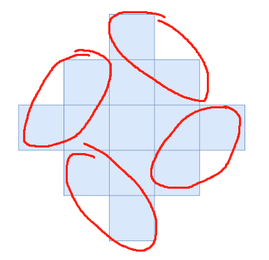

# 找规律

> **[2579. 统计染色格子数](https://leetcode.cn/problems/count-total-number-of-colored-cells/solutions/2147721/zhao-gui-lu-by-endlesscheng-gksh/) · Medium · 难度分 1356**

> **所属题单**
> - [数学算法 · 七、杂项](../../../刷题路径/灵神原版题单/数学算法/七、杂项.md) · §7.10 其他

> **题目描述**
> 有一个无穷大的二维网格图，一开始所有格子都未染色。给你一个正整数 `n` ，表示你需要执行以下步骤 `n` 分钟：
>
> - 第一分钟，将 **任一** 格子染成蓝色。
>
> - 之后的每一分钟，将与蓝色格子相邻的 **所有** 未染色格子染成蓝色。
>
> 下图分别是 1、2、3 分钟后的网格图。
>
> 
>
> 请你返回 `n` 分钟之后 **被染色的格子** 数目。
>
> **示例 1：**
>
> ```
> 输入：n = 1
> 输出：1
> 解释：1 分钟后，只有 1 个蓝色的格子，所以返回 1 。
> ```
>
> **示例 2：**
>
> ```
> 输入：n = 2
> 输出：5
> 解释：2 分钟后，有 4 个在边缘的蓝色格子和 1 个在中间的蓝色格子，所以返回 5 。
> ```
>
> **提示：**
>
> - `1 <= n <= 10⁵`

> **题解**
> 设答案为 $f(n)$，那么 $f(n)$ 相当于在 $f(n-1)$ 的基础上多了 $4$ 组 $n-1$ 的格子。
>
> 
>
> 所以 
>
> $$
> f(n) =
> \begin{cases} 
> 1,&n=1\\
> f(n-1) + 4(n-1),&n \ge 2
> \end{cases}
> $$
>
> 化简得
>
> $$
> f(n) = 1 + 4(1+2+\cdots+ n-1) = 1 + 2n(n-1)
> $$
>
> [视频讲解](https://www.bilibili.com/video/BV1dY4y1C77x/)
>
> ```python
> class Solution:
>     def coloredCells(self, n: int) -> int:
>         return 1 + 2 * n * (n - 1)
> ```
>
>
> #### 复杂度分析
>
> - 时间复杂度：$\mathcal{O}(1)$。
> - 空间复杂度：$\mathcal{O}(1)$。
>
> ## 分类题单
>
> [如何科学刷题？](https://leetcode.cn/circle/discuss/RvFUtj/)
>
> 1. [滑动窗口与双指针（定长/不定长/单序列/双序列/三指针/分组循环）](https://leetcode.cn/circle/discuss/0viNMK/)
> 2. [二分算法（二分答案/最小化最大值/最大化最小值/第K小）](https://leetcode.cn/circle/discuss/SqopEo/)
> 3. [单调栈（基础/矩形面积/贡献法/最小字典序）](https://leetcode.cn/circle/discuss/9oZFK9/)
> 4. [网格图（DFS/BFS/综合应用）](https://leetcode.cn/circle/discuss/YiXPXW/)
> 5. [位运算（基础/性质/拆位/试填/恒等式/思维）](https://leetcode.cn/circle/discuss/dHn9Vk/)
> 6. [图论算法（DFS/BFS/拓扑排序/基环树/最短路/最小生成树/网络流）](https://leetcode.cn/circle/discuss/01LUak/)
> 7. [动态规划（入门/背包/划分/状态机/区间/状压/数位/数据结构优化/树形/博弈/概率期望）](https://leetcode.cn/circle/discuss/tXLS3i/)
> 8. [常用数据结构（前缀和/差分/栈/队列/堆/字典树/并查集/树状数组/线段树）](https://leetcode.cn/circle/discuss/mOr1u6/)
> 9. [数学算法（数论/组合/概率期望/博弈/计算几何/随机算法）](https://leetcode.cn/circle/discuss/IYT3ss/)
> 10. [贪心与思维（基本贪心策略/反悔/区间/字典序/数学/思维/脑筋急转弯/构造）](https://leetcode.cn/circle/discuss/g6KTKL/)
> 11. [链表、二叉树与回溯（前后指针/快慢指针/DFS/BFS/直径/LCA/一般树）](https://leetcode.cn/circle/discuss/K0n2gO/)
> 12. [字符串（KMP/Z函数/Manacher/字符串哈希/AC自动机/后缀数组/子序列自动机）](https://leetcode.cn/circle/discuss/SJFwQI/)
>
> [我的题解精选（已分类）](https://github.com/EndlessCheng/codeforces-go/blob/master/leetcode/SOLUTIONS.md)
>
> 欢迎关注 [B站@灵茶山艾府](https://space.bilibili.com/206214)
