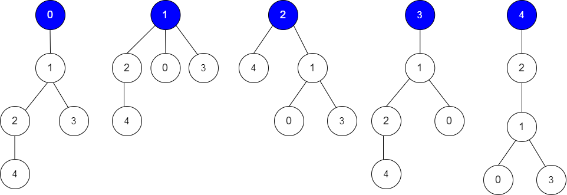

# 换根 DP（Python/Java/C++/Go）

> **[2581. 统计可能的树根数目](https://leetcode.cn/problems/count-number-of-possible-root-nodes/solutions/2147714/huan-gen-dppythonjavacgo-by-endlesscheng-ccwy/) · Hard · 难度分 2228**

> **所属题单**
> - [动态规划 · 十二、树形 DP](../../../刷题路径/灵神原版题单/动态规划/十二、树形%20DP.md) · §12.4 换根 DP

> **题目描述**
> Alice 有一棵 `n` 个节点的树，节点编号为 `0` 到 `n - 1` 。树用一个长度为 `n - 1` 的二维整数数组 `edges` 表示，其中 `edges[i] = [a_i, b_i]` ，表示树中节点 `a_i` 和 `b_i` 之间有一条边。
>
> Alice 想要 Bob 找到这棵树的根。她允许 Bob 对这棵树进行若干次 **猜测** 。每一次猜测，Bob 做如下事情：
>
> - 选择两个 **不相等** 的整数 `u` 和 `v` ，且树中必须存在边 `[u, v]` 。
>
> - Bob 猜测树中 `u` 是 `v` 的 **父节点** 。
>
> Bob 的猜测用二维整数数组 `guesses` 表示，其中 `guesses[j] = [u_j, v_j]` 表示 Bob 猜 `u_j` 是 `v_j` 的父节点。
>
> Alice 非常懒，她不想逐个回答 Bob 的猜测，只告诉 Bob 这些猜测里面 **至少** 有 `k` 个猜测的结果为 `true` 。
>
> 给你二维整数数组 `edges` ，Bob 的所有猜测和整数 `k` ，请你返回可能成为树根的 **节点数目** 。如果没有这样的树，则返回 `0`。
>
> **示例 1：**
>
> 
>
> ```
>
> 输入：edges = [[0,1],[1,2],[1,3],[4,2]], guesses = [[1,3],[0,1],[1,0],[2,4]], k = 3
> 输出：3
> 解释：
> 根为节点 0 ，正确的猜测为 [1,3], [0,1], [2,4]
> 根为节点 1 ，正确的猜测为 [1,3], [1,0], [2,4]
> 根为节点 2 ，正确的猜测为 [1,3], [1,0], [2,4]
> 根为节点 3 ，正确的猜测为 [1,0], [2,4]
> 根为节点 4 ，正确的猜测为 [1,3], [1,0]
> 节点 0 ，1 或 2 为根时，可以得到 3 个正确的猜测。
> ```
>
> **示例 2：**
>
> 
>
> ```
>
> 输入：edges = [[0,1],[1,2],[2,3],[3,4]], guesses = [[1,0],[3,4],[2,1],[3,2]], k = 1
> 输出：5
> 解释：
> 根为节点 0 ，正确的猜测为 [3,4]
> 根为节点 1 ，正确的猜测为 [1,0], [3,4]
> 根为节点 2 ，正确的猜测为 [1,0], [2,1], [3,4]
> 根为节点 3 ，正确的猜测为 [1,0], [2,1], [3,2], [3,4]
> 根为节点 4 ，正确的猜测为 [1,0], [2,1], [3,2]
> 任何节点为根，都至少有 1 个正确的猜测。
> ```
>
> **提示：**
>
> - `edges.length == n - 1`
>
> - `2 <= n <= 10⁵`
>
> - `1 <= guesses.length <= 10⁵`
>
> - `0 <= a_i, b_i, u_j, v_j <= n - 1`
>
> - `a_i != b_i`
>
> - `u_j != v_j`
>
> - `edges` 表示一棵有效的树。
>
> - `guesses[j]` 是树中的一条边。
>
> - `guesses` 是唯一的。
>
> - `0 <= k <= guesses.length`

> **题解**
> 没学过换根 DP 的同学，请先看[【图解】一张图秒懂换根 DP！](../../0800-0899/0834%20树中距离之和/灵茶山艾府.md)
>
> 本题如果只求以 $0$ 为根时的猜对次数 $\textit{cnt}_0$，把 $\textit{guesses}$ 转成哈希表，DFS 一次这棵树就可以算出来。
>
> 如果枚举 $0$ 到 $n-1$ 的每个点作为树根，就需要 DFS $n$ 次，需要 $\mathcal{O}(n^2)$ 的时间，怎么优化呢？
>
> 注意到，如果节点 $x$ 和节点 $y$ 相邻，那么从「以 $x$ 为根的树」变成「以 $y$ 为根的树」，就只有 $x$ 和 $y$ 的父子关系改变了，其余相邻节点的父子关系没有变化。所以只有 $[x,y]$ 和 $[y,x]$ 这两个猜测的正确性变了，其余猜测的正确性不变。
>
> 因此，在计算出 $\textit{cnt}_0$ 后，我们可以再次从 $0$ 出发，DFS 这棵树。从节点 $x$ 递归到节点 $y$ 时：
>
> - 如果有猜测 $[x,y]$，那么猜对次数减一。
> - 如果有猜测 $[y,x]$，那么猜对次数加一。
>
> DFS 的同时，统计猜对次数 $\ge k$ 的节点个数，即为答案。
>
> ```python
> class Solution:
>     def rootCount(self, edges: List[List[int]], guesses: List[List[int]], k: int) -> int:
>         g = [[] for _ in range(len(edges) + 1)]
>         for x, y in edges:
>             g[x].append(y)
>             g[y].append(x)  # 建图
>
>         s = {(x, y) for x, y in guesses}  # guesses 转成哈希表 s
>
>         ans = cnt0 = 0
>         def dfs(x: int, fa: int) -> None:
>             nonlocal cnt0
>             for y in g[x]:
>                 if y != fa:
>                     cnt0 += (x, y) in s  # 以 0 为根时，猜对了
>                     dfs(y, x)
>         dfs(0, -1)
>
>         def reroot(x: int, fa: int, cnt: int) -> None:
>             nonlocal ans
>             ans += cnt >= k  # 此时 cnt 就是以 x 为根时的猜对次数
>             for y in g[x]:
>                 if y != fa:
>                     reroot(y, x, cnt - ((x, y) in s) + ((y, x) in s))
>         reroot(0, -1, cnt0)
>         return ans
> ```
>
>
> #### 复杂度分析
>
> - 时间复杂度：$\mathcal{O}(n+m)$，其中 $n$ 为 $\textit{edges}$ 的长度加一，$m$ 为 $\textit{guesses}$ 的长度。
> - 空间复杂度：$\mathcal{O}(n+m)$。
>
> ## 思考题
>
> 如果把「$u$ 是 $v$ 的父节点」改成「$u$ 是 $v$ 的**祖先节点**」，要怎么做呢？（解答见 [视频](https://www.bilibili.com/video/BV1dY4y1C77x/)）
>
> 如果改成「$\textit{guesses}[i]$ 猜对会得到 $\textit{score}[i]$ 分，计算的是以每个点为根时的得分之和」，要怎么做呢？（本题相当于 $\textit{score}[i]$ 均为 $1$）
>
> ## 分类题单
>
> [如何科学刷题？](https://leetcode.cn/circle/discuss/RvFUtj/)
>
> 1. [滑动窗口与双指针（定长/不定长/单序列/双序列/三指针/分组循环）](https://leetcode.cn/circle/discuss/0viNMK/)
> 2. [二分算法（二分答案/最小化最大值/最大化最小值/第K小）](https://leetcode.cn/circle/discuss/SqopEo/)
> 3. [单调栈（基础/矩形面积/贡献法/最小字典序）](https://leetcode.cn/circle/discuss/9oZFK9/)
> 4. [网格图（DFS/BFS/综合应用）](https://leetcode.cn/circle/discuss/YiXPXW/)
> 5. [位运算（基础/性质/拆位/试填/恒等式/思维）](https://leetcode.cn/circle/discuss/dHn9Vk/)
> 6. [图论算法（DFS/BFS/拓扑排序/最短路/最小生成树/二分图/基环树/欧拉路径）](https://leetcode.cn/circle/discuss/01LUak/)
> 7. 【本题相关】[动态规划（入门/背包/状态机/划分/区间/状压/数位/数据结构优化/树形/博弈/概率期望）](https://leetcode.cn/circle/discuss/tXLS3i/)
> 8. [常用数据结构（前缀和/差分/栈/队列/堆/字典树/并查集/树状数组/线段树）](https://leetcode.cn/circle/discuss/mOr1u6/)
> 9. [数学算法（数论/组合/概率期望/博弈/计算几何/随机算法）](https://leetcode.cn/circle/discuss/IYT3ss/)
> 10. [贪心与思维（基本贪心策略/反悔/区间/字典序/数学/思维/脑筋急转弯/构造）](https://leetcode.cn/circle/discuss/g6KTKL/)
> 11. [链表、二叉树与回溯（前后指针/快慢指针/DFS/BFS/直径/LCA/一般树）](https://leetcode.cn/circle/discuss/K0n2gO/)
> 12. [字符串（KMP/Z函数/Manacher/字符串哈希/AC自动机/后缀数组/子序列自动机）](https://leetcode.cn/circle/discuss/SJFwQI/)
>
> [我的题解精选（已分类）](https://github.com/EndlessCheng/codeforces-go/blob/master/leetcode/SOLUTIONS.md)
>
> 欢迎关注 [B站@灵茶山艾府](https://space.bilibili.com/206214)
