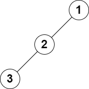

# 2583. 二叉树中的第 K 大层和

Medium · 难度分 1374 · [力扣原题](https://leetcode.cn/problems/kth-largest-sum-in-a-binary-tree/)

所在刷题路径：灵神题单·链表树与回溯

| 作者 | 题解 | 动画讲解 |
|---|---|---|
| 灵茶山艾府 | [📄 题解](灵茶山艾府.md) | [▶︎ 2583 二叉树中的第 K 大层和 · 灵茶山艾府.mp4](2583%20二叉树中的第%20K%20大层和%20·%20灵茶山艾府.mp4) |
| yiduobo | [📄 题解](yiduobo.md) | [▶︎ 2583 二叉树中的第 K 大层和 · yiduobo.mp4](2583%20二叉树中的第%20K%20大层和%20·%20yiduobo.mp4) |

## 题目描述

给你一棵二叉树的根节点 `root` 和一个正整数 `k` 。

树中的 **层和** 是指 **同一层** 上节点值的总和。

返回树中第 `k` 大的层和（不一定不同）。如果树少于 `k` 层，则返回 `-1` 。

**注意**，如果两个节点与根节点的距离相同，则认为它们在同一层。

**示例 1：**


```

输入：root = [5,8,9,2,1,3,7,4,6], k = 2
输出：13
解释：树中每一层的层和分别是：
- Level 1: 5
- Level 2: 8 + 9 = 17
- Level 3: 2 + 1 + 3 + 7 = 13
- Level 4: 4 + 6 = 10
第 2 大的层和等于 13 。
```

**示例 2：**



```

输入：root = [1,2,null,3], k = 1
输出：3
解释：最大的层和是 3 。
```

**提示：**

- 树中的节点数为 `n`

- `2 <= n <= 10⁵`

- `1 <= Node.val <= 10⁶`

- `1 <= k <= n`

---
[↑ 返回 2500-2599](../README.md) · [总索引](../../../索引.md) · [仓库首页](../../../README.md)
