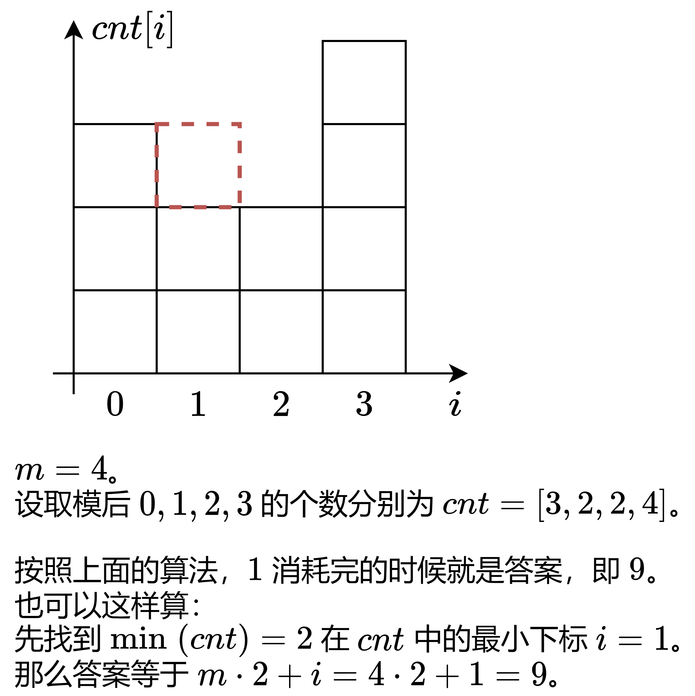

# 同余分组（Python/Java/C++/C/Go/JS/Rust）

> **[2598. 执行操作后的最大 MEX](https://leetcode.cn/problems/smallest-missing-non-negative-integer-after-operations/solutions/2177789/tong-yu-pythonjavacgo-by-endlesscheng-qoan/) · Medium · 难度分 1846**

> **所属题单**
> - [数学算法 · 一、数论](../../../刷题路径/灵神原版题单/数学算法/一、数论.md) · §1.9 同余

> **题目描述**
> 给你一个下标从 **0** 开始的整数数组 `nums` 和一个整数 `value` 。
>
> 在一步操作中，你可以对 `nums` 中的任一元素加上或减去 `value` 。
>
> - 例如，如果 `nums = [1,2,3]` 且 `value = 2` ，你可以选择 `nums[0]` 减去 `value` ，得到 `nums = [-1,2,3]` 。
>
> 数组的 MEX (minimum excluded) 是指其中数组中缺失的最小非负整数。
>
> - 例如，`[-1,2,3]` 的 MEX 是 `0` ，而 `[1,0,3]` 的 MEX 是 `2` 。
>
> 返回在执行上述操作 **任意次** 后，`nums` 的最大 MEX <em>。</em>
>
> **示例 1：**
>
> ```
> 输入：nums = [1,-10,7,13,6,8], value = 5
> 输出：4
> 解释：执行下述操作可以得到这一结果：
> - nums[1] 加上 value 两次，nums = [1,0,7,13,6,8]
> - nums[2] 减去 value 一次，nums = [1,0,2,13,6,8]
> - nums[3] 减去 value 两次，nums = [1,0,2,3,6,8]
> nums 的 MEX 是 4 。可以证明 4 是可以取到的最大 MEX 。
> ```
>
> **示例 2：**
>
> ```
> 输入：nums = [1,-10,7,13,6,8], value = 7
> 输出：2
> 解释：执行下述操作可以得到这一结果：
> - nums[2] 减去 value 一次，nums = [1,-10,0,13,6,8]
> nums 的 MEX 是 2 。可以证明 2 是可以取到的最大 MEX 。
> ```
>
> **提示：**
>
> - `1 <= nums.length, value <= 10⁵`
>
> - `-10⁹ <= nums[i] <= 10⁹`

> **题解**
> 下文记 $m=\textit{value}$。
>
> 由于同一个数可以加减任意倍的 $m$，我们可以先把每个 $\textit{nums}[i]$ 变成与 $\textit{nums}[i]$ 关于模 $m$ **同余**的最小非负整数，以备后用。关于同余的介绍，请看 [模运算的世界：当加减乘除遇上取模](https://leetcode.cn/circle/discuss/mDfnkW/)。
>
> 本题有负数，根据这篇文章中的公式，我们可以把每个 $\textit{nums}[i]$ 变成
>
> $$
> (\textit{nums}[i]\bmod m + m)\bmod m
> $$
>
> 从而保证取模结果在 $[0,m)$ 中。
>
> 例如 $\textit{nums}=[1,-6,-4,3,5]$，$m=3$，取模后变成 $[1,0,2,0,2]$。
>
> 然后枚举答案：
>
> - 有没有与 $0$ 关于模 $m$ 同余的数？有，我们消耗掉一个 $0$。
> - 有没有与 $1$ 关于模 $m$ 同余的数？有，我们消耗掉一个 $1$。
> - 有没有与 $2$ 关于模 $m$ 同余的数？有，我们消耗掉一个 $2$。
> - 有没有与 $3$ 关于模 $m$ 同余的数？有，我们消耗掉一个 $0$。这个取模后等于 $0$ 的数，可以继续操作，变成 $3$。
> - 有没有与 $4$ 关于模 $m$ 同余的数？也就是看是否还有 $1$，没有，那么答案等于 $4$。
>
> 怎么知道还有没有剩余元素？用一个哈希表 $\textit{cnt}$ 统计 $(\textit{nums}[i]\bmod m + m) \bmod m$ 的个数。
>
> [本题视频讲解](https://www.bilibili.com/video/BV1EL411C7YU/?t=42m20s)，欢迎点赞关注~
>
> ## 写法一
>
> ```python
> class Solution:
>     def findSmallestInteger(self, nums: List[int], m: int) -> int:
>         cnt = Counter(x % m for x in nums)
>         mex = 0
>         while cnt[mex % m]:
>             cnt[mex % m] -= 1
>             mex += 1
>         return mex
> ```
>
>
> #### 复杂度分析
>
> - 时间复杂度：$\mathcal{O}(n)$，其中 $n$ 是 $\textit{nums}$ 的长度。由于加多少个数，就只能减多少个数，所以第二个循环至多循环 $\mathcal{O}(n)$ 次。
> - 空间复杂度：$\mathcal{O}(\min(n,m))$。哈希表中至多有 $\mathcal{O}(\min(n,m))$ 个元素。
>
> ## 写法二
>
> {:width=500px}
>
> 此外，把哈希表换成数组更快。
>
> ```python
> class Solution:
>     def findSmallestInteger(self, nums: List[int], m: int) -> int:
>         cnt = [0] * m
>         for x in nums:
>             cnt[x % m] += 1
>
>         i = cnt.index(min(cnt))
>         return m * cnt[i] + i
> ```
>
>
> #### 复杂度分析
>
> - 时间复杂度：$\mathcal{O}(n+m)$，其中 $n$ 是 $\textit{nums}$ 的长度。
> - 空间复杂度：$\mathcal{O}(m)$。
>
> ## 相似题目
>
> 见下面数学题单的「**§1.9 同余**」。
>
> ## 分类题单
>
> [如何科学刷题？](https://leetcode.cn/circle/discuss/RvFUtj/)
>
> 1. [滑动窗口与双指针（定长/不定长/单序列/双序列/三指针/分组循环）](https://leetcode.cn/circle/discuss/0viNMK/)
> 2. [二分算法（二分答案/最小化最大值/最大化最小值/第K小）](https://leetcode.cn/circle/discuss/SqopEo/)
> 3. [单调栈（基础/矩形面积/贡献法/最小字典序）](https://leetcode.cn/circle/discuss/9oZFK9/)
> 4. [网格图（DFS/BFS/综合应用）](https://leetcode.cn/circle/discuss/YiXPXW/)
> 5. [位运算（基础/性质/拆位/试填/恒等式/思维）](https://leetcode.cn/circle/discuss/dHn9Vk/)
> 6. [图论算法（DFS/BFS/拓扑排序/基环树/最短路/最小生成树/网络流）](https://leetcode.cn/circle/discuss/01LUak/)
> 7. [动态规划（入门/背包/划分/状态机/区间/状压/数位/数据结构优化/树形/博弈/概率期望）](https://leetcode.cn/circle/discuss/tXLS3i/)
> 8. [常用数据结构（前缀和/差分/栈/队列/堆/字典树/并查集/树状数组/线段树）](https://leetcode.cn/circle/discuss/mOr1u6/)
> 9. [数学算法（数论/组合/概率期望/博弈/计算几何/随机算法）](https://leetcode.cn/circle/discuss/IYT3ss/)
> 10. [贪心与思维（基本贪心策略/反悔/区间/字典序/数学/思维/脑筋急转弯/构造）](https://leetcode.cn/circle/discuss/g6KTKL/)
> 11. [链表、二叉树与回溯（前后指针/快慢指针/DFS/BFS/直径/LCA/一般树）](https://leetcode.cn/circle/discuss/K0n2gO/)
> 12. [字符串（KMP/Z函数/Manacher/字符串哈希/AC自动机/后缀数组/子序列自动机）](https://leetcode.cn/circle/discuss/SJFwQI/)
>
> [我的题解精选（已分类）](https://github.com/EndlessCheng/codeforces-go/blob/master/leetcode/SOLUTIONS.md)
>
> 欢迎关注 [B站@灵茶山艾府](https://space.bilibili.com/206214)
