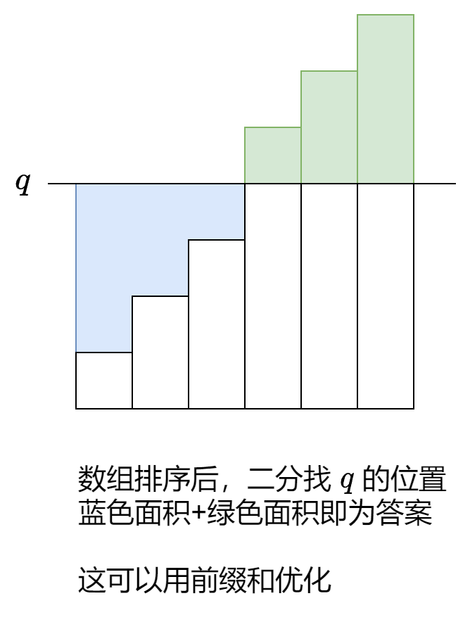

# 【一图秒懂】排序+前缀和+二分查找（Python/Java/C++/Go）

> **[2602. 使数组元素全部相等的最少操作次数](https://leetcode.cn/problems/minimum-operations-to-make-all-array-elements-equal/solutions/2191417/yi-tu-miao-dong-pai-xu-qian-zhui-he-er-f-nf55/) · Medium · 难度分 1903**

> **所属题单**
> - [常用数据结构 · 一、前缀和](../../../刷题路径/灵神原版题单/常用数据结构/一、前缀和.md) · §1.3 距离和

> **题目描述**
> 给你一个正整数数组 `nums` 。
>
> 同时给你一个长度为 `m` 的整数数组 `queries` 。第 `i` 个查询中，你需要将 `nums` 中所有元素变成 `queries[i]` 。你可以执行以下操作 **任意** 次：
>
> - 将数组里一个元素 **增大** 或者 **减小** `1` 。
>
> 请你返回一个长度为 `m` 的数组 `answer` ，其中 `answer[i]`是将 `nums` 中所有元素变成 `queries[i]` 的 **最少** 操作次数。
>
> **注意**，每次查询后，数组变回最开始的值。
>
> **示例 1：**
>
> ```
> 输入：nums = [3,1,6,8], queries = [1,5]
> 输出：[14,10]
> 解释：第一个查询，我们可以执行以下操作：
> - 将 nums[0] 减小 2 次，nums = [1,1,6,8] 。
> - 将 nums[2] 减小 5 次，nums = [1,1,1,8] 。
> - 将 nums[3] 减小 7 次，nums = [1,1,1,1] 。
> 第一个查询的总操作次数为 2 + 5 + 7 = 14 。
> 第二个查询，我们可以执行以下操作：
> - 将 nums[0] 增大 2 次，nums = [5,1,6,8] 。
> - 将 nums[1] 增大 4 次，nums = [5,5,6,8] 。
> - 将 nums[2] 减小 1 次，nums = [5,5,5,8] 。
> - 将 nums[3] 减小 3 次，nums = [5,5,5,5] 。
> 第二个查询的总操作次数为 2 + 4 + 1 + 3 = 10 。
> ```
>
> **示例 2：**
>
> ```
> 输入：nums = [2,9,6,3], queries = [10]
> 输出：[20]
> 解释：我们可以将数组中所有元素都增大到 10 ，总操作次数为 8 + 1 + 4 + 7 = 20 。
> ```
>
> **提示：**
>
> - `n == nums.length`
>
> - `m == queries.length`
>
> - `1 <= n, m <= 10⁵`
>
> - `1 <= nums[i], queries[i] <= 10⁹`

> **题解**
> {:width=400px}
>
> 关于**二分查找**，请看 [二分查找 红蓝染色法【基础算法精讲 04】](https://www.bilibili.com/video/BV1AP41137w7/)。
>
> 关于**前缀和**数组的定义，请看 [前缀和](../../0300-0399/0303%20区域和检索%20-%20数组不可变/灵茶山艾府.md)。
>
> ```python
> class Solution:
>     def minOperations(self, nums: List[int], queries: List[int]) -> List[int]:
>         n = len(nums)
>         nums.sort()
>         s = list(accumulate(nums, initial=0))  # 前缀和
>
>         ans = []
>         for q in queries:
>             j = bisect_left(nums, q)
>             left = q * j - s[j]  # 蓝色面积
>             right = s[n] - s[j] - q * (n - j)  # 绿色面积
>             ans.append(left + right)
>         return ans
> ```
>
>
> #### 复杂度分析
>
> - 时间复杂度：$\mathcal{O}((n+q)\log n)$，其中 $n$ 为 $\textit{nums}$ 的长度，$q$ 为 $\textit{queries}$ 的长度。
> - 空间复杂度：$\mathcal{O}(n)$。返回值不计入。
>
> ## 分类题单
>
> [如何科学刷题？](https://leetcode.cn/circle/discuss/RvFUtj/)
>
> 1. [滑动窗口与双指针（定长/不定长/单序列/双序列/三指针/分组循环）](https://leetcode.cn/circle/discuss/0viNMK/)
> 2. [二分算法（二分答案/最小化最大值/最大化最小值/第K小）](https://leetcode.cn/circle/discuss/SqopEo/)
> 3. [单调栈（基础/矩形面积/贡献法/最小字典序）](https://leetcode.cn/circle/discuss/9oZFK9/)
> 4. [网格图（DFS/BFS/综合应用）](https://leetcode.cn/circle/discuss/YiXPXW/)
> 5. [位运算（基础/性质/拆位/试填/恒等式/思维）](https://leetcode.cn/circle/discuss/dHn9Vk/)
> 6. [图论算法（DFS/BFS/拓扑排序/基环树/最短路/最小生成树/网络流）](https://leetcode.cn/circle/discuss/01LUak/)
> 7. [动态规划（入门/背包/划分/状态机/区间/状压/数位/数据结构优化/树形/博弈/概率期望）](https://leetcode.cn/circle/discuss/tXLS3i/)
> 8. [常用数据结构（前缀和/差分/栈/队列/堆/字典树/并查集/树状数组/线段树）](https://leetcode.cn/circle/discuss/mOr1u6/)
> 9. [数学算法（数论/组合/概率期望/博弈/计算几何/随机算法）](https://leetcode.cn/circle/discuss/IYT3ss/)
> 10. [贪心与思维（基本贪心策略/反悔/区间/字典序/数学/思维/脑筋急转弯/构造）](https://leetcode.cn/circle/discuss/g6KTKL/)
> 11. [链表、树与回溯（前后指针/快慢指针/DFS/BFS/直径/LCA）](https://leetcode.cn/circle/discuss/K0n2gO/)
> 12. [字符串（KMP/Z函数/Manacher/字符串哈希/AC自动机/后缀数组/子序列自动机）](https://leetcode.cn/circle/discuss/SJFwQI/)
>
> [我的题解精选（已分类）](https://github.com/EndlessCheng/codeforces-go/blob/master/leetcode/SOLUTIONS.md)
>
> 欢迎关注 [B站@灵茶山艾府](https://space.bilibili.com/206214)
