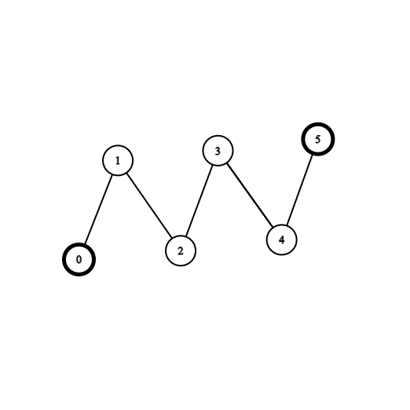
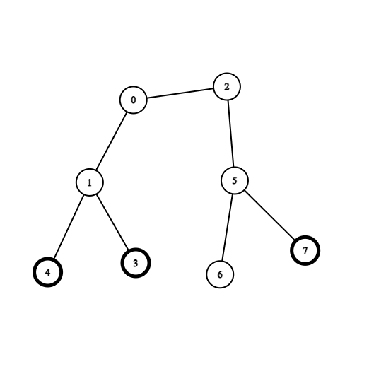

# 拓扑排序（Python/Java/C++/Go/JS/Rust）

> **[2603. 收集树中金币](https://leetcode.cn/problems/collect-coins-in-a-tree/solutions/2191371/tuo-bu-pai-xu-ji-lu-ru-dui-shi-jian-pyth-6uli/) · Hard · 难度分 2712**

> **所属题单**
> - [链表、二叉树与回溯 · 三、一般树](../../../刷题路径/灵神原版题单/链表、二叉树与回溯/三、一般树.md) · §3.6 树的拓扑排序
> - [图论算法 · 二、拓扑排序](../../../刷题路径/灵神原版题单/图论算法/二、拓扑排序.md) · §2.1 拓扑排序

> **题目描述**
> 给你一个 `n` 个节点的无向无根树，节点编号从 `0` 到 `n - 1` 。给你整数 `n` 和一个长度为 `n - 1` 的二维整数数组 `edges` ，其中 `edges[i] = [a_i, b_i]` 表示树中节点 `a_i` 和 `b_i` 之间有一条边。再给你一个长度为 `n` 的数组 `coins` ，其中 `coins[i]` 可能为 `0` 也可能为 `1` ，`1` 表示节点 `i` 处有一个金币。
>
> 一开始，你需要选择树中任意一个节点出发。你可以执行下述操作任意次：
>
> - 收集距离当前节点距离为 `2` 以内的所有金币，或者
>
> - 移动到树中一个相邻节点。
>
> 你需要收集树中所有的金币，并且回到出发节点，请你返回最少经过的边数。
>
> 如果你多次经过一条边，每一次经过都会给答案加一。
>
> **示例 1：**
>
> 
>
> ```
> 输入：coins = [1,0,0,0,0,1], edges = [[0,1],[1,2],[2,3],[3,4],[4,5]]
> 输出：2
> 解释：从节点 2 出发，收集节点 0 处的金币，移动到节点 3 ，收集节点 5 处的金币，然后移动回节点 2 。
> ```
>
> **示例 2：**
>
> 
>
> ```
> 输入：coins = [0,0,0,1,1,0,0,1], edges = [[0,1],[0,2],[1,3],[1,4],[2,5],[5,6],[5,7]]
> 输出：2
> 解释：从节点 0 出发，收集节点 4 和 3 处的金币，移动到节点 2 处，收集节点 7 处的金币，移动回节点 0 。
> ```
>
> **提示：**
>
> - `n == coins.length`
>
> - `1 <= n <= 3 * 10⁴`
>
> - `0 <= coins[i] <= 1`
>
> - `edges.length == n - 1`
>
> - `edges[i].length == 2`
>
> - `0 <= a_i, b_i < n`
>
> - `a_i != b_i`
>
> - `edges` 表示一棵合法的树。

> **题解**
> ## 提示 1
>
> 定义一个点的**度数**为其邻居个数。如果一个点的度数为 $1$，那么这个点叫做**叶子节点**，例如示例 2 的 $3,4,6,7$ 都是叶子节点。
>
> 如果叶子节点没有金币，我们有必要移动到叶子节点吗？没有必要。
>
> 那么可以先把这些没有金币的叶子节点去掉。如果去掉后又产生了新的没有金币的叶子节点，就继续去掉。
>
> 怎么实现？**拓扑排序**。一开始，把没有金币的叶子节点都加到队列中。然后不断循环直到队列为空。每次循环，弹出队首的节点 $x$，并删除 $x$ 及其邻居之间的边。我们并不需要实际删除边，只需要把邻居的度数减少 $1$。如果一个邻居的度数减少为 $1$ 且没有金币，就加到队列中，继续拓扑排序。
>
> ## 提示 2
>
> 看示例 2，在去掉节点 $6$ 之后，现在每个叶子节点上都有金币。
>
> 由于可以「收集距离当前节点距离为 $2$ 以内的所有金币」，我们没有必要移动到叶子节点再收集，而是移动到叶子节点的父节点的父节点，就能收集到叶子节点上的金币。
>
> 那么，去掉所有叶子，然后再去掉新产生的叶子，剩余节点就是必须要访问的节点。
>
> ## 提示 3
>
> 由于题目要求最后回到出发点，无论从哪个点出发，每条边都必须走两次。这是因为把出发点作为树根，递归遍历这棵树，那么往下「递」是一次，往上「归」又是一次，每条边都会经过两次。
>
> 所以答案就是剩余边数乘 $2$。当我们删除节点时，也可以看成是删除这个点到其父节点的边。
>
> 特别地，如果所有点都要被删除，那么当剩下两个点时，这两个点之间的边我们会删除两次，这会导致剩余边数等于 $-1$，而此时答案应该是 $0$。所以最后答案要和 $0$ 取最大值。
>
> **代码实现时，由于我们不需要得到一个严格的拓扑序，所以简单地用栈或者数组代替队列，也是可以的。**
>
> ```python
> class Solution:
>     def collectTheCoins(self, coins: List[int], edges: List[List[int]]) -> int:
>         n = len(coins)
>         g = [[] for _ in range(n)]
>         for x, y in edges:
>             g[x].append(y)
>             g[y].append(x)  # 建图
>         deg = list(map(len, g))  # 每个节点的度数（邻居个数）
>
>         left_edges = n - 1  # 剩余边数
>         # 拓扑排序，去掉没有金币的子树
>         q = []
>         for i, (d, c) in enumerate(zip(deg, coins)):
>             if d == 1 and c == 0:  # 没有金币的叶子
>                 q.append(i)
>         while q:
>             left_edges -= 1  # 删除节点到其父节点的边
>             for y in g[q.pop()]:
>                 deg[y] -= 1
>                 if deg[y] == 1 and coins[y] == 0:  # 没有金币的叶子
>                     q.append(y)
>
>         # 再次拓扑排序
>         for i, (d, c) in enumerate(zip(deg, coins)):
>             if d == 1 and c:  # 有金币的叶子（判断 c 是避免把没有金币的叶子也算进来）
>                 q.append(i)
>         left_edges -= len(q)  # 删除所有叶子（到其父节点的边）
>         for x in q:  # 遍历所有叶子
>             for y in g[x]:
>                 deg[y] -= 1
>                 if deg[y] == 1:  # y 现在是叶子了
>                     left_edges -= 1  # 删除 y（到其父节点的边）
>         return max(left_edges * 2, 0)
> ```
>
>
> #### 复杂度分析
>
> - 时间复杂度：$\mathcal{O}(n)$，其中 $n$ 为 $\textit{coins}$ 的长度。
> - 空间复杂度：$\mathcal{O}(n)$。
>
> ## 分类题单
>
> [如何科学刷题？](https://leetcode.cn/circle/discuss/RvFUtj/)
>
> 1. [滑动窗口与双指针（定长/不定长/单序列/双序列/三指针/分组循环）](https://leetcode.cn/circle/discuss/0viNMK/)
> 2. [二分算法（二分答案/最小化最大值/最大化最小值/第K小）](https://leetcode.cn/circle/discuss/SqopEo/)
> 3. [单调栈（基础/矩形面积/贡献法/最小字典序）](https://leetcode.cn/circle/discuss/9oZFK9/)
> 4. [网格图（DFS/BFS/综合应用）](https://leetcode.cn/circle/discuss/YiXPXW/)
> 5. [位运算（基础/性质/拆位/试填/恒等式/思维）](https://leetcode.cn/circle/discuss/dHn9Vk/)
> 6. [图论算法（DFS/BFS/拓扑排序/最短路/最小生成树/二分图/基环树/欧拉路径）](https://leetcode.cn/circle/discuss/01LUak/)
> 7. [动态规划（入门/背包/状态机/划分/区间/状压/数位/数据结构优化/树形/博弈/概率期望）](https://leetcode.cn/circle/discuss/tXLS3i/)
> 8. [常用数据结构（前缀和/差分/栈/队列/堆/字典树/并查集/树状数组/线段树）](https://leetcode.cn/circle/discuss/mOr1u6/)
> 9. [数学算法（数论/组合/概率期望/博弈/计算几何/随机算法）](https://leetcode.cn/circle/discuss/IYT3ss/)
> 10. [贪心与思维（基本贪心策略/反悔/区间/字典序/数学/思维/脑筋急转弯/构造）](https://leetcode.cn/circle/discuss/g6KTKL/)
> 11. [链表、二叉树与回溯（前后指针/快慢指针/DFS/BFS/直径/LCA/一般树）](https://leetcode.cn/circle/discuss/K0n2gO/)
> 12. [字符串（KMP/Z函数/Manacher/字符串哈希/AC自动机/后缀数组/子序列自动机）](https://leetcode.cn/circle/discuss/SJFwQI/)
>
> [我的题解精选（已分类）](https://github.com/EndlessCheng/codeforces-go/blob/master/leetcode/SOLUTIONS.md)
>
> 欢迎关注 [B站@灵茶山艾府](https://space.bilibili.com/206214)
