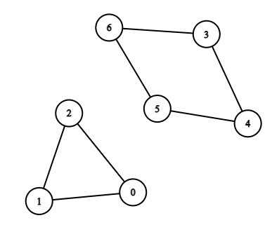
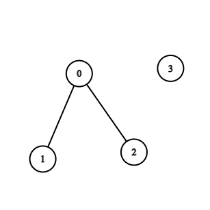
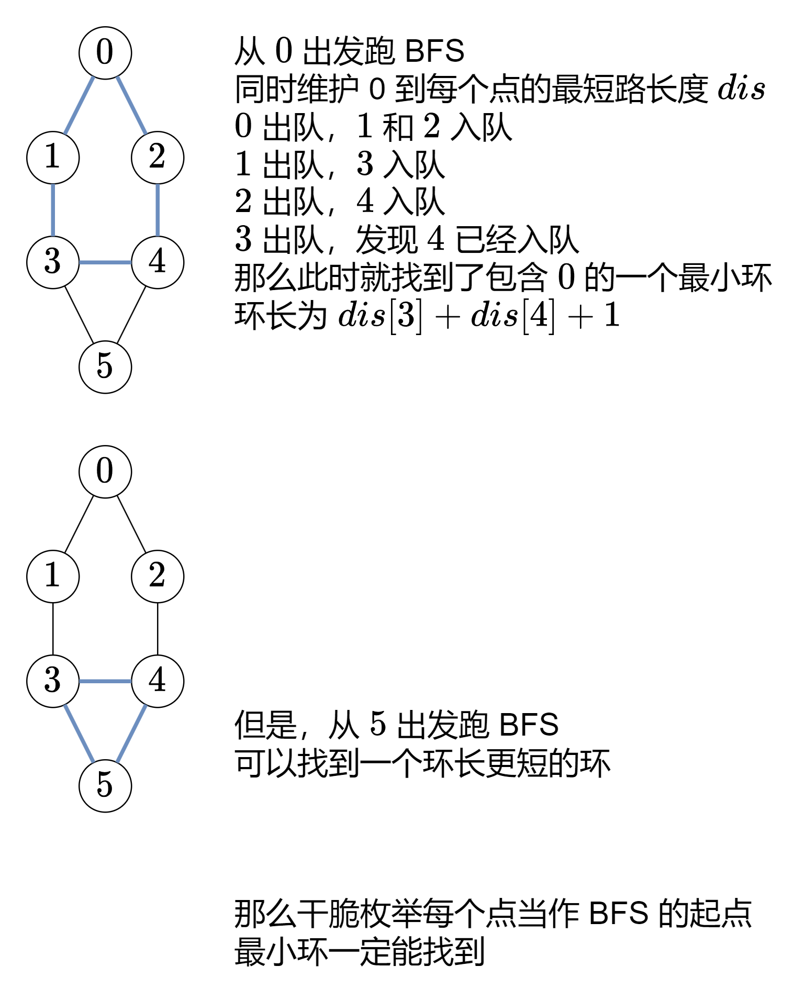

# 【一图秒懂】枚举起点跑 BFS（Python/Java/C++/Go）

> **[2608. 图中的最短环](https://leetcode.cn/problems/shortest-cycle-in-a-graph/solutions/2203585/yi-tu-miao-dong-mei-ju-qi-dian-pao-bfspy-ntck/) · Hard · 难度分 1904**

> **所属题单**
> - [图论算法 · 一、图的遍历](../../../刷题路径/灵神原版题单/图论算法/一、图的遍历.md) · §1.2 广度优先搜索（BFS）

> **题目描述**
> 现有一个含 `n` 个顶点的 **双向** 图，每个顶点按从 `0` 到 `n - 1` 标记。图中的边由二维整数数组 `edges` 表示，其中 `edges[i] = [u_i, v_i]` 表示顶点 `u_i` 和 `v_i` 之间存在一条边。每对顶点最多通过一条边连接，并且不存在与自身相连的顶点。
>
> 返回图中 **最短** 环的长度。如果不存在环，则返回 `-1` 。
>
> **环** 是指以同一节点开始和结束，并且路径中的每条边仅使用一次。
>
> **示例 1：**
>
> 
>
> ```
> 输入：n = 7, edges = [[0,1],[1,2],[2,0],[3,4],[4,5],[5,6],[6,3]]
> 输出：3
> 解释：长度最小的循环是：0 -> 1 -> 2 -> 0
> ```
>
> **示例 2：**
>
> 
>
> ```
> 输入：n = 4, edges = [[0,1],[0,2]]
> 输出：-1
> 解释：图中不存在循环
> ```
>
> **提示：**
>
> - `2 <= n <= 1000`
>
> - `1 <= edges.length <= 1000`
>
> - `edges[i].length == 2`
>
> - `0 <= u_i, v_i < n`
>
> - `u_i != v_i`
>
> - 不存在重复的边

> **题解**
> 
>
> ## 答疑
>
> **问**：为什么说发现一个已经入队的点，就说明有环？
>
> **答**：这说明到同一个点有两条不同的路径，这两条路径组成了一个环。
>
> [本题视频讲解](https://www.bilibili.com/video/BV1Ga4y1M72A/)
>
> ```python
> class Solution:
>     def findShortestCycle(self, n: int, edges: List[List[int]]) -> int:
>         g = [[] for _ in range(n)]
>         for x, y in edges:
>             g[x].append(y)
>             g[y].append(x)  # 建图
>
>         def bfs(start: int) -> int:
>             ans = inf
>             dis = [-1] * n  # dis[i] 表示从 start 到 i 的最短路长度
>             dis[start] = 0
>             q = deque([(start, -1)])
>             while q:
>                 x, fa = q.popleft()
>                 for y in g[x]:
>                     if dis[y] < 0:  # 第一次遇到
>                         dis[y] = dis[x] + 1
>                         q.append((y, x))
>                     elif y != fa:  # 第二次遇到
>                         ans = min(ans, dis[x] + dis[y] + 1)
>             return ans
>
>         ans = min(bfs(i) for i in range(n))
>         return ans if ans < inf else -1
> ```
>
>
> #### 复杂度分析
>
> - 时间复杂度：$\mathcal{O}(nm)$，其中 $m$ 为 $\textit{edges}$ 的长度。每次 BFS 需要 $\mathcal{O}(m)$ 的时间。
> - 空间复杂度：$\mathcal{O}(n+m)$。
>
> ## 思考题
>
> 如果改成求最大环要怎么做？
>
> 极端情况下，这会算出一个哈密顿回路，而它是 NP 完全问题，只能通过暴搜得到。
>
> ## 分类题单
>
> [如何科学刷题？](https://leetcode.cn/circle/discuss/RvFUtj/)
>
> 1. [滑动窗口与双指针（定长/不定长/单序列/双序列/三指针/分组循环）](https://leetcode.cn/circle/discuss/0viNMK/)
> 2. [二分算法（二分答案/最小化最大值/最大化最小值/第K小）](https://leetcode.cn/circle/discuss/SqopEo/)
> 3. [单调栈（基础/矩形面积/贡献法/最小字典序）](https://leetcode.cn/circle/discuss/9oZFK9/)
> 4. [网格图（DFS/BFS/综合应用）](https://leetcode.cn/circle/discuss/YiXPXW/)
> 5. [位运算（基础/性质/拆位/试填/恒等式/思维）](https://leetcode.cn/circle/discuss/dHn9Vk/)
> 6. [图论算法（DFS/BFS/拓扑排序/基环树/最短路/最小生成树/网络流）](https://leetcode.cn/circle/discuss/01LUak/)
> 7. [动态规划（入门/背包/划分/状态机/区间/状压/数位/数据结构优化/树形/博弈/概率期望）](https://leetcode.cn/circle/discuss/tXLS3i/)
> 8. [常用数据结构（前缀和/差分/栈/队列/堆/字典树/并查集/树状数组/线段树）](https://leetcode.cn/circle/discuss/mOr1u6/)
> 9. [数学算法（数论/组合/概率期望/博弈/计算几何/随机算法）](https://leetcode.cn/circle/discuss/IYT3ss/)
> 10. [贪心与思维（基本贪心策略/反悔/区间/字典序/数学/思维/脑筋急转弯/构造）](https://leetcode.cn/circle/discuss/g6KTKL/)
> 11. [链表、二叉树与回溯（前后指针/快慢指针/DFS/BFS/直径/LCA/一般树）](https://leetcode.cn/circle/discuss/K0n2gO/)
> 12. [字符串（KMP/Z函数/Manacher/字符串哈希/AC自动机/后缀数组/子序列自动机）](https://leetcode.cn/circle/discuss/SJFwQI/)
>
> [我的题解精选（已分类）](https://github.com/EndlessCheng/codeforces-go/blob/master/leetcode/SOLUTIONS.md)
>
> 欢迎关注 [B站@灵茶山艾府](https://space.bilibili.com/206214)
