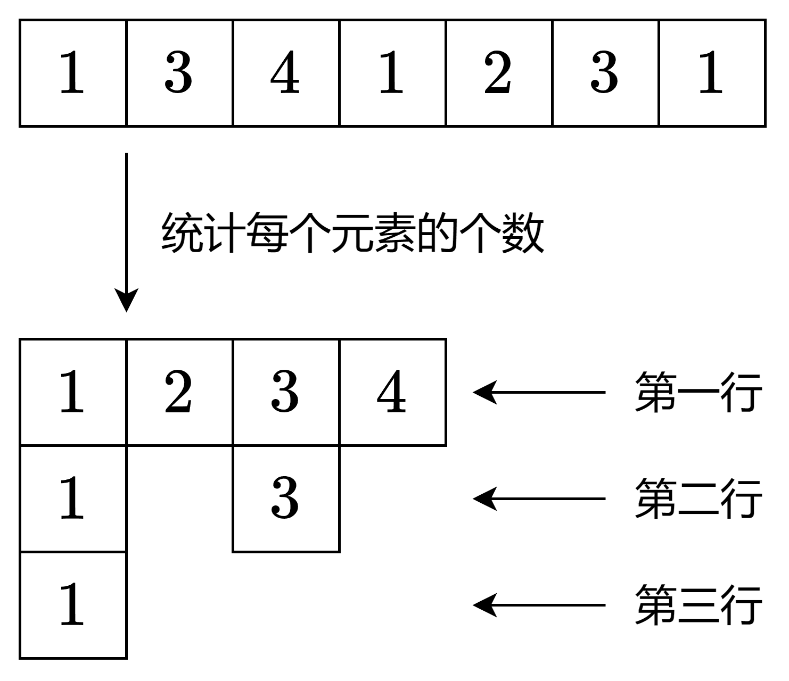

# 一图秒懂（Python/Java/C++/Go/JS/Rust）

> **[2610. 转换二维数组](https://leetcode.cn/problems/convert-an-array-into-a-2d-array-with-conditions/solutions/2204116/ha-xi-biao-mo-ni-by-endlesscheng-6rgb/) · Medium**

> **题目描述**
> 给你一个整数数组 `nums` 。请你创建一个满足以下条件的二维数组：
>
> - 二维数组应该 **只** 包含数组 `nums` 中的元素。
>
> - 二维数组中的每一行都包含 **不同** 的整数。
>
> - 二维数组的行数应尽可能 **少** 。
>
> 返回结果数组。如果存在多种答案，则返回其中任何一种。
>
> 请注意，二维数组的每一行上可以存在不同数量的元素。
>
> **示例 1：**
>
> ```
> 输入：nums = [1,3,4,1,2,3,1]
> 输出：[[1,3,4,2],[1,3],[1]]
> 解释：根据题目要求可以创建包含以下几行元素的二维数组：
> - 1,3,4,2
> - 1,3
> - 1
> nums 中的所有元素都有用到，并且每一行都由不同的整数组成，所以这是一个符合题目要求的答案。
> 可以证明无法创建少于三行且符合题目要求的二维数组。
> ```
>
> **示例 2：**
>
> ```
> 输入：nums = [1,2,3,4]
> 输出：[[4,3,2,1]]
> 解释：nums 中的所有元素都不同，所以我们可以将其全部保存在二维数组中的第一行。
> ```
>
> **提示：**
>
> - `1 <= nums.length <= 200`
>
> - `1 <= nums[i] <= nums.length`

> **题解**
> ## 方法一
>
> {:width=350}
>
> ```python
> class Solution:
>     def findMatrix(self, nums: List[int]) -> List[List[int]]:
>         ans = []
>         cnt = Counter(nums)  # 统计每个元素的出现次数
>         while cnt:  # 还有剩余元素
>             row = list(cnt)
>             ans.append(row)
>             # cnt 中的每个元素的出现次数都减一
>             for x in row:
>                 cnt[x] -= 1
>                 if cnt[x] == 0:
>                     del cnt[x]  # 去掉出现次数为 0 的元素
>         return ans
> ```
>
>
> #### 复杂度分析
>
> - 时间复杂度：$\mathcal{O}(n)$，其中 $n$ 为 $\textit{nums}$ 的长度。
> - 空间复杂度：$\mathcal{O}(n)$。
>
> ## 方法二：一次遍历
>
> 一边遍历 $\textit{nums}$，一边统计每个元素的出现次数。
>
> 一个数出现了多少次，就加到第几行。
>
> - 首次遇到 $\textit{nums}[i]=1$，加到第一行。
> - 再次遇到 $\textit{nums}[i]=1$，加到第二行。
> - 第三次遇到 $\textit{nums}[i]=1$，加到第三行。
>
> 这样既可以保证每行不会有相同元素，又可以保证用到的行数是最小的。
>
> 此外，由于本题保证元素值在 $[1,n]$ 中，可以用数组代替哈希表，效率更高。
>
> ```python
> class Solution:
>     def findMatrix(self, nums: List[int]) -> List[List[int]]:
>         ans = []
>         cnt = [0] * (len(nums) + 1)
>         for x in nums:
>             if cnt[x] == len(ans):  # 需要加一行
>                 ans.append([])
>             ans[cnt[x]].append(x)
>             cnt[x] += 1
>         return ans
> ```
>
>
> #### 复杂度分析
>
> - 时间复杂度：$\mathcal{O}(n)$，其中 $n$ 为 $\textit{nums}$ 的长度。
> - 空间复杂度：$\mathcal{O}(n)$。
>
> ## 分类题单
>
> [如何科学刷题？](https://leetcode.cn/circle/discuss/RvFUtj/)
>
> 1. [滑动窗口与双指针（定长/不定长/单序列/双序列/三指针/分组循环）](https://leetcode.cn/circle/discuss/0viNMK/)
> 2. [二分算法（二分答案/最小化最大值/最大化最小值/第K小）](https://leetcode.cn/circle/discuss/SqopEo/)
> 3. [单调栈（基础/矩形面积/贡献法/最小字典序）](https://leetcode.cn/circle/discuss/9oZFK9/)
> 4. [网格图（DFS/BFS/综合应用）](https://leetcode.cn/circle/discuss/YiXPXW/)
> 5. [位运算（基础/性质/拆位/试填/恒等式/思维）](https://leetcode.cn/circle/discuss/dHn9Vk/)
> 6. [图论算法（DFS/BFS/拓扑排序/最短路/最小生成树/二分图/基环树/欧拉路径）](https://leetcode.cn/circle/discuss/01LUak/)
> 7. [动态规划（入门/背包/状态机/划分/区间/状压/数位/数据结构优化/树形/博弈/概率期望）](https://leetcode.cn/circle/discuss/tXLS3i/)
> 8. [常用数据结构（前缀和/差分/栈/队列/堆/字典树/并查集/树状数组/线段树）](https://leetcode.cn/circle/discuss/mOr1u6/)
> 9. [数学算法（数论/组合/概率期望/博弈/计算几何/随机算法）](https://leetcode.cn/circle/discuss/IYT3ss/)
> 10. [贪心与思维（基本贪心策略/反悔/区间/字典序/数学/思维/脑筋急转弯/构造）](https://leetcode.cn/circle/discuss/g6KTKL/)
> 11. [链表、二叉树与回溯（前后指针/快慢指针/DFS/BFS/直径/LCA/一般树）](https://leetcode.cn/circle/discuss/K0n2gO/)
> 12. [字符串（KMP/Z函数/Manacher/字符串哈希/AC自动机/后缀数组/子序列自动机）](https://leetcode.cn/circle/discuss/SJFwQI/)
>
> [我的题解精选（已分类）](https://github.com/EndlessCheng/codeforces-go/blob/master/leetcode/SOLUTIONS.md)
>
> 欢迎关注 [B站@灵茶山艾府](https://space.bilibili.com/206214)
