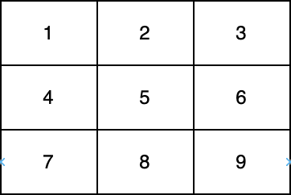

# 2614. 对角线上的质数

Easy · 难度分 1375 · [力扣原题](https://leetcode.cn/problems/prime-in-diagonal/)

所在刷题路径：灵神题单·数学算法

| 作者 | 题解 | 动画讲解 |
|---|---|---|
| 灵茶山艾府 | [📄 题解](灵茶山艾府.md) | [▶︎ 动画（GIF）](2614%20对角线上的质数%20·%20灵茶山艾府.gif) · [mp4 文件](2614%20对角线上的质数%20·%20灵茶山艾府.mp4) |
| yiduobo | [📄 题解](yiduobo.md) | [▶︎ 动画（GIF）](2614%20对角线上的质数%20·%20yiduobo.gif) · [mp4 文件](2614%20对角线上的质数%20·%20yiduobo.mp4) |

## 动画讲解

> 动图会循环播放；想暂停、拖进度条请下载上面表格里的 mp4 文件。

### 灵茶山艾府


### yiduobo


## 题目描述

给你一个下标从 **0** 开始的二维整数数组 `nums` 。

返回位于 `nums` 至少一条 **对角线** 上的最大 **质数** 。如果任一对角线上均不存在质数，返回 <em>0 。</em>

注意：

- 如果某个整数大于 `1` ，且不存在除 `1` 和自身之外的正整数因子，则认为该整数是一个质数。

- 如果存在整数 `i` ，使得 `nums[i][i] = val` 或者 `nums[i][nums.length - i - 1]= val` ，则认为整数 `val` 位于 `nums` 的一条对角线上。



在上图中，一条对角线是 **[1,5,9]** ，而另一条对角线是 **[3,5,7]** 。

**示例 1：**

```

输入：nums = [[1,2,3],[5,6,7],[9,10,11]]
输出：11
解释：数字 1、3、6、9 和 11 是所有 "位于至少一条对角线上" 的数字。由于 11 是最大的质数，故返回 11 。
```

**示例 2：**

```

输入：nums = [[1,2,3],[5,17,7],[9,11,10]]
输出：17
解释：数字 1、3、9、10 和 17 是所有满足"位于至少一条对角线上"的数字。由于 17 是最大的质数，故返回 17 。
```

**提示：**

- `1 <= nums.length <= 300`

- `nums.length == nums_i.length`

- `1 <= nums[i][j] <= 4*10⁶`

---
[↑ 返回 2600-2699](../README.md) · [总索引](../../../索引.md) · [仓库首页](../../../README.md)
