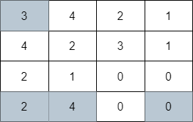
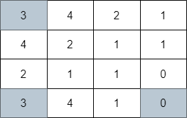
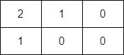

# 两种方法：单调栈优化 DP / 贪心+最小堆（Python/Java/C++/Go/JS/Rust）

> **[2617. 网格图中最少访问的格子数](https://leetcode.cn/problems/minimum-number-of-visited-cells-in-a-grid/solutions/2216329/dan-diao-zhan-you-hua-dp-by-endlesscheng-mc50/) · Hard · 难度分 2582**

> **所属题单**
> - [常用数据结构 · 五、堆（优先队列）](../../../刷题路径/灵神原版题单/常用数据结构/五、堆（优先队列）.md) · §5.2 进阶
> - [网格图 · 五、综合应用](../../../刷题路径/灵神原版题单/网格图/五、综合应用.md)
> - [动态规划 · 十一、优化 DP](../../../刷题路径/灵神原版题单/动态规划/十一、优化%20DP.md) · §11.2 单调栈优化 DP

> **题目描述**
> 给你一个下标从 **0** 开始的 `m x n` 整数矩阵 `grid` 。你一开始的位置在 **左上角** 格子 `(0, 0)` 。
>
> 当你在格子 `(i, j)` 的时候，你可以移动到以下格子之一：
>
> - 满足 `j < k <= grid[i][j] + j` 的格子 `(i, k)` （向右移动），或者
>
> - 满足 `i < k <= grid[i][j] + i` 的格子 `(k, j)` （向下移动）。
>
> 请你返回到达 **右下角** 格子 `(m - 1, n - 1)` 需要经过的最少移动格子数，如果无法到达右下角格子，请你返回 `-1` 。
>
> **示例 1：**
>
> 
>
> ```
> 输入：grid = [[3,4,2,1],[4,2,3,1],[2,1,0,0],[2,4,0,0]]
> 输出：4
> 解释：上图展示了到达右下角格子经过的 4 个格子。
> ```
>
> **示例 2：**
>
> 
>
> ```
> 输入：grid = [[3,4,2,1],[4,2,1,1],[2,1,1,0],[3,4,1,0]]
> 输出：3
> 解释：上图展示了到达右下角格子经过的 3 个格子。
> ```
>
> **示例 3：**
>
> 
>
> ```
> 输入：grid = [[2,1,0],[1,0,0]]
> 输出：-1
> 解释：无法到达右下角格子。
> ```
>
> **提示：**
>
> - `m == grid.length`
>
> - `n == grid[i].length`
>
> - `1 <= m, n <= 10⁵`
>
> - `1 <= m * n <= 10⁵`
>
> - `0 <= grid[i][j] < m * n`
>
> - `grid[m - 1][n - 1] == 0`

> **题解**
> ## 方法一：单调栈优化 DP
>
> ### 前置知识
>
> 1. [动态规划入门：从记忆化搜索到递推【基础算法精讲 17】](https://www.bilibili.com/video/BV1Xj411K7oF/)
> 2. [单调栈【基础算法精讲 26】](https://www.bilibili.com/video/BV1VN411J7S7/)
> 3. [二分查找【基础算法精讲 04】](https://www.bilibili.com/video/BV1AP41137w7/)
>
> ### 思路
>
> 题目要计算从 $(0,0)$ 出发，到达 $(m-1,n-1)$ 经过的最少格子数。假设我们移动到了 $(i,j)$，那么问题就变成从 $(i,j)$ 到 $(m-1,n-1)$ 经过的最少格子数，这是一个和原问题相似的子问题。
>
> 定义 $f[i][j]$ 表示从 $(i,j)$ 到 $(m-1,n-1)$ 经过的最少格子数。
>
> - 从 $(i,j)$ 向**右**移动一次，到达 $(i,k)$，问题变成从 $(i,k)$ 到 $(m-1,n-1)$ 经过的最少格子数，即 $f[i][j] = f[i][k] + 1$。
> - 从 $(i,j)$ 向**下**移动一次，到达 $(k,j)$，问题变成从 $(k,j)$ 到 $(m-1,n-1)$ 经过的最少格子数，即 $f[i][j] = f[k][j] + 1$。
>
> 设 $g=\textit{grid}[i][j]$，有
>
> $$
> f[i][j] = \min\left\{\min_{k=j+1}^{j+g} f[i][k], \min_{k=i+1}^{i+g} f[k][j]\right\} + 1
> $$
>
> 倒序枚举 $i$ 和 $j$ 计算。答案为 $f[0][0]$。
>
> 这样做时间复杂度为 $\mathcal{O}(mn(m+n))$，太慢了。
>
> ### 优化
>
> 由于有「区间查询」和「单点更新」，我们可以用线段树来优化。
>
> 但其实不需要线段树，有更轻量的做法。
>
> 对于 $\min\limits_{k=j+1}^{j+g} f[i][k]$，在倒序枚举 $j$ 时，$k$ 的左边界 $j+1$ 是在单调减小的，但右边界没有单调性。联想到滑动窗口最小值的做法，我们用一个 $f$ 值底小顶大的**单调栈**来维护 $f[i][j]$ 及其下标 $j$。由于 $j$ 是倒序枚举，单调栈中的下标是底大顶小的，从那么在单调栈上**二分查找**最大的不超过 $j+g$ 的下标 $k$，对应的 $f[i][k]$ 就是要计算的最小值。
>
> 对于 $\min\limits_{k=i+1}^{i+g} f[k][j]$ 也同理，每一列都需要维护一个单调栈。
>
> ```python
> class Solution:
>     def minimumVisitedCells(self, grid: List[List[int]]) -> int:
>         m, n = len(grid), len(grid[0])
>         col_stacks = [[] for _ in range(n)]  # 每列的单调栈
>         for i in range(m - 1, -1, -1):
>             row_st = []  # 当前行的单调栈
>             for j in range(n - 1, -1, -1):
>                 g = grid[i][j]
>                 col_st = col_stacks[j]
>                 mn = inf if i < m - 1 or j < n - 1 else 1
>                 if g:  # 可以向右/向下跳
>                     # 在单调栈上二分查找最优转移来源
>                     k = bisect_left(row_st, -(j + g), key=lambda p: p[1])
>                     if k < len(row_st):
>                         mn = row_st[k][0] + 1
>                     k = bisect_left(col_st, -(i + g), key=lambda p: p[1])
>                     if k < len(col_st):
>                         mn = min(mn, col_st[k][0] + 1)
>                 if mn < inf:
>                     # 插入单调栈
>                     while row_st and mn <= row_st[-1][0]:
>                         row_st.pop()
>                     row_st.append((mn, -j))  # 保证下标单调递增，方便调用 bisect_left
>                     while col_st and mn <= col_st[-1][0]:
>                         col_st.pop()
>                     col_st.append((mn, -i))  # 保证下标单调递增，方便调用 bisect_left
>         return mn if mn < inf else -1  # 最后一个算出的 mn 就是 f[0][0]
> ```
>
>
> #### 复杂度分析
>
> - 时间复杂度：$\mathcal{O}(mn(\log m+\log n))$，其中 $m$ 和 $n$ 分别为 $\textit{grid}$ 的行数和列数。
> - 空间复杂度：$\mathcal{O}(mn)$。
>
> ## 方法二：贪心+最小堆
>
> 这个思路类似 [Dijkstra 算法](../../0700-0799/0743%20网络延迟时间/灵茶山艾府.md)。
>
> 从起点 $(0,0)$ 开始，小到大枚举 $i$ 和 $j$。
>
> 假设枚举到 $(i,j)$，设从 $(0,0)$ 到 $(i,j)$ 经过了 $f$ 个格子，设 $g=\textit{grid}[i][j]$。
>
> - 从 $(i,j)$ 出发向右，我们最远可以到达第 $g+j$ 列，把数对 $(f,g+j)$ 保存到一个数据结构 $\textit{rowH}$ 中。
> - 从 $(i,j)$ 出发向下，我们最远可以到达第 $g+i$ 行，把数对 $(f,g+i)$ 保存到另一个数据结构 $\textit{colH}$ 中。
>
> 怎么算出 $f$？答案就在 $\textit{rowH}$ 和 $\textit{colH}$ 中。
>
> - 从 $\textit{rowH}$ 中找到一个 $f$ 值最小的，且可以到达第 $j$ 列的数对。
> - 从 $\textit{colH}$ 中找到一个 $f$ 值最小的，且可以到达第 $i$ 行的数对。
>
> 选择哪种数据结构实现？这样的数据结构需要支持：
>
> - 添加元素。
> - 查找最小元素。
> - 如果最小元素不满足要求（无法到达行/列），将其从数据结构中移除。
>
> **最小堆**完美符合上述要求。
>
> 具体来说，对于每一行和每一列，都有一个对应的最小堆。下面的 $\textit{rowH}$ 维护的是第 $i$ 行的数对，$\textit{colH}$ 维护的是第 $j$ 列的数对。
>
> - 对于行最小堆 $\textit{rowH}$，如果堆顶列号（也就是之前保存的 $g+j$）小于当前列号 $j$，说明无法到达第 $j$ 列（以及更右的列），弹出堆顶，重复该过程直到堆为空或者堆顶列号大于等于 $j$。如果堆不为空，取堆顶的 $f$ 值加一，作为 $(i,j)$ 位置的 $f$。
> - 对于列最小堆 $\textit{colH}$，如果堆顶行号（也就是之前保存的 $g+i$）小于当前行号 $i$，说明无法到达第 $i$ 行（以及更下的行），弹出堆顶，重复该过程直到堆为空或者堆顶行号大于等于 $i$。如果堆不为空，取堆顶的 $f$ 值加一，作为 $(i,j)$ 位置的 $f$。
> - 这两种情况取最小值。
> - 特别地，如果 $i=0$ 且 $j=0$，我们位于起点，$f=1$。
> - 特别地，如果无法到达 $(i,j)$，则 $f=\infty$。
>
> ```python
> class Solution:
>     def minimumVisitedCells(self, grid: List[List[int]]) -> int:
>         col_heaps = [[] for _ in grid[0]]  # 每一列的最小堆
>         for i, row in enumerate(grid):
>             row_h = []  # 第 i 行的最小堆
>             for j, (g, col_h) in enumerate(zip(row, col_heaps)):
>                 while row_h and row_h[0][1] < j:  # 无法到达第 j 列
>                     heappop(row_h)  # 弹出无用数据
>                 while col_h and col_h[0][1] < i:  # 无法到达第 i 行
>                     heappop(col_h)  # 弹出无用数据
>                 f = inf if i or j else 1  # 起点算 1 个格子
>                 if row_h: f = row_h[0][0] + 1  # 从左边跳过来
>                 if col_h: f = min(f, col_h[0][0] + 1)  # 从上边跳过来
>                 if g and f < inf:
>                     heappush(row_h, (f, g + j))  # 经过的格子数，向右最远能到达的列号
>                     heappush(col_h, (f, g + i))  # 经过的格子数，向下最远能到达的行号
>         return f if f < inf else -1  # 此时的 f 是在 (m-1, n-1) 处算出来的
> ```
>
>
> #### 复杂度分析
>
> - 时间复杂度：$\mathcal{O}(mn(\log m+\log n))$，其中 $m$ 和 $n$ 分别为 $\textit{grid}$ 的行数和列数。
> - 空间复杂度：$\mathcal{O}(mn)$。
>
> ## 分类题单
>
> [如何科学刷题？](https://leetcode.cn/circle/discuss/RvFUtj/)
>
> 1. [滑动窗口与双指针（定长/不定长/单序列/双序列/三指针/分组循环）](https://leetcode.cn/circle/discuss/0viNMK/)
> 2. [二分算法（二分答案/最小化最大值/最大化最小值/第K小）](https://leetcode.cn/circle/discuss/SqopEo/)
> 3. [单调栈（基础/矩形面积/贡献法/最小字典序）](https://leetcode.cn/circle/discuss/9oZFK9/)
> 4. [网格图（DFS/BFS/综合应用）](https://leetcode.cn/circle/discuss/YiXPXW/)
> 5. [位运算（基础/性质/拆位/试填/恒等式/思维）](https://leetcode.cn/circle/discuss/dHn9Vk/)
> 6. [图论算法（DFS/BFS/拓扑排序/基环树/最短路/最小生成树/网络流）](https://leetcode.cn/circle/discuss/01LUak/)
> 7. [动态规划（入门/背包/划分/状态机/区间/状压/数位/数据结构优化/树形/博弈/概率期望）](https://leetcode.cn/circle/discuss/tXLS3i/)
> 8. [常用数据结构（前缀和/差分/栈/队列/堆/字典树/并查集/树状数组/线段树）](https://leetcode.cn/circle/discuss/mOr1u6/)
> 9. [数学算法（数论/组合/概率期望/博弈/计算几何/随机算法）](https://leetcode.cn/circle/discuss/IYT3ss/)
> 10. [贪心与思维（基本贪心策略/反悔/区间/字典序/数学/思维/脑筋急转弯/构造）](https://leetcode.cn/circle/discuss/g6KTKL/)
> 11. [链表、二叉树与回溯（前后指针/快慢指针/DFS/BFS/直径/LCA/一般树）](https://leetcode.cn/circle/discuss/K0n2gO/)
> 12. [字符串（KMP/Z函数/Manacher/字符串哈希/AC自动机/后缀数组/子序列自动机）](https://leetcode.cn/circle/discuss/SJFwQI/)
>
> [我的题解精选（已分类）](https://github.com/EndlessCheng/codeforces-go/blob/master/leetcode/SOLUTIONS.md)
>
> 欢迎关注 [B站@灵茶山艾府](https://space.bilibili.com/206214)
