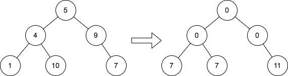
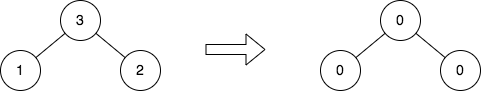

# 2641. 二叉树的堂兄弟节点 II

Medium · 难度分 1677 · [力扣原题](https://leetcode.cn/problems/cousins-in-binary-tree-ii/)

所在刷题路径：灵神题单·链表树与回溯

| 作者 | 题解 | 动画讲解 |
|---|---|---|
| 灵茶山艾府 | [📄 题解](灵茶山艾府.md) | [▶︎ 2641 二叉树的堂兄弟节点 II · 灵茶山艾府.mp4](2641%20二叉树的堂兄弟节点%20II%20·%20灵茶山艾府.mp4) |
| yiduobo | [📄 题解](yiduobo.md) | [▶︎ 2641 二叉树的堂兄弟节点 II · yiduobo.mp4](2641%20二叉树的堂兄弟节点%20II%20·%20yiduobo.mp4) |

## 题目描述

给你一棵二叉树的根 `root` ，请你将每个节点的值替换成该节点的所有 **堂兄弟节点值的和** 。

如果两个节点在树中有相同的深度且它们的父节点不同，那么它们互为 **堂兄弟** 。

请你返回修改值之后，树的根 `root` 。

**注意**，一个节点的深度指的是从树根节点到这个节点经过的边数。

**示例 1：**



```

输入：root = [5,4,9,1,10,null,7]
输出：[0,0,0,7,7,null,11]
解释：上图展示了初始的二叉树和修改每个节点的值之后的二叉树。
- 值为 5 的节点没有堂兄弟，所以值修改为 0 。
- 值为 4 的节点没有堂兄弟，所以值修改为 0 。
- 值为 9 的节点没有堂兄弟，所以值修改为 0 。
- 值为 1 的节点有一个堂兄弟，值为 7 ，所以值修改为 7 。
- 值为 10 的节点有一个堂兄弟，值为 7 ，所以值修改为 7 。
- 值为 7 的节点有两个堂兄弟，值分别为 1 和 10 ，所以值修改为 11 。
```

**示例 2：**



```

输入：root = [3,1,2]
输出：[0,0,0]
解释：上图展示了初始的二叉树和修改每个节点的值之后的二叉树。
- 值为 3 的节点没有堂兄弟，所以值修改为 0 。
- 值为 1 的节点没有堂兄弟，所以值修改为 0 。
- 值为 2 的节点没有堂兄弟，所以值修改为 0 。
```

**提示：**

- 树中节点数目的范围是 `[1, 10⁵]` 。

- `1 <= Node.val <= 10⁴`

---
[↑ 返回 2600-2699](../README.md) · [总索引](../../../索引.md) · [仓库首页](../../../README.md)
