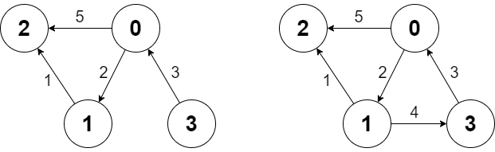

# 两种方法：Dijkstra / Floyd（Python/Java/C++/Go/JS/Rust）

> **[2642. 设计可以求最短路径的图类](https://leetcode.cn/problems/design-graph-with-shortest-path-calculator/solutions/2229013/dijkstra-suan-fa-mo-ban-pythonjavacgo-by-unmv/) · Hard · 难度分 1811**

> **所属题单**
> - [图论算法 · 三、最短路](../../../刷题路径/灵神原版题单/图论算法/三、最短路.md) · §3.1 单源最短路：Dijkstra 算法
> - [图论算法 · 三、最短路](../../../刷题路径/灵神原版题单/图论算法/三、最短路.md) · §3.2 全源最短路：Floyd 算法

> **题目描述**
> 给你一个有 `n` 个节点的 **有向带权** 图，节点编号为 `0` 到 `n - 1` 。图中的初始边用数组 `edges` 表示，其中 `edges[i] = [from_i, to_i, edgeCost_i]` 表示从 `from_i` 到 `to_i` 有一条代价为 `edgeCost_i` 的边。
>
> 请你实现一个 `Graph` 类：
>
> - `Graph(int n, int[][] edges)` 初始化图有 `n` 个节点，并输入初始边。
>
> - `addEdge(int[] edge)` 向边集中添加一条边，其中 `edge = [from, to, edgeCost]` 。数据保证添加这条边之前对应的两个节点之间没有有向边。
>
> - `int shortestPath(int node1, int node2)` 返回从节点 `node1` 到 `node2` 的路径 **最小** 代价。如果路径不存在，返回 `-1` 。一条路径的代价是路径中所有边代价之和。
>
> **示例 1：**
>
> 
>
> ```
> 输入：
> ["Graph", "shortestPath", "shortestPath", "addEdge", "shortestPath"]
> [[4, [[0, 2, 5], [0, 1, 2], [1, 2, 1], [3, 0, 3]]], [3, 2], [0, 3], [[1, 3, 4]], [0, 3]]
> 输出：
> [null, 6, -1, null, 6]
>
> 解释：
> Graph g = new Graph(4, [[0, 2, 5], [0, 1, 2], [1, 2, 1], [3, 0, 3]]);
> g.shortestPath(3, 2); // 返回 6 。从 3 到 2 的最短路径如第一幅图所示：3 -> 0 -> 1 -> 2 ，总代价为 3 + 2 + 1 = 6 。
> g.shortestPath(0, 3); // 返回 -1 。没有从 0 到 3 的路径。
> g.addEdge([1, 3, 4]); // 添加一条节点 1 到节点 3 的边，得到第二幅图。
> g.shortestPath(0, 3); // 返回 6 。从 0 到 3 的最短路径为 0 -> 1 -> 3 ，总代价为 2 + 4 = 6 。
> ```
>
> **提示：**
>
> - `1 <= n <= 100`
>
> - `0 <= edges.length <= n * (n - 1)`
>
> - `edges[i].length == edge.length == 3`
>
> - `0 <= from_i, to_i, from, to, node1, node2 <= n - 1`
>
> - `1 <= edgeCost_i, edgeCost <= 10⁶`
>
> - 图中任何时候都不会有重边和自环。
>
> - 调用 `addEdge` 至多 `100` 次。
>
> - 调用 `shortestPath` 至多 `100` 次。

> **题解**
> ## 方法一：Dijkstra 算法
>
> 请先阅读 [Dijkstra 算法介绍](../../0700-0799/0743%20网络延迟时间/灵茶山艾府.md)。
>
> - 对于 $\texttt{addEdge}$，直接把边加入图中即可。
> - 对于 $\texttt{shortestPath}$，用 Dijkstra 算法计算从起点 $\textit{start}$ 到终点 $\textit{end}$ 的最短路长度。
>
> #### 写法一：邻接矩阵建图 + 朴素 Dijkstra
>
> ```python
> class Graph:
>     def __init__(self, n: int, edges: List[List[int]]):
>         self.g = [[inf] * n for _ in range(n)]  # 邻接矩阵
>         for x, y, w in edges:
>             self.g[x][y] = w  # 添加一条边（题目保证没有重边）
>
>     def addEdge(self, e: List[int]) -> None:
>         self.g[e[0]][e[1]] = e[2]  # 添加一条边（题目保证这条边之前不存在）
>
>     def shortestPath(self, start: int, end: int) -> int:
>         n = len(self.g)
>         dis = [inf] * n  # 从 start 出发，到各个点的最短路，如果不存在则为无穷大
>         dis[start] = 0
>         vis = [False] * n
>         while True:  # 至多循环 n 次
>             x = -1
>             for i, (b, d) in enumerate(zip(vis, dis)):
>                 if not b and (x < 0 or d < dis[x]):
>                     x = i
>             if x < 0 or dis[x] == inf:  # 所有从 start 能到达的点都被更新了
>                 return -1  # 无法到达终点
>             if x == end:  # 找到终点，提前退出
>                 return dis[x]
>             vis[x] = True  # 标记，在后续的循环中无需反复更新 x 到其余点的最短路长度
>             for y, w in enumerate(self.g[x]):
>                 if dis[x] + w < dis[y]:
>                     dis[y] = dis[x] + w  # 更新最短路长度
> ```
>
>
> #### 复杂度分析
>
> - 时间复杂度：
>   - 初始化 $\mathcal{O}(n^2)$。
>   - $\texttt{addEdge}$ $\mathcal{O}(1)$。
>   - $\texttt{shortestPath}$ $\mathcal{O}(n^2)$。
> - 空间复杂度：$\mathcal{O}(n^2)$。
>
> #### 写法二：邻接表建图 + 堆优化 Dijkstra
>
> ```python
> class Graph:
>     def __init__(self, n: int, edges: List[List[int]]):
>         self.g = [[] for _ in range(n)]  # 邻接表
>         for x, y, w in edges:
>             self.g[x].append((y, w))
>
>     def addEdge(self, e: List[int]) -> None:
>         self.g[e[0]].append((e[1], e[2]))
>
>     def shortestPath(self, start: int, end: int) -> int:
>         dis = [inf] * len(self.g)  # dis[i] 表示从起点 start 出发，到节点 i 的最短路长度
>         dis[start] = 0
>         h = [(0, start)]
>         while h:
>             d, x = heappop(h)
>             if x == end:  # 计算出从起点到终点的最短路长度
>                 return d
>             if d > dis[x]:  # x 之前出堆过，无需更新邻居的最短路
>                 continue
>             for y, w in self.g[x]:
>                 if d + w < dis[y]:
>                     dis[y] = d + w  # 更新最短路长度
>                     heappush(h, (dis[y], y))
>         return -1  # 无法到达终点
> ```
>
>
> #### 复杂度分析
>
> - 时间复杂度：
>     - 初始化 $\mathcal{O}(n+m)$。其中 $m$ 为 $\textit{edges}$ 的长度。
>     - $\texttt{addEdge}$ $\mathcal{O}(1)$。
>     - $\texttt{shortestPath}$ $\mathcal{O}(n + m\log m)$。其中 $m$ 为调用 $\texttt{shortestPath}$ 时，图的边数。当图是稠密图时，复杂度为 $\mathcal{O}(n^2\log n)$。
> - 空间复杂度：$\mathcal{O}(n+m)$。其中 $m$ 为 $\textit{edges}$ 的长度加上 $\texttt{addEdge}$ 的调用次数。
>
> ## 方法二：Floyd 算法
>
> 请先阅读 [带你发明 Floyd 算法：从记忆化搜索到递推](../../1300-1399/1334%20阈值距离内邻居最少的城市/灵茶山艾府.md)。
>
> 对于 $\texttt{addEdge}$，记 $x=\textit{from},y=\textit{to}$。如果 $\textit{edgeCost} \ge f[x][y]$，则无法更新任何点对的最短路。否则枚举所有 $f[i][j]$，尝试看看能否更新成更小，即从 $i$ 到 $j$ 的如下路径
>
> $$
> i---x-y---j
> $$
>
> 是否更短，写成式子就是
>
> $$
> f[i][j] = \min(f[i][j], f[i][x] + \textit{edgeCost} + f[y][j])
> $$
>
> **注意**：当 $i=x$ 或 $j=y$ 时，我们需要用到 $f[i][i]$ 这样的值，所以初始化的时候，$f[i][i]$ 要置为 $0$。
>
> 对于 $\texttt{shortestPath}$，返回 $f[\textit{start}][\textit{end}]$ 即可。
>
> #### 答疑
>
> **问**：在 $\texttt{addEdge}$ 中，上式 $f[i][j]$ 的计算依赖于 $f[i][x]$ 的值，如果先计算 $f[i][j]$，再计算 $f[i][x]$，我们还需要重新计算 $f[i][j]$ 吗？
>
> **答**：没有必要，每个 $f[i][j]$ 只需要计算一次。如果 $f[i][x]$ 因为 $x-y$ 这条边变小，说明从 $i$ 到 $x$ 的最短路包含 $x-y$ 这条边。那么对于 $f[i][j]$，最短路不可能是 $i---x-y---j$，这意味着最短路会经过 $x-y$ 这条边**两次**。所以重新计算 $f[i][j]$ 是不可能让 $f[i][j]$ 变小的。
>
> ```python
> class Graph:
>     def __init__(self, n: int, edges: List[List[int]]):
>         f = [[inf] * n for _ in range(n)]
>         for i in range(n):
>             f[i][i] = 0
>         for x, y, w in edges:
>             f[x][y] = w  # 添加一条边（题目保证没有重边和自环）
>         for k in range(n):
>             for i in range(n):
>                 if f[i][k] == inf: continue
>                 for j in range(n):
>                     f[i][j] = min(f[i][j], f[i][k] + f[k][j])
>         self.f = f
>
>     def addEdge(self, edge: List[int]) -> None:
>         f = self.f
>         x, y, w = edge
>         if w >= f[x][y]:  # 无需更新
>             return
>         n = len(f)
>         for i in range(n):
>             for j in range(n):
>                 f[i][j] = min(f[i][j], f[i][x] + w + f[y][j])
>
>     def shortestPath(self, start: int, end: int) -> int:
>         ans = self.f[start][end]
>         return ans if ans < inf else -1
> ```
>
>
> #### 复杂度分析
>
> - 时间复杂度：
>     - 初始化 $\mathcal{O}(n^3)$。
>     - $\texttt{addEdge}$ $\mathcal{O}(n^2)$。
>     - $\texttt{shortestPath}$ $\mathcal{O}(1)$。
> - 空间复杂度：$\mathcal{O}(n^2)$。
>
> ## 总结
>
> 方法一适用于调用 $\texttt{addEdge}$ 比较多的场景，方法二适用于调用 $\texttt{shortestPath}$ 比较多的场景。
>
> ## 分类题单
>
> [如何科学刷题？](https://leetcode.cn/circle/discuss/RvFUtj/)
>
> 1. [滑动窗口与双指针（定长/不定长/单序列/双序列/三指针/分组循环）](https://leetcode.cn/circle/discuss/0viNMK/)
> 2. [二分算法（二分答案/最小化最大值/最大化最小值/第K小）](https://leetcode.cn/circle/discuss/SqopEo/)
> 3. [单调栈（基础/矩形面积/贡献法/最小字典序）](https://leetcode.cn/circle/discuss/9oZFK9/)
> 4. [网格图（DFS/BFS/综合应用）](https://leetcode.cn/circle/discuss/YiXPXW/)
> 5. [位运算（基础/性质/拆位/试填/恒等式/思维）](https://leetcode.cn/circle/discuss/dHn9Vk/)
> 6. [图论算法（DFS/BFS/拓扑排序/基环树/最短路/最小生成树/网络流）](https://leetcode.cn/circle/discuss/01LUak/)
> 7. [动态规划（入门/背包/划分/状态机/区间/状压/数位/数据结构优化/树形/博弈/概率期望）](https://leetcode.cn/circle/discuss/tXLS3i/)
> 8. [常用数据结构（前缀和/差分/栈/队列/堆/字典树/并查集/树状数组/线段树）](https://leetcode.cn/circle/discuss/mOr1u6/)
> 9. [数学算法（数论/组合/概率期望/博弈/计算几何/随机算法）](https://leetcode.cn/circle/discuss/IYT3ss/)
> 10. [贪心与思维（基本贪心策略/反悔/区间/字典序/数学/思维/脑筋急转弯/构造）](https://leetcode.cn/circle/discuss/g6KTKL/)
> 11. [链表、二叉树与回溯（前后指针/快慢指针/DFS/BFS/直径/LCA/一般树）](https://leetcode.cn/circle/discuss/K0n2gO/)
> 12. [字符串（KMP/Z函数/Manacher/字符串哈希/AC自动机/后缀数组/子序列自动机）](https://leetcode.cn/circle/discuss/SJFwQI/)
>
> [我的题解精选（已分类）](https://github.com/EndlessCheng/codeforces-go/blob/master/leetcode/SOLUTIONS.md)
>
> 欢迎关注 [B站@灵茶山艾府](https://space.bilibili.com/206214)
