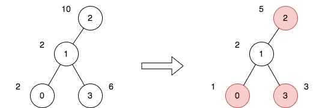

# 两种方法：暴力 DFS / 树上差分（Python/Java/C++/Go/JS/Rust）

> **[2646. 最小化旅行的价格总和](https://leetcode.cn/problems/minimize-the-total-price-of-the-trips/solutions/2229503/lei-si-da-jia-jie-she-iii-pythonjavacgo-4k3wq/) · Hard · 难度分 2238**

> **所属题单**
> - [链表、二叉树与回溯 · 三、一般树](../../../刷题路径/灵神原版题单/链表、二叉树与回溯/三、一般树.md) · §3.8 最近公共祖先（LCA）、倍增算法
> - [动态规划 · 十二、树形 DP](../../../刷题路径/灵神原版题单/动态规划/十二、树形%20DP.md) · §12.2 树上最大独立集

> **题目描述**
> 现有一棵无向、无根的树，树中有 `n` 个节点，按从 `0` 到 `n - 1` 编号。给你一个整数 `n` 和一个长度为 `n - 1` 的二维整数数组 `edges` ，其中 `edges[i] = [a_i, b_i]` 表示树中节点 `a_i` 和 `b_i` 之间存在一条边。
>
> 每个节点都关联一个价格。给你一个整数数组 `price` ，其中 `price[i]` 是第 `i` 个节点的价格。
>
> 给定路径的 **价格总和** 是该路径上所有节点的价格之和。
>
> 另给你一个二维整数数组 `trips` ，其中 `trips[i] = [start_i, end_i]` 表示您从节点 `start_i` 开始第 `i` 次旅行，并通过任何你喜欢的路径前往节点 `end_i` 。
>
> 在执行第一次旅行之前，你可以选择一些 **非相邻节点** 并将价格减半。
>
> 返回执行所有旅行的最小价格总和。
>
> **示例 1：**
>
> 
>
> ```
> 输入：n = 4, edges = [[0,1],[1,2],[1,3]], price = [2,2,10,6], trips = [[0,3],[2,1],[2,3]]
> 输出：23
> 解释：
> 上图表示将节点 2 视为根之后的树结构。第一个图表示初始树，第二个图表示选择节点 0 、2 和 3 并使其价格减半后的树。
> 第 1 次旅行，选择路径 [0,1,3] 。路径的价格总和为 1 + 2 + 3 = 6 。
> 第 2 次旅行，选择路径 [2,1] 。路径的价格总和为 2 + 5 = 7 。
> 第 3 次旅行，选择路径 [2,1,3] 。路径的价格总和为 5 + 2 + 3 = 10 。
> 所有旅行的价格总和为 6 + 7 + 10 = 23 。可以证明，23 是可以实现的最小答案。
> ```
>
> **示例 2：**
>
> 
>
> ```
> 输入：n = 2, edges = [[0,1]], price = [2,2], trips = [[0,0]]
> 输出：1
> 解释：
> 上图表示将节点 0 视为根之后的树结构。第一个图表示初始树，第二个图表示选择节点 0 并使其价格减半后的树。
> 第 1 次旅行，选择路径 [0] 。路径的价格总和为 1 。
> 所有旅行的价格总和为 1 。可以证明，1 是可以实现的最小答案。
> ```
>
> **提示：**
>
> - `1 <= n <= 50`
>
> - `edges.length == n - 1`
>
> - `0 <= a_i, b_i <= n - 1`
>
> - `edges` 表示一棵有效的树
>
> - `price.length == n`
>
> - `price[i]` 是一个偶数
>
> - `1 <= price[i] <= 1000`
>
> - `1 <= trips.length <= 100`
>
> - `0 <= start_i, end_i <= n - 1`

> **题解**
> ## 方法一：暴力 DFS 每条路径
>
> 对每个 $\textit{trips}[i]$ 都 DFS 一次这棵树，在 DFS 的过程中，把从 $\textit{start}$ 到 $\textit{end}$ 的路径上的每个点 $x$ 的经过次数 $\textit{cnt}[x]$ 都加一。
>
> 既然知道了每个点会被经过多少次，把 $\textit{price}[i]$ 更新成 $\textit{price}[i]\cdot \textit{cnt}[i]$，问题就转换成计算减半后的 $\textit{price}[i]$ 之和的最小值。注意 $\textit{cnt}[i]=0$ 时 $\textit{price}[i]$ 会被更新成 $0$，我们无需考虑没有经过的节点。
>
> 对于转换后的问题，做法和 [337. 打家劫舍 III](https://leetcode.cn/problems/house-robber-iii/) 是类似的，请看视频讲解：[【基础算法精讲 24】](https://www.bilibili.com/video/BV1vu4y1f7dn/)
>
> 我们随便选一个节点出发 DFS（比如节点 $0$）。在 DFS 的过程中，对于节点 $x$ 及其儿子 $y$，分类讨论：
>
> - 如果 $\textit{price}[x]$ 不变，那么 $\textit{price}[y]$ 可以减半，也可以不变，取这两种情况的最小值；
> - 如果 $\textit{price}[x]$ 减半，那么 $\textit{price}[y]$ 只能不变。
>
> 因此子树 $x$ 需要返回两个值：
>
> - $\textit{price}[x]$ 不变时的子树 $x$ 的最小价值总和；
> - $\textit{price}[x]$ 减半时的子树 $x$ 的最小价值总和。
>
> 答案就是根节点不变/减半的最小值。
>
> #### 答疑
>
> **问**：代码实现时，如何找到从 $\textit{start}$ 到 $\textit{end}$ 的路径？
>
> **答**：以 $\textit{start}$ 为树根 DFS，找到 $\textit{end}$ 时，$\textit{end}$ 及其祖先节点就恰好组成了从 $\textit{start}$ 到 $\textit{end}$ 的路径。据此可以在递归的「归」当中去更新 $\textit{cnt}$。
>
> ```python
> class Solution:
>     def minimumTotalPrice(self, n: int, edges: List[List[int]], price: List[int], trips: List[List[int]]) -> int:
>         g = [[] for _ in range(n)]
>         for x, y in edges:
>             g[x].append(y)
>             g[y].append(x)
>
>         cnt = [0] * n
>         for start, end in trips:
>             def dfs(x: int, fa: int) -> bool:
>                 if x == end:
>                     cnt[x] += 1
>                     return True  # 找到 end
>                 for y in g[x]:
>                     if y != fa and dfs(y, x):
>                         cnt[x] += 1  # x 是 end 的祖先节点，也就在路径上
>                         return True
>                 return False  # 未找到 end
>             dfs(start, -1)
>
>         # 类似 337. 打家劫舍 III
>         def dfs(x: int, fa: int) -> (int, int):
>             not_halve = price[x] * cnt[x]  # x 不变
>             halve = not_halve // 2  # x 减半
>             for y in g[x]:
>                 if y != fa:
>                     nh, h = dfs(y, x)  # 计算 y 不变/减半的最小价值总和
>                     not_halve += min(nh, h)  # x 不变，那么 y 可以不变或者减半，取这两种情况的最小值
>                     halve += nh  # x 减半，那么 y 只能不变
>             return not_halve, halve
>         return min(dfs(0, -1))
> ```
>
>
> #### 复杂度分析
>
> - 时间复杂度：$\mathcal{O}(nm)$，其中 $m$ 为 $\textit{trips}$ 的长度。
> - 空间复杂度：$\mathcal{O}(n)$。
>
> ## 方法二（选读）：Tarjan 离线 LCA + 树上差分
>
> **前置知识**：并查集、Tarjan 离线求 LCA、树上差分。
>
> 数组上的区间加一操作，我们可以用 [差分数组](https://leetcode.cn/circle/discuss/FfMCgb/) 解决（请至少完成一道差分数组题目再往下读）。这一思想同样可以用到树上，把树上的一条路径上的节点值加一，也可以用差分数组解决。
>
> 从 $x=\textit{start}$ 到 $y=\textit{end}$ 的路径可以视作从 $x$ 向上到某个点「拐弯」，再向下到达 $y$。
>
> 这个拐弯的点是 $x$ 和 $y$ 的 $\textit{lca}$（最近公共祖先）。注意拐弯的点也可能就是 $x$ 或 $y$。
>
> 设路径为 $x-z-\textit{lca}-y$，其中 $z$ 是 $\textit{lca}$ 往 $x$ 方向的儿子。由于更新的是点，拆分成 $x-z$ 和 $y-\textit{lca}$ 这两段路径。
>
> 把路径上的点的 $\textit{cnt}$ 加一，转换成对差分数组 $\textit{diff}$ 的两个数的更新。规定把下面的点加一，把上面的点减一：
>
> - 对于 $x-z$，把 $\textit{diff}[x]$ 加一，$\textit{diff}[\textit{lca}]$ 减一。注意，如果 $x$ 就是 $\textit{lca}$，那么 $z$ 是不存在的，而差分操作刚好对 $\textit{diff}[x]$ 加一再减一，没有变化。所以我们无需特判 $x$ 就是 $\textit{lca}$ 的情况。
> - 对于 $y-\textit{lca}$，把 $\textit{diff}[y]$ 加一，$\textit{diff}[\textit{father}[\textit{lca}]]$ 减一，其中 $\textit{father}[\textit{lca}]$ 表示 $\textit{lca}$ 的父节点。
>
> 最近公共祖先 $\textit{lca}$ 可以用 Tarjan 离线算法计算，见代码注释。
>
> 更新完 $\textit{diff}$ 后，DFS 这棵树，在递归的「归」的过程中自底向上累加 $\textit{diff}$，计算出 $\textit{cnt}$ 值。这个过程可以和计算答案的过程合在一起。
>
> 注：求最近公共祖先不止一种方式，也可以用树上倍增实现，请看 [【模板讲解】树上倍增](../../1400-1499/1483%20树节点的第%20K%20个祖先/灵茶山艾府.md)
>
> ```python
> class Solution:
>     def minimumTotalPrice(self, n: int, edges: List[List[int]], price: List[int], trips: List[List[int]]) -> int:
>         g = [[] for _ in range(n)]
>         for x, y in edges:
>             g[x].append(y)
>             g[y].append(x)
>
>         qs = [[] for _ in range(n)]
>         for s, e in trips:
>             qs[s].append(e)  # 路径端点分组
>             if s != e:
>                 qs[e].append(s)
>
>         # 并查集模板
>         root = list(range(n))
>         def find(x: int) -> int:
>             if x != root[x]:
>                 root[x] = find(root[x])
>             return root[x]
>
>         diff = [0] * n
>         father = [0] * n
>         color = [0] * n
>         def tarjan(x: int, fa: int) -> None:
>             father[x] = fa
>             color[x] = 1  # 递归中
>             for y in g[x]:
>                 if color[y] == 0:  # 未递归
>                     tarjan(y, x)
>                     root[y] = x  # 相当于把 y 的子树节点全部 merge 到 x
>             for y in qs[x]:
>                 # color[y] == 2 意味着 y 所在子树已经遍历完
>                 # 也就意味着 y 已经 merge 到它和 x 的 lca 上了
>                 # 此时 find(y) 就是 x 和 y 的 lca
>                 if y == x or color[y] == 2:
>                     diff[x] += 1
>                     diff[y] += 1
>                     lca = find(y)
>                     diff[lca] -= 1
>                     if father[lca] >= 0:
>                         diff[father[lca]] -= 1
>             color[x] = 2  # 递归结束
>         tarjan(0, -1)
>
>         def dfs(x: int, fa: int) -> (int, int, int):
>             not_halve, halve, cnt = 0, 0, diff[x]
>             for y in g[x]:
>                 if y != fa:
>                     nh, h, c = dfs(y, x)  # 计算 y 不变/减半的最小价值总和
>                     not_halve += min(nh, h)  # x 不变，那么 y 可以不变，可以减半，取这两种情况的最小值
>                     halve += nh  # x 减半，那么 y 只能不变
>                     cnt += c  # 自底向上累加差分值
>             not_halve += price[x] * cnt  # x 不变
>             halve += price[x] * cnt // 2  # x 减半
>             return not_halve, halve, cnt
>         return min(dfs(0, -1)[:2])
> ```
>
>
> #### 复杂度分析
>
> - 时间复杂度：$\mathcal{O}(n+m\alpha)$，其中 $m$ 为 $\textit{trips}$ 的长度，$\alpha$ 可视作 $\mathcal{O}(1)$。
> - 空间复杂度：$\mathcal{O}(n+m)$。
>
> 欢迎关注 [B站@灵茶山艾府](https://space.bilibili.com/206214)
>
> 更多精彩题解，请看 [往期题解精选（已分类）](https://github.com/EndlessCheng/codeforces-go/blob/master/leetcode/SOLUTIONS.md)
