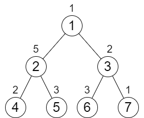
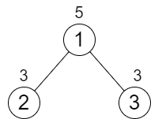

# 贪心，简洁写法（Python/Java/C++/Go/JS/Rust）

> **[2673. 使二叉树所有路径值相等的最小代价](https://leetcode.cn/problems/make-costs-of-paths-equal-in-a-binary-tree/solutions/2259983/tan-xin-jian-ji-xie-fa-pythonjavacgo-by-5svh1/) · Medium · 难度分 1917**

> **所属题单**
> - [链表、二叉树与回溯 · 二、二叉树](../../../刷题路径/灵神原版题单/链表、二叉树与回溯/二、二叉树.md) · §2.16 其他
> - [贪心算法 · 一、贪心策略](../../../刷题路径/灵神原版题单/贪心算法/一、贪心策略.md) · §1.4 从最左/最右开始贪心

> **题目描述**
> 给你一个整数 `n` 表示一棵 **满二叉树** 里面节点的数目，节点编号从 `1` 到 `n` 。根节点编号为 `1` ，树中每个非叶子节点 `i` 都有两个孩子，分别是左孩子 `2 * i` 和右孩子 `2 * i + 1` 。
>
> 树中每个节点都有一个值，用下标从 **0** 开始、长度为 `n` 的整数数组 `cost` 表示，其中 `cost[i]` 是第 `i + 1` 个节点的值。每次操作，你可以将树中 **任意** 节点的值 **增加** `1` 。你可以执行操作 **任意** 次。
>
> 你的目标是让根到每一个 **叶子结点** 的路径值相等。请你返回 **最少** 需要执行增加操作多少次。
>
> **注意：**
>
> - **满二叉树** 指的是一棵树，它满足树中除了叶子节点外每个节点都恰好有 2 个子节点，且所有叶子节点距离根节点距离相同。
>
> - **路径值** 指的是路径上所有节点的值之和。
>
> **示例 1：**
>
> 
>
> ```
>
> 输入：n = 7, cost = [1,5,2,2,3,3,1]
> 输出：6
> 解释：我们执行以下的增加操作：
> - 将节点 4 的值增加一次。
> - 将节点 3 的值增加三次。
> - 将节点 7 的值增加两次。
> 从根到叶子的每一条路径值都为 9 。
> 总共增加次数为 1 + 3 + 2 = 6 。
> 这是最小的答案。
> ```
>
> **示例 2：**
>
> 
>
> ```
>
> 输入：n = 3, cost = [5,3,3]
> 输出：0
> 解释：两条路径已经有相等的路径值，所以不需要执行任何增加操作。
> ```
>
> **提示：**
>
> - `3 <= n <= 10⁵`
>
> - `n + 1` 是 `2` 的幂
>
> - `cost.length == n`
>
> - `1 <= cost[i] <= 10⁴`

> **题解**
> 视频讲解请看[【周赛 344】](https://www.bilibili.com/video/BV1YL41187Rx/)第四题，欢迎点赞投币！
>
> ## 提示 1
>
> 考虑根到两个互为兄弟节点（父节点相同）的叶子的两条路径。
>
> 由于这两条路径除了叶子节点不一样，其余节点都一样，所以为了让这两条路径的路径和相等，必须修改叶子节点的值。
>
> 设叶子节点的值分别为 $x$ 和 $y$，假设 $x\le y$，是否需要同时增加 $x$ 和 $y$ 呢？
>
> 这是不需要的，把 $x$ 增加 $y-x$ 就行，因为我们可以增加它们的祖先节点的值，使得它们俩的路径和与其它的路径和相等，这样可以节省操作次数。
>
> ## 提示 2
>
> 对于不是叶子的兄弟节点，又要如何比较和计算呢？
>
> 和上面的分析一样，从根到当前节点的路径，除了这两个兄弟节点不一样，其余节点都一样。所以把路径和从叶子往上传，这样就可以按照提示 1 那样比较了。
>
> 示例 1 如下图，把节点 $2$ 的路径和视作 $x+5+3=x+8$，节点 $3$ 的路径和视作 $x+2+3=x+5$（其中 $x$ 是在节点 $2,3$ 之上的路径和），这样可以知道需要把节点 $3$ 的值增加 $(x+8)-(x+5)=8-5=3$。
>
> 
>
> 代码实现时，可以直接在 $\textit{cost}$ 上累加路径和。由于 $\textit{cost}$ 数组的下标是从 $0$ 开始的，所以节点编号转成下标需要减一。
>
> ```python
> class Solution:
>     def minIncrements(self, n: int, cost: List[int]) -> int:
>         ans = 0
>         for i in range(n // 2, 0, -1):  # 从最后一个非叶节点开始算
>             ans += abs(cost[i * 2 - 1] - cost[i * 2])  # 两个子节点变成一样的
>             cost[i - 1] += max(cost[i * 2 - 1], cost[i * 2])  # 累加路径和
>         return ans
> ```
>
>
> #### 复杂度分析
>
> - 时间复杂度：$\mathcal{O}(n)$，其中 $n$ 为 $\textit{cost}$ 的长度。
> - 空间复杂度：$\mathcal{O}(1)$。仅用到若干额外变量。
>
> ## 思考题
>
> 如果还可以对节点值**减一**要怎么做？
>
> [往期题解精选（已分类）](https://github.com/EndlessCheng/codeforces-go/blob/master/leetcode/SOLUTIONS.md)
