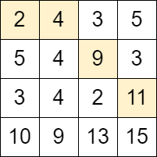
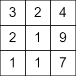

# 2684. 矩阵中移动的最大次数

Medium · 难度分 1626 · [力扣原题](https://leetcode.cn/problems/maximum-number-of-moves-in-a-grid/)

所在刷题路径：灵神核心路线、灵神题单·网格图、灵神题单·动态规划

| 作者 | 题解 | 动画讲解 |
|---|---|---|
| 灵茶山艾府 | [📄 题解](灵茶山艾府.md) | [▶︎ 2684 矩阵中移动的最大次数 · 灵茶山艾府.mp4](2684%20矩阵中移动的最大次数%20·%20灵茶山艾府.mp4) |
| yiduobo | [📄 题解](yiduobo.md) | [▶︎ 2684 矩阵中移动的最大次数 · yiduobo.mp4](2684%20矩阵中移动的最大次数%20·%20yiduobo.mp4) |

## 题目描述

给你一个下标从 **0** 开始、大小为 `m x n` 的矩阵 `grid` ，矩阵由若干 **正** 整数组成。

你可以从矩阵第一列中的 **任一** 单元格出发，按以下方式遍历 `grid` ：

- 从单元格 `(row, col)` 可以移动到 `(row - 1, col + 1)`、`(row, col + 1)` 和 `(row + 1, col + 1)` 三个单元格中任一满足值 **严格** 大于当前单元格的单元格。

返回你在矩阵中能够 **移动** 的 **最大** 次数。

**示例 1：**



```
输入：grid = [[2,4,3,5],[5,4,9,3],[3,4,2,11],[10,9,13,15]]
输出：3
解释：可以从单元格 (0, 0) 开始并且按下面的路径移动：
- (0, 0) -> (0, 1).
- (0, 1) -> (1, 2).
- (1, 2) -> (2, 3).
可以证明这是能够移动的最大次数。
```

**示例 2：**

```



输入：grid = [[3,2,4],[2,1,9],[1,1,7]]
输出：0
解释：从第一列的任一单元格开始都无法移动。
```

**提示：**

- `m == grid.length`

- `n == grid[i].length`

- `2 <= m, n <= 1000`

- `4 <= m * n <= 10⁵`

- `1 <= grid[i][j] <= 10⁶`

---
[↑ 返回 2600-2699](../README.md) · [总索引](../../../索引.md) · [仓库首页](../../../README.md)
