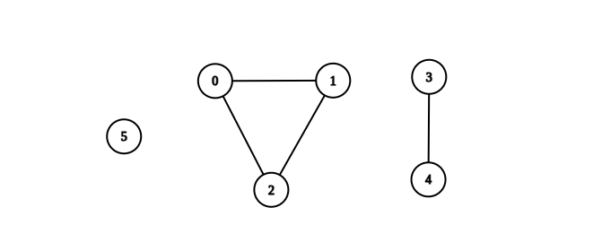
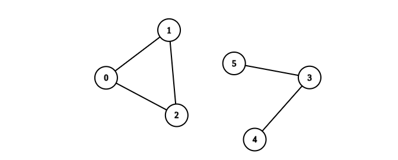

# DFS 求每个连通块的点数和边数（Python/Java/C++/Go）

> **[2685. 统计完全连通分量的数量](https://leetcode.cn/problems/count-the-number-of-complete-components/solutions/2269255/dfs-qiu-mei-ge-lian-tong-kuai-de-dian-sh-opg4/) · Medium · 难度分 1769**

> **所属题单**
> - [图论算法 · 一、图的遍历](../../../刷题路径/灵神原版题单/图论算法/一、图的遍历.md) · §1.1 深度优先搜索（DFS）

> **题目描述**
> 给你一个整数 `n` 。现有一个包含 `n` 个顶点的 **无向** 图，顶点按从 `0` 到 `n - 1` 编号。给你一个二维整数数组 `edges` 其中 `edges[i] = [a_i, b_i]` 表示顶点 `a_i` 和 `b_i` 之间存在一条 **无向** 边。
>
> 返回图中 **完全连通分量** 的数量。
>
> 如果在子图中任意两个顶点之间都存在路径，并且子图中没有任何一个顶点与子图外部的顶点共享边，则称其为 **连通分量** 。
>
> 如果连通分量中每对节点之间都存在一条边，则称其为 **完全连通分量** 。
>
> **示例 1：**
>
> 
>
> ```
>
> 输入：n = 6, edges = [[0,1],[0,2],[1,2],[3,4]]
> 输出：3
> 解释：如上图所示，可以看到此图所有分量都是完全连通分量。
> ```
>
> **示例 2：**
>
> 
>
> ```
>
> 输入：n = 6, edges = [[0,1],[0,2],[1,2],[3,4],[3,5]]
> 输出：1
> 解释：包含节点 0、1 和 2 的分量是完全连通分量，因为每对节点之间都存在一条边。
> 包含节点 3 、4 和 5 的分量不是完全连通分量，因为节点 4 和 5 之间不存在边。
> 因此，在图中完全连接分量的数量是 1 。
> ```
>
> **提示：**
>
> - `1 <= n <= 50`
>
> - `0 <= edges.length <= n * (n - 1) / 2`
>
> - `edges[i].length == 2`
>
> - `0 <= a_i, b_i <= n - 1`
>
> - `a_i != b_i`
>
> - 不存在重复的边

> **题解**
> DFS 每个连通块，统计当前连通块的点数 $v$ 和边数 $e$。
>
> 每访问一个点 $x$，就把 $v$ 加一，把 $e$ 加上点 $x$ 的邻居个数（注意同一条边会被计入两次）。
>
> 在完全图中，任意两点之间都有边。$v$ 个点的完全图的边数，等于从 $v$ 个点中选 $2$ 个点的方案数。所以完全图有 $\dfrac{v(v-1)}{2}$ 条边。
>
> 由于统计的时候，一条边统计了两次，所以实际代码中的判断条件是 $e$ 是否等于 $v(v-1)$。
>
> ```python
> class Solution:
>     def countCompleteComponents(self, n: int, edges: List[List[int]]) -> int:
>         g = [[] for _ in range(n)]
>         for x, y in edges:
>             g[x].append(y)
>             g[y].append(x)
>
>         vis = [False] * n
>
>         def dfs(x: int) -> None:
>             nonlocal v, e
>             v += 1
>             e += len(g[x])
>
>             vis[x] = True
>             for y in g[x]:
>                 if not vis[y]:
>                     dfs(y)
>
>         ans = 0
>         for i, b in enumerate(vis):
>             if not b:
>                 v = e = 0
>                 dfs(i)
>                 ans += e == v * (v - 1)
>         return ans
> ```
>
>
> #### 复杂度分析
>
> - 时间复杂度：$\mathcal{O}(n+m)$，其中 $m$ 是 $\textit{edges}$ 的长度。
> - 空间复杂度：$\mathcal{O}(n+m)$。
>
> ## 专题训练
>
> 见下面图论题单的「**§1.1 深度优先搜索**」。
>
> ## 分类题单
>
> [如何科学刷题？](https://leetcode.cn/circle/discuss/RvFUtj/)
>
> 1. [滑动窗口与双指针（定长/不定长/单序列/双序列/三指针/分组循环）](https://leetcode.cn/circle/discuss/0viNMK/)
> 2. [二分算法（二分答案/最小化最大值/最大化最小值/第K小）](https://leetcode.cn/circle/discuss/SqopEo/)
> 3. [单调栈（基础/矩形面积/贡献法/最小字典序）](https://leetcode.cn/circle/discuss/9oZFK9/)
> 4. [网格图（DFS/BFS/综合应用）](https://leetcode.cn/circle/discuss/YiXPXW/)
> 5. [位运算（基础/性质/拆位/试填/恒等式/思维）](https://leetcode.cn/circle/discuss/dHn9Vk/)
> 6. [图论算法（DFS/BFS/拓扑排序/基环树/最短路/最小生成树/网络流）](https://leetcode.cn/circle/discuss/01LUak/)
> 7. [动态规划（入门/背包/划分/状态机/区间/状压/数位/数据结构优化/树形/博弈/概率期望）](https://leetcode.cn/circle/discuss/tXLS3i/)
> 8. [常用数据结构（前缀和/差分/栈/队列/堆/字典树/并查集/树状数组/线段树）](https://leetcode.cn/circle/discuss/mOr1u6/)
> 9. [数学算法（数论/组合/概率期望/博弈/计算几何/随机算法）](https://leetcode.cn/circle/discuss/IYT3ss/)
> 10. [贪心与思维（基本贪心策略/反悔/区间/字典序/数学/思维/脑筋急转弯/构造）](https://leetcode.cn/circle/discuss/g6KTKL/)
> 11. [链表、树与回溯（前后指针/快慢指针/DFS/BFS/直径/LCA）](https://leetcode.cn/circle/discuss/K0n2gO/)
> 12. [字符串（KMP/Z函数/Manacher/字符串哈希/AC自动机/后缀数组/子序列自动机）](https://leetcode.cn/circle/discuss/SJFwQI/)
>
> [我的题解精选（已分类）](https://github.com/EndlessCheng/codeforces-go/blob/master/leetcode/SOLUTIONS.md)
>
> 欢迎关注 [B站@灵茶山艾府](https://space.bilibili.com/206214)
