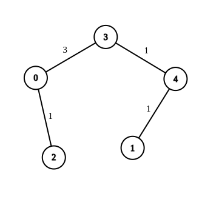
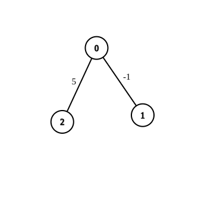
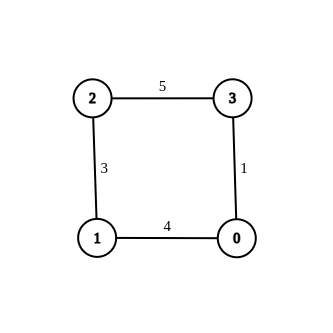

# 详细分析两次 Dijkstra（稠密图下是线性做法）Python/Java/C++/Go

> **[2699. 修改图中的边权](https://leetcode.cn/problems/modify-graph-edge-weights/solutions/2278296/xiang-xi-fen-xi-liang-ci-dijkstrachou-mi-gv1m/) · Hard · 难度分 2874**

> **所属题单**
> - [图论算法 · 三、最短路](../../../刷题路径/灵神原版题单/图论算法/三、最短路.md) · §3.1 单源最短路：Dijkstra 算法

> **题目描述**
> 给你一个 `n` 个节点的 **无向带权连通** 图，节点编号为 `0` 到 `n - 1` ，再给你一个整数数组 `edges` ，其中 `edges[i] = [a_i, b_i, w_i]` 表示节点 `a_i` 和 `b_i` 之间有一条边权为 `w_i` 的边。
>
> 部分边的边权为 `-1`（`w_i = -1`），其他边的边权都为 **正** 数（`w_i > 0`）。
>
> 你需要将所有边权为 `-1` 的边都修改为范围 `[1, 2 * 10⁹]` 中的 **正整数** ，使得从节点 `source` 到节点 `destination` 的 **最短距离** 为整数 `target` 。如果有 **多种** 修改方案可以使 `source` 和 `destination` 之间的最短距离等于 `target` ，你可以返回任意一种方案。
>
> 如果存在使 `source` 到 `destination` 最短距离为 `target` 的方案，请你按任意顺序返回包含所有边的数组（包括未修改边权的边）。如果不存在这样的方案，请你返回一个 **空数组** 。
>
> **注意：**你不能修改一开始边权为正数的边。
>
> **示例 1：**
>
> 
>
> ```
>
> 输入：n = 5, edges = [[4,1,-1],[2,0,-1],[0,3,-1],[4,3,-1]], source = 0, destination = 1, target = 5
> 输出：[[4,1,1],[2,0,1],[0,3,3],[4,3,1]]
> 解释：上图展示了一个满足题意的修改方案，从 0 到 1 的最短距离为 5 。
> ```
>
> **示例 2：**
>
> 
>
> ```
>
> 输入：n = 3, edges = [[0,1,-1],[0,2,5]], source = 0, destination = 2, target = 6
> 输出：[]
> 解释：上图是一开始的图。没有办法通过修改边权为 -1 的边，使得 0 到 2 的最短距离等于 6 ，所以返回一个空数组。
> ```
>
> **示例 3：**
>
> 
>
> ```
>
> 输入：n = 4, edges = [[1,0,4],[1,2,3],[2,3,5],[0,3,-1]], source = 0, destination = 2, target = 6
> 输出：[[1,0,4],[1,2,3],[2,3,5],[0,3,1]]
> 解释：上图展示了一个满足题意的修改方案，从 0 到 2 的最短距离为 6 。
> ```
>
> **提示：**
>
> - `1 <= n <= 100`
>
> - `1 <= edges.length <= n * (n - 1) / 2`
>
> - `edges[i].length == 3`
>
> - `0 <= a_i, b_i < n`
>
> - `w_i = -1` 或者 `1 <= w_i <= 10⁷`
>
> - `a_i != b_i`
>
> - `0 <= source, destination < n`
>
> - `source != destination`
>
> - `1 <= target <= 10⁹`
>
> - 输入的图是连通图，且没有自环和重边。

> **题解**
> ## 什么时候无解？
>
> 题目要求把边权为 $-1$ 的至少修改为 $1$。如果都修改成 $1$，跑最短路（Dijkstra），发现从起点到终点的最短路长度大于 $\textit{target}$，那么由于边权变大，最短路不可能变小，所以此时无解。
>
> 另外一种无解的情况是，如果都修改成无穷大（本题限制为 $2\cdot 10^9$），发现从起点到终点的最短路长度小于 $\textit{target}$，那么由于边权变小，最短路不可能变大，所以此时也无解。
>
> ## 一个错误的思路
>
> 先把 $-1$ 都修改成 $1$，然后跑 Dijkstra。设从起点到终点的最短路长度为 $d$。
>
> 如果 $d<\textit{target}$，**看上去**把其中一个 $1$ 加上 $\textit{target}-d$，就可以使从起点到终点的最短路长度恰好为 $\textit{target}$ 了。
>
> 这是不对的，因为在增加边权后，最短路可能就走别的边了，不走刚才修改的这条边了。（具体见视频中画的例子。）
>
> 只修改一条边不行，那么修改两条边呢？也是不行的，最短路仍然可以走别的边。
>
> ## 正确思路
>
> 先把 $-1$ 都修改成 $1$，然后跑第一遍 Dijkstra，设从 $\textit{source}$ 到点 $i$ 的最短路长度为 $d_{i,0}$。
>
> 如果从起点到终点的最短路长度不超过 $\textit{target}$（否则无解，返回空数组），那我们就来尝试修改某些边权，使得从起点到终点的最短路长度恰好等于 $\textit{target}$。
>
> 这会引出两个问题：
>
> 1. 要按照什么样的**顺序**修改这些边？
> 2. 修改成多少合适？
>
> 正所谓「牵一发而动全身」，从上面对错误思路的分析可知，仅仅修改一个边权，就可能影响很多最短路的值。
>
> 那不妨再跑一遍 Dijkstra，由于 Dijkstra 算法保证每次拿到的点的最短路就是最终的最短路，所以按照 Dijkstra 算法遍历点/边的顺序去修改，就不会对**已确定的**最短路产生影响。
>
> 对于第二遍 Dijkstra，设从 $\textit{source}$ 到点 $i$ 的最短路长度为 $d_{i,1}$。
>
> 对于一条可以修改的边 $x-y$，假设要把它的边权改为 $w$，那么 $\textit{source}-x-y-\textit{destination}$ 这条路径由三部分组成：
>
> 1. 从 $\textit{source}$ 到 $x$ 的最短路，这是第二遍 Dijkstra 算出来的，即 $d_{x,1}$。
> 2. 从 $x$ 到 $y$，即 $w$。
> 3. 从 $y$ 到 $\textit{destination}$ 的最短路，由于后面的边还没有修改，这个最短路是第一遍 Dijkstra 算出来的，即 $d_{\textit{destination},0} - d_{y,0}$。
>
> 这三部分之和需要等于 $\textit{target}$，所以有
>
> $$
> d_{x,1} + w + d_{\textit{destination},0} - d_{y,0} = \textit{target}
> $$
>
> 解得
>
> $$
> w = \textit{target} - d_{\textit{destination},0} + d_{y,0} - d_{x,1}
> $$
>
> > 注意上式中的 $\textit{target} - d_{\textit{destination},0}$ 是一个定值，代码中用 $\textit{delta}$ 表示。
>
> 根据「什么时候无解」中的分析，如果第二遍 Dijkstra 跑完后，从起点到终点的最短路仍然小于 $\textit{target}$，那么就说明无法修改，返回空数组。
>
> 否则，答案就是我们在第二遍 Dijkstra 中做出的修改。注意第二遍 Dijkstra 跑完后可能还有些边是 $-1$（因为在 $w=1$ 的时候没有修改，或者有些边不影响最短路），把这些边都改成 $1$ 就行。
>
> 代码实现时，为了修改边权，需要在邻接表中额外记录边的编号。
>
> 此外，由于输入最坏是稠密图，可以用朴素版的 Dijkstra 算法。
>
> [视频讲解](https://www.bilibili.com/video/BV1Qm4y1t7cx/) 第四题。
>
> ```python
> class Solution:
>     def modifiedGraphEdges(self, n: int, edges: List[List[int]], source: int, destination: int, target: int) -> List[List[int]]:
>         g = [[] for _ in range(n)]
>         for i, (x, y, _) in enumerate(edges):
>             g[x].append((y, i))
>             g[y].append((x, i))  # 建图，额外保存边的编号
>
>         dis = [[1 << 30] * 2 for _ in range(n)]
>         dis[source] = [0] * 2
>
>         def dijkstra(k: int) -> None:  # 这里 k 表示第一次/第二次
>             vis = [False] * n
>             while True:
>                 # 找到当前最短路，去更新它的邻居的最短路
>                 # 根据数学归纳法，dis[x][k] 一定是最短路长度
>                 x = -1
>                 for y, (b, d) in enumerate(zip(vis, dis)):
>                     if not b and (x < 0 or d[k] < dis[x][k]):
>                         x = y
>                 if x == destination:  # 起点 source 到终点 destination 的最短路已确定
>                     return
>                 vis[x] = True  # 标记，在后续的循环中无需反复更新 x 到其余点的最短路长度
>                 for y, eid in g[x]:
>                     wt = edges[eid][2]
>                     if wt == -1:
>                         wt = 1  # -1 改成 1
>                     if k == 1 and edges[eid][2] == -1:
>                         # 第二次 Dijkstra，改成 w
>                         w = delta + dis[y][0] - dis[x][1]
>                         if w > wt:
>                             edges[eid][2] = wt = w  # 直接在 edges 上修改
>                     # 更新最短路
>                     dis[y][k] = min(dis[y][k], dis[x][k] + wt)
>
>         dijkstra(0)
>         delta = target - dis[destination][0]
>         if delta < 0:  # -1 全改为 1 时，最短路比 target 还大
>             return []
>
>         dijkstra(1)
>         if dis[destination][1] < target:  # 最短路无法再变大，无法达到 target
>             return []
>
>         for e in edges:
>             if e[2] == -1:  # 剩余没修改的边全部改成 1
>                 e[2] = 1
>         return edges
> ```
>
>
> #### 复杂度分析
>
> - 时间复杂度：$\mathcal{O}(n^2)$。在稠密图（本题最坏情况）中，算法的时间复杂度与边的数量 $m=\mathcal{O}(n^2)$ 成正比。
> - 空间复杂度：$\mathcal{O}(m)$，其中 $m$ 是 $\textit{edges}$ 的长度。注意输入是连通图，$m$ 至少为 $n-1$，所以 $\mathcal{O}(n+m)=\mathcal{O}(m)$
>
> ## 分类题单
>
> [如何科学刷题？](https://leetcode.cn/discuss/post/3141566/ru-he-ke-xue-shua-ti-by-endlesscheng-q3yd/)
>
> 1. [滑动窗口与双指针（定长/不定长/单序列/双序列/三指针/分组循环）](https://leetcode.cn/discuss/post/3578981/ti-dan-hua-dong-chuang-kou-ding-chang-bu-rzz7/)
> 2. [二分算法（二分答案/最小化最大值/最大化最小值/第K小）](https://leetcode.cn/discuss/post/3579164/ti-dan-er-fen-suan-fa-er-fen-da-an-zui-x-3rqn/)
> 3. [单调栈（基础/矩形面积/贡献法/最小字典序）](https://leetcode.cn/discuss/post/3579480/ti-dan-dan-diao-zhan-ju-xing-xi-lie-zi-d-u4hk/)
> 4. [网格图（DFS/BFS/综合应用）](https://leetcode.cn/discuss/post/3580195/fen-xiang-gun-ti-dan-wang-ge-tu-dfsbfszo-l3pa/)
> 5. [位运算（基础/性质/拆位/试填/恒等式/思维）](https://leetcode.cn/discuss/post/3580371/fen-xiang-gun-ti-dan-wei-yun-suan-ji-chu-nth4/)
> 6. [图论算法（DFS/BFS/拓扑排序/基环树/最短路/最小生成树/网络流）](https://leetcode.cn/discuss/post/3581143/fen-xiang-gun-ti-dan-tu-lun-suan-fa-dfsb-qyux/)
> 7. [动态规划（入门/背包/划分/状态机/区间/状压/数位/数据结构优化/树形/博弈/概率期望）](https://leetcode.cn/discuss/post/3581838/fen-xiang-gun-ti-dan-dong-tai-gui-hua-ru-007o/)
> 8. [常用数据结构（前缀和/差分/栈/队列/堆/字典树/并查集/树状数组/线段树）](https://leetcode.cn/discuss/post/3583665/fen-xiang-gun-ti-dan-chang-yong-shu-ju-j-bvmv/)
> 9. [数学算法（数论/组合/概率期望/博弈/计算几何/随机算法）](https://leetcode.cn/discuss/post/3584388/fen-xiang-gun-ti-dan-shu-xue-suan-fa-shu-gcai/)
> 10. [贪心与思维（基本贪心策略/反悔/区间/字典序/数学/思维/脑筋急转弯/构造）](https://leetcode.cn/discuss/post/3091107/fen-xiang-gun-ti-dan-tan-xin-ji-ben-tan-k58yb/)
> 11. [链表、树与回溯（前后指针/快慢指针/DFS/BFS/直径/LCA）](https://leetcode.cn/discuss/post/3142882/fen-xiang-gun-ti-dan-lian-biao-er-cha-sh-6srp/)
> 12. [字符串（KMP/Z函数/Manacher/字符串哈希/AC自动机/后缀数组/子序列自动机）](https://leetcode.cn/discuss/post/3144832/fen-xiang-gun-ti-dan-zi-fu-chuan-kmpzhan-ugt4/)
>
> [我的题解精选（已分类）](https://github.com/EndlessCheng/codeforces-go/blob/master/leetcode/SOLUTIONS.md)
>
> 欢迎关注 [B站@灵茶山艾府](https://space.bilibili.com/206214)
