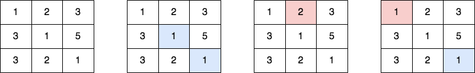

# 2711. 对角线上不同值的数量差

Medium · 难度分 1429 · [力扣原题](https://leetcode.cn/problems/difference-of-number-of-distinct-values-on-diagonals/)

所在刷题路径：灵神核心路线、灵神题单·动态规划、灵神题单·常用数据结构

| 作者 | 题解 | 动画讲解 |
|---|---|---|
| 灵茶山艾府 | [📄 题解](灵茶山艾府.md) | [▶︎ 动画（GIF）](2711%20对角线上不同值的数量差%20·%20灵茶山艾府.gif) · [mp4 文件](2711%20对角线上不同值的数量差%20·%20灵茶山艾府.mp4) |
| yiduobo | [📄 题解](yiduobo.md) | [▶︎ 动画（GIF）](2711%20对角线上不同值的数量差%20·%20yiduobo.gif) · [mp4 文件](2711%20对角线上不同值的数量差%20·%20yiduobo.mp4) |

## 动画讲解

> 动图会循环播放；想暂停、拖进度条请下载上面表格里的 mp4 文件。

### 灵茶山艾府


### yiduobo


## 题目描述

给你一个下标从 `0` 开始、大小为 `m x n` 的二维矩阵 `grid` ，请你求解大小同样为 `m x n` 的答案矩阵 `answer` 。

矩阵 `answer` 中每个单元格 `(r, c)` 的值可以按下述方式进行计算：

- 令 `topLeft[r][c]` 为矩阵 `grid` 中单元格 `(r, c)` 左上角对角线上 **不同值** 的数量。

- 令 `bottomRight[r][c]` 为矩阵 `grid` 中单元格 `(r, c)` 右下角对角线上 **不同值** 的数量。

然后 `answer[r][c] = |topLeft[r][c] - bottomRight[r][c]|` 。

返回矩阵 `answer` 。

**矩阵对角线** 是从最顶行或最左列的某个单元格开始，向右下方向走到矩阵末尾的对角线。

如果单元格 `(r1, c1)` 和单元格 `(r, c) `属于同一条对角线且 `r1 < r` ，则单元格 `(r1, c1)` 属于单元格 `(r, c)` 的左上对角线。类似地，可以定义右下对角线。

**示例 1：**



```

输入：grid = [[1,2,3],[3,1,5],[3,2,1]]
输出：[[1,1,0],[1,0,1],[0,1,1]]
解释：第 1 个图表示最初的矩阵 grid 。
第 2 个图表示对单元格 (0,0) 计算，其中蓝色单元格是位于右下对角线的单元格。
第 3 个图表示对单元格 (1,2) 计算，其中红色单元格是位于左上对角线的单元格。
第 4 个图表示对单元格 (1,1) 计算，其中蓝色单元格是位于右下对角线的单元格，红色单元格是位于左上对角线的单元格。
- 单元格 (0,0) 的右下对角线包含 [1,1] ，而左上对角线包含 [] 。对应答案是 |1 - 0| = 1 。
- 单元格 (1,2) 的右下对角线包含 [] ，而左上对角线包含 [2] 。对应答案是 |0 - 1| = 1 。
- 单元格 (1,1) 的右下对角线包含 [1] ，而左上对角线包含 [1] 。对应答案是 |1 - 1| = 0 。
其他单元格的对应答案也可以按照这样的流程进行计算。
```

**示例 2：**

```

输入：grid = [[1]]
输出：[[0]]
解释：- 单元格 (0,0) 的右下对角线包含 [] ，左上对角线包含 [] 。对应答案是 |0 - 0| = 0 。
```

**提示：**

- `m == grid.length`

- `n == grid[i].length`

- `1 <= m, n, grid[i][j] <= 50`

---
[↑ 返回 2700-2799](../README.md) · [总索引](../../../索引.md) · [仓库首页](../../../README.md)
