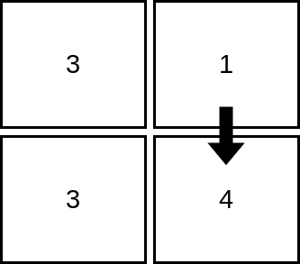
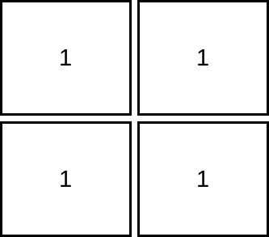
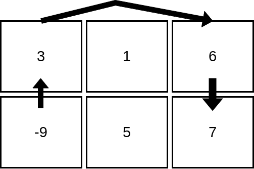

# 2713. 矩阵中严格递增的单元格数

Hard · 难度分 2387 · [力扣原题](https://leetcode.cn/problems/maximum-strictly-increasing-cells-in-a-matrix/)

所在刷题路径：灵神题单·动态规划

| 作者 | 题解 | 动画讲解 |
|---|---|---|
| 灵茶山艾府 | [📄 题解](灵茶山艾府.md) | [▶︎ 动画（GIF）](2713%20矩阵中严格递增的单元格数%20·%20灵茶山艾府.gif) · [mp4 文件](2713%20矩阵中严格递增的单元格数%20·%20灵茶山艾府.mp4) |
| yiduobo | [📄 题解](yiduobo.md) | [▶︎ 动画（GIF）](2713%20矩阵中严格递增的单元格数%20·%20yiduobo.gif) · [mp4 文件](2713%20矩阵中严格递增的单元格数%20·%20yiduobo.mp4) |

## 动画讲解

> 动图会循环播放；想暂停、拖进度条请下载上面表格里的 mp4 文件。

### 灵茶山艾府


### yiduobo


## 题目描述

给你一个下标从 **1** 开始、大小为 `m x n` 的整数矩阵 `mat`，你可以选择任一单元格作为 **起始单元格** 。

从起始单元格出发，你可以移动到 **同一行或同一列** 中的任何其他单元格，但前提是目标单元格的值 **严格大于** 当前单元格的值。

你可以多次重复这一过程，从一个单元格移动到另一个单元格，直到无法再进行任何移动。

请你找出从某个单元开始访问矩阵所能访问的 **单元格的最大数量** 。

返回一个表示可访问单元格最大数量的整数。

**示例 1：**



```
输入：mat = [[3,1],[3,4]]
输出：2
解释：上图展示了从第 1 行、第 2 列的单元格开始，可以访问 2 个单元格。可以证明，无论从哪个单元格开始，最多只能访问 2 个单元格，因此答案是 2 。
```

**示例 2：**



```
输入：mat = [[1,1],[1,1]]
输出：1
解释：由于目标单元格必须严格大于当前单元格，在本示例中只能访问 1 个单元格。
```

**示例 3：**



```
输入：mat = [[3,1,6],[-9,5,7]]
输出：4
解释：上图展示了从第 2 行、第 1 列的单元格开始，可以访问 4 个单元格。可以证明，无论从哪个单元格开始，最多只能访问 4 个单元格，因此答案是 4 。
```

**提示：**

- `m == mat.length `

- `n == mat[i].length `

- `1 <= m, n <= 10⁵`

- `1 <= m * n <= 10⁵`

- `-10⁵ <= mat[i][j] <= 10⁵`

---
[↑ 返回 2700-2799](../README.md) · [总索引](../../../索引.md) · [仓库首页](../../../README.md)
