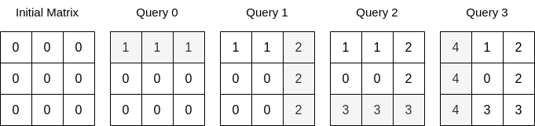
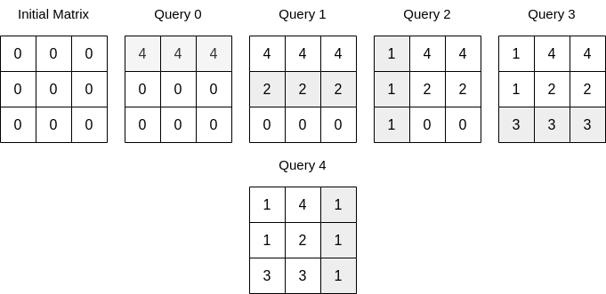

# 2718. 查询后矩阵的和

Medium · 难度分 1769 · [力扣原题](https://leetcode.cn/problems/sum-of-matrix-after-queries/)

所在刷题路径：灵神题单·贪心与思维

| 作者 | 题解 | 动画讲解 |
|---|---|---|
| 灵茶山艾府 | [📄 题解](灵茶山艾府.md) | [▶︎ 动画（GIF）](2718%20查询后矩阵的和%20·%20灵茶山艾府.gif) · [mp4 文件](2718%20查询后矩阵的和%20·%20灵茶山艾府.mp4) |
| yiduobo | [📄 题解](yiduobo.md) | [▶︎ 动画（GIF）](2718%20查询后矩阵的和%20·%20yiduobo.gif) · [mp4 文件](2718%20查询后矩阵的和%20·%20yiduobo.mp4) |

## 动画讲解

> 动图会循环播放；想暂停、拖进度条请下载上面表格里的 mp4 文件。

### 灵茶山艾府


### yiduobo


## 题目描述

给你一个整数 `n` 和一个下标从 **0** 开始的 **二维数组** `queries` ，其中 `queries[i] = [type_i, index_i, val_i]` 。

一开始，给你一个下标从 **0** 开始的 `n x n` 矩阵，所有元素均为 `0` 。每一个查询，你需要执行以下操作之一：

- 如果 `type_i == 0` ，将第 `index_i` 行的元素全部修改为 `val_i` ，覆盖任何之前的值。

- 如果 `type_i == 1` ，将第 `index_i` 列的元素全部修改为 `val_i` ，覆盖任何之前的值。

请你执行完所有查询以后，返回矩阵中所有整数的和。

**示例 1：**



```
输入：n = 3, queries = [[0,0,1],[1,2,2],[0,2,3],[1,0,4]]
输出：23
解释：上图展示了每个查询以后矩阵的值。所有操作执行完以后，矩阵元素之和为 23 。
```

**示例 2：**



```
输入：n = 3, queries = [[0,0,4],[0,1,2],[1,0,1],[0,2,3],[1,2,1]]
输出：17
解释：上图展示了每一个查询操作之后的矩阵。所有操作执行完以后，矩阵元素之和为 17 。
```

**提示：**

- `1 <= n <= 10⁴`

- `1 <= queries.length <= 5 * 10⁴`

- `queries[i].length == 3`

- `0 <= type_i <= 1`

- `0 <= index_i < n`

- `0 <= val_i <= 10⁵`

---
[↑ 返回 2700-2799](../README.md) · [总索引](../../../索引.md) · [仓库首页](../../../README.md)
