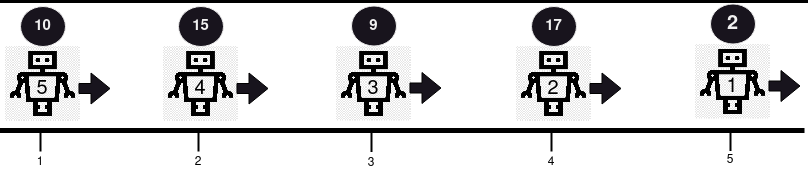
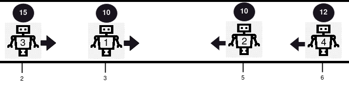
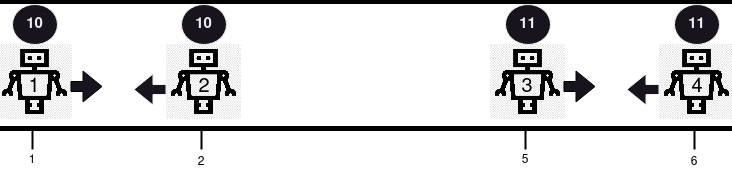

# 用栈维护机器人（Python/Java/C++/C/Go/JS/Rust）

> **[2751. 机器人碰撞](https://leetcode.cn/problems/robot-collisions/solutions/2319664/zhan-mo-ni-by-endlesscheng-fu26/) · Hard · 难度分 2092**

> **所属题单**
> - [常用数据结构 · 三、栈](../../../刷题路径/灵神原版题单/常用数据结构/三、栈.md) · §3.3 邻项消除

> **题目描述**
> 现有 `n` 个机器人，编号从 **1** 开始，每个机器人包含在路线上的位置、健康度和移动方向。
>
> 给你下标从 **0** 开始的两个整数数组 `positions`、`healths` 和一个字符串 `directions`（`directions[i]` 为 **'L'** 表示 **向左** 或 **'R'** 表示 **向右**）。 `positions` 中的所有整数 **互不相同** 。
>
> 所有机器人以 **相同速度** **同时** 沿给定方向在路线上移动。如果两个机器人移动到相同位置，则会发生 **碰撞** 。
>
> 如果两个机器人发生碰撞，则将 **健康度较低** 的机器人从路线中 **移除** ，并且另一个机器人的健康度 **减少 1** 。幸存下来的机器人将会继续沿着与之前 **相同** 的方向前进。如果两个机器人的健康度相同，则将二者都从路线中移除。
>
> 请你确定全部碰撞后幸存下的所有机器人的 **健康度** ，并按照原来机器人编号的顺序排列。即机器人 1 （如果幸存）的最终健康度，机器人 2 （如果幸存）的最终健康度等。 如果不存在幸存的机器人，则返回空数组。
>
> 在不再发生任何碰撞后，请你以数组形式，返回所有剩余机器人的健康度（按机器人输入中的编号顺序）。
>
> **注意：**位置  `positions` 可能是乱序的。
>
> **示例 1：**
>
> 
>
> ```
>
> 输入：positions = [5,4,3,2,1], healths = [2,17,9,15,10], directions = "RRRRR"
> 输出：[2,17,9,15,10]
> 解释：在本例中不存在碰撞，因为所有机器人向同一方向移动。所以，从第一个机器人开始依序返回健康度，[2, 17, 9, 15, 10] 。
> ```
>
> **示例 2：**
>
> 
>
> ```
>
> 输入：positions = [3,5,2,6], healths = [10,10,15,12], directions = "RLRL"
> 输出：[14]
> 解释：本例中发生 2 次碰撞。首先，机器人 1 和机器人 2 将会碰撞，因为二者健康度相同，二者都将被从路线中移除。接下来，机器人 3 和机器人 4 将会发生碰撞，由于机器人 4 的健康度更小，则它会被移除，而机器人 3 的健康度变为 15 - 1 = 14 。仅剩机器人 3 ，所以返回 [14] 。
> ```
>
> **示例 3：**
>
> 
>
> ```
>
> 输入：positions = [1,2,5,6], healths = [10,10,11,11], directions = "RLRL"
> 输出：[]
> 解释：机器人 1 和机器人 2 将会碰撞，因为二者健康度相同，二者都将被从路线中移除。机器人 3 和机器人 4 将会碰撞，因为二者健康度相同，二者都将被从路线中移除。所以返回空数组 [] 。
> ```
>
> **提示：**
>
> - `1 <= positions.length == healths.length == directions.length == n <= 10⁵`
>
> - `1 <= positions[i], healths[i] <= 10⁹`
>
> - `directions[i] == 'L'` 或 `directions[i] == 'R'`
>
> - `positions` 中的所有值互不相同

> **题解**
> 推荐先完成本题的简单版本：[735. 行星碰撞](https://leetcode.cn/problems/asteroid-collision/)，[我的题解](../../0700-0799/0735%20小行星碰撞/灵茶山艾府.md)。
>
> 从左到右遍历这些机器人（需要先按照位置排序），向右的机器人会和向左的机器人碰撞。
>
> 遍历到一个向左的机器人时，我们需要找到左边最近的未移除的机器人。这可以用一个栈维护。
>
> 如果当前机器人向右，那么直接入栈，继续向后遍历。
>
> 如果当前机器人向左，设其健康度为 $h$，栈顶机器人的健康度为 $\textit{top}$，分类讨论：
>
> - 如果 $\textit{top} > h$，那么移除当前机器人，$\textit{top}$ 减一。
> - 如果 $\textit{top} = h$，那么两个机器人都移除。
> - 如果 $\textit{top} < h$，那么移除栈顶机器人，$h$ 减一。
> - 如此循环，直到当前机器人被移除，或者栈顶为空。
>
> ⚠**注意**：比大小的这两个健康度都是正整数，所以减一的那个健康度一定大于 $1$。所以减一后，健康度大于 $0$。
>
> 代码实现时，直接在 $\textit{healths}$ 上修改，移除机器人 $i$ 相当于把 $\textit{healths}[i]$ 置为 $0$。最后返回 $\textit{healths}$ 中的正数。
>
> ```python
> class Solution:
>     def survivedRobotsHealths(self, positions: List[int], healths: List[int], directions: str) -> List[int]:
>         # 创建一个下标数组，对下标数组排序，这样不会打乱输入顺序
>         idx = sorted(range(len(positions)), key=lambda i: positions[i])
>
>         st = []
>         for i in idx:
>             if directions[i] == 'R':  # 机器人 i 向右
>                 st.append(i)
>                 continue
>             while st:  # 栈顶机器人向右
>                 j = st[-1]
>                 if healths[j] > healths[i]:  # 栈顶机器人的健康度大
>                     healths[i] = 0  # 移除机器人 i
>                     healths[j] -= 1
>                     break
>                 if healths[j] == healths[i]:  # 健康度一样大，都移除
>                     healths[i] = 0
>                     healths[j] = 0
>                     st.pop()
>                     break
>                 # 机器人 i 的健康度大
>                 healths[i] -= 1
>                 healths[j] = 0  # 移除机器人 j
>                 st.pop()
>
>         # 返回幸存机器人的健康度
>         return [h for h in healths if h > 0]
> ```
>
>
> #### 复杂度分析
>
> - 时间复杂度：$\mathcal{O}(n\log n)$，其中 $n$ 是 $\textit{positions}$ 的长度。瓶颈在排序上。虽然我们写了个二重循环，但每个元素至多入栈出栈各一次，所以二重循环的**总**循环次数是 $\mathcal{O}(n)$ 的。
> - 空间复杂度：$\mathcal{O}(n)$。
>
> ## 专题训练
>
> 见下面数据结构题单的「**§3.3 邻项消除**」。
>
> ## 分类题单
>
> [如何科学刷题？](https://leetcode.cn/circle/discuss/RvFUtj/)
>
> 1. [滑动窗口与双指针（定长/不定长/单序列/双序列/三指针/分组循环）](https://leetcode.cn/circle/discuss/0viNMK/)
> 2. [二分算法（二分答案/最小化最大值/最大化最小值/第K小）](https://leetcode.cn/circle/discuss/SqopEo/)
> 3. [单调栈（基础/矩形面积/贡献法/最小字典序）](https://leetcode.cn/circle/discuss/9oZFK9/)
> 4. [网格图（DFS/BFS/综合应用）](https://leetcode.cn/circle/discuss/YiXPXW/)
> 5. [位运算（基础/性质/拆位/试填/恒等式/思维）](https://leetcode.cn/circle/discuss/dHn9Vk/)
> 6. [图论算法（DFS/BFS/拓扑排序/基环树/最短路/最小生成树/网络流）](https://leetcode.cn/circle/discuss/01LUak/)
> 7. [动态规划（入门/背包/划分/状态机/区间/状压/数位/数据结构优化/树形/博弈/概率期望）](https://leetcode.cn/circle/discuss/tXLS3i/)
> 8. [常用数据结构（前缀和/差分/栈/队列/堆/字典树/并查集/树状数组/线段树）](https://leetcode.cn/circle/discuss/mOr1u6/)
> 9. [数学算法（数论/组合/概率期望/博弈/计算几何/随机算法）](https://leetcode.cn/circle/discuss/IYT3ss/)
> 10. [贪心与思维（基本贪心策略/反悔/区间/字典序/数学/思维/脑筋急转弯/构造）](https://leetcode.cn/circle/discuss/g6KTKL/)
> 11. [链表、树与回溯（前后指针/快慢指针/DFS/BFS/直径/LCA）](https://leetcode.cn/circle/discuss/K0n2gO/)
> 12. [字符串（KMP/Z函数/Manacher/字符串哈希/AC自动机/后缀数组/子序列自动机）](https://leetcode.cn/circle/discuss/SJFwQI/)
>
> [我的题解精选（已分类）](https://github.com/EndlessCheng/codeforces-go/blob/master/leetcode/SOLUTIONS.md)
>
> 欢迎关注 [B站@灵茶山艾府](https://space.bilibili.com/206214)
