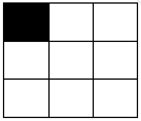
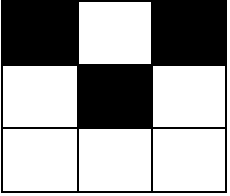

# 2768. 黑格子的数目

Medium · [力扣原题](https://leetcode.cn/problems/number-of-black-blocks/)

| 作者 | 题解 | 动画讲解 |
|---|---|---|
| 灵茶山艾府 | [📄 题解](灵茶山艾府.md) | [▶︎ 动画（GIF）](2768%20黑格子的数目%20·%20灵茶山艾府.gif) · [mp4 文件](2768%20黑格子的数目%20·%20灵茶山艾府.mp4) |
| yiduobo | [📄 题解](yiduobo.md) | [▶︎ 动画（GIF）](2768%20黑格子的数目%20·%20yiduobo.gif) · [mp4 文件](2768%20黑格子的数目%20·%20yiduobo.mp4) |

## 动画讲解

> 动图会循环播放；想暂停、拖进度条请下载上面表格里的 mp4 文件。

### 灵茶山艾府


### yiduobo


## 题目描述

给你两个整数 `m` 和 `n` ，表示一个下标从 **0** 开始的 `m x n` 的网格图。

给你一个下标从 **0** 开始的二维整数矩阵 `coordinates` ，其中 `coordinates[i] = [x, y]` 表示坐标为 `[x, y]` 的格子是 **黑色的** ，所有没出现在 `coordinates` 中的格子都是 **白色的**。

一个块定义为网格图中 `2 x 2` 的一个子矩阵。更正式的，对于左上角格子为 `[x, y]` 的块，其中 `0 <= x < m - 1` 且 `0 <= y < n - 1` ，包含坐标为 `[x, y]` ，`[x + 1, y]` ，`[x, y + 1]` 和 `[x + 1, y + 1]` 的格子。

请你返回一个下标从 **0** 开始长度为 `5` 的整数数组 `arr` ，`arr[i]` 表示恰好包含 `i` 个 **黑色** 格子的块的数目。

**示例 1：**

```

输入：m = 3, n = 3, coordinates = [[0,0]]
输出：[3,1,0,0,0]
解释：网格图如下：



只有 1 个块有一个黑色格子，这个块是左上角为 [0,0] 的块。
其他 3 个左上角分别为 [0,1] ，[1,0] 和 [1,1] 的块都有 0 个黑格子。
所以我们返回 [3,1,0,0,0] 。
```

**示例 2：**

```

输入：m = 3, n = 3, coordinates = [[0,0],[1,1],[0,2]]
输出：[0,2,2,0,0]
解释：网格图如下：



有 2 个块有 2 个黑色格子（左上角格子分别为 [0,0] 和 [0,1]）。
左上角为 [1,0] 和 [1,1] 的两个块，都有 1 个黑格子。
所以我们返回 [0,2,2,0,0] 。
```

**提示：**

- `2 <= m <= 10⁵`

- `2 <= n <= 10⁵`

- `0 <= coordinates.length <= 10⁴`

- `coordinates[i].length == 2`

- `0 <= coordinates[i][0] < m`

- `0 <= coordinates[i][1] < n`

- `coordinates` 中的坐标对两两互不相同。

---
[↑ 返回 2700-2799](../README.md) · [总索引](../../../索引.md) · [仓库首页](../../../README.md)
