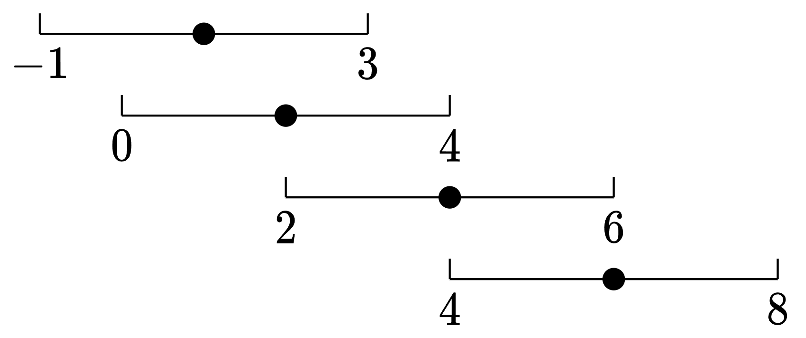

# 转化成滑动窗口问题（Python/Java/C++/Go）

> **[2779. 数组的最大美丽值](https://leetcode.cn/problems/maximum-beauty-of-an-array-after-applying-operation/solutions/2345805/pai-xu-shuang-zhi-zhen-by-endlesscheng-hbqx/) · Medium · 难度分 1638**

> **所属题单**
> - [滑动窗口与双指针 · 二、不定长滑动窗口](../../../刷题路径/灵神原版题单/滑动窗口与双指针/二、不定长滑动窗口.md) · §2.1 越短越合法/求最长/最大 · §2.1.2 进阶（选做）

> **题目描述**
> 给你一个下标从 **0** 开始的整数数组 `nums` 和一个 **非负** 整数 `k` 。
>
> 在一步操作中，你可以执行下述指令：
>
> - 在范围 `[0, nums.length - 1]` 中选择一个 **此前没有选过** 的下标 `i` 。
>
> - 将 `nums[i]` 替换为范围 `[nums[i] - k, nums[i] + k]` 内的任一整数。
>
> 数组的 **美丽值** 定义为数组中由相等元素组成的最长子序列的长度。
>
> 对数组 `nums` 执行上述操作任意次后，返回数组可能取得的 **最大** 美丽值。
>
> **注意：**你 **只** 能对每个下标执行 **一次** 此操作。
>
> 数组的 **子序列** 定义是：经由原数组删除一些元素（也可能不删除）得到的一个新数组，且在此过程中剩余元素的顺序不发生改变。
>
> **示例 1：**
>
> ```
>
> 输入：nums = [4,6,1,2], k = 2
> 输出：3
> 解释：在这个示例中，我们执行下述操作：
> - 选择下标 1 ，将其替换为 4（从范围 [4,8] 中选出），此时 nums = [4,4,1,2] 。
> - 选择下标 3 ，将其替换为 4（从范围 [0,4] 中选出），此时 nums = [4,4,1,4] 。
> 执行上述操作后，数组的美丽值是 3（子序列由下标 0 、1 、3 对应的元素组成）。
> 可以证明 3 是我们可以得到的由相等元素组成的最长子序列长度。
> ```
>
> **示例 2：**
>
> ```
>
> 输入：nums = [1,1,1,1], k = 10
> 输出：4
> 解释：在这个示例中，我们无需执行任何操作。
> 数组 nums 的美丽值是 4（整个数组）。
> ```
>
> **提示：**
>
> - `1 <= nums.length <= 10⁵`
>
> - `0 <= nums[i], k <= 10⁵`

> **题解**
> 由于选的是子序列，且操作后子序列的元素都相等，所以**元素顺序对答案没有影响**，可以先对数组**排序**。
>
> 示例 1 排序后 $\textit{nums}=[1,2,4,6]$。由于每个数 $x$ 可以改成闭区间 $[x-k,x+k]$ 中的数，我们把示例 1 的每个数看成闭区间，也就是
>
> 
>
> 题目要求的「由相等元素组成的最长子序列」，相当于选出若干闭区间，这些区间的**交集不为空**。
>
> 排序后，选出的区间是连续的，我们只需考虑最左边的区间 $[x-k,x+k]$ 和最右边的区间 $[y-k,y+k]$，如果这两个区间的交集不为空，那么选出的这些区间的交集就不为空。也就是说，要满足
>
> $$
> x+k\ge y-k
> $$
>
> 即
>
> $$
> y-x \le 2k
> $$
>
> 于是原问题等价于：
>
> - 排序后，找最长的连续子数组，其最大值减最小值 $\le 2k$。由于数组是有序的，相当于子数组的最后一个数减去子数组的第一个数 $\le 2k$。
>
> 只要子数组满足这个要求，对应的区间的交集就不为空，也就是子数组的元素都可以变成同一个数。
>
> 这可以用 [滑动窗口](https://www.bilibili.com/video/BV1hd4y1r7Gq/) 解决。枚举 $\textit{nums}[\textit{right}]$ 作为子数组的最后一个数，一旦 $\textit{nums}[\textit{right}]-\textit{nums}[\textit{left}]>2k$，就移动左端点 $\textit{left}$。
>
> 左端点停止移动时，下标在 $[\textit{left},\textit{right}]$ 的子数组就是满足要求的子数组，用子数组长度 $\textit{right}-\textit{left}+1$ 更新答案的最大值。
>
> ```python
> class Solution:
>     def maximumBeauty(self, nums: List[int], k: int) -> int:
>         nums.sort()
>         ans = left = 0
>         for right, x in enumerate(nums):
>             while x - nums[left] > k * 2:
>                 left += 1
>             ans = max(ans, right - left + 1)
>         return ans
> ```
>
>
> #### 复杂度分析
>
> - 时间复杂度：$\mathcal{O}(n\log n)$，其中 $n$ 为 $\textit{nums}$ 的长度。瓶颈在排序上。虽然写了个二重循环，但是内层循环中对 $\textit{left}$ 加一的**总**执行次数不会超过 $n$ 次，所以滑窗那部分的时间复杂度为 $\mathcal{O}(n)$。
> - 空间复杂度：$\mathcal{O}(1)$。忽略排序的栈开销，仅用到若干额外变量。
>
> ## 思考题
>
> 把题目中的「子序列」改成「连续子数组」要怎么做？
>
> ## 分类题单
>
> [如何科学刷题？](https://leetcode.cn/circle/discuss/RvFUtj/)
>
> 1. [滑动窗口与双指针（定长/不定长/单序列/双序列/三指针）](https://leetcode.cn/circle/discuss/0viNMK/)
> 2. [二分算法（二分答案/最小化最大值/最大化最小值/第K小）](https://leetcode.cn/circle/discuss/SqopEo/)
> 3. [单调栈（基础/矩形面积/贡献法/最小字典序）](https://leetcode.cn/circle/discuss/9oZFK9/)
> 4. [网格图（DFS/BFS/综合应用）](https://leetcode.cn/circle/discuss/YiXPXW/)
> 5. [位运算（基础/性质/拆位/试填/恒等式/思维）](https://leetcode.cn/circle/discuss/dHn9Vk/)
> 6. [图论算法（DFS/BFS/拓扑排序/最短路/最小生成树/二分图/基环树/欧拉路径）](https://leetcode.cn/circle/discuss/01LUak/)
> 7. [动态规划（入门/背包/状态机/划分/区间/状压/数位/数据结构优化/树形/博弈/概率期望）](https://leetcode.cn/circle/discuss/tXLS3i/)
> 8. [常用数据结构（前缀和/差分/栈/队列/堆/字典树/并查集/树状数组/线段树）](https://leetcode.cn/circle/discuss/mOr1u6/)
> 9. [数学算法（数论/组合/概率期望/博弈/计算几何/随机算法）](https://leetcode.cn/circle/discuss/IYT3ss/)
> 10. [贪心与思维（基本贪心策略/反悔/区间/字典序/数学/思维/脑筋急转弯/构造）](https://leetcode.cn/circle/discuss/g6KTKL/)
> 11. [链表、二叉树与回溯（前后指针/快慢指针/DFS/BFS/直径/LCA/一般树）](https://leetcode.cn/circle/discuss/K0n2gO/)
> 12. [字符串（KMP/Z函数/Manacher/字符串哈希/AC自动机/后缀数组/子序列自动机）](https://leetcode.cn/circle/discuss/SJFwQI/)
>
> [我的题解精选（已分类）](https://github.com/EndlessCheng/codeforces-go/blob/master/leetcode/SOLUTIONS.md)
>
> 欢迎关注 [B站@灵茶山艾府](https://space.bilibili.com/206214)
