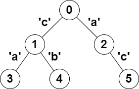

# 2791. 树中可以形成回文的路径数

Hard · 难度分 2677 · [力扣原题](https://leetcode.cn/problems/count-paths-that-can-form-a-palindrome-in-a-tree/)

所在刷题路径：灵神题单·常用数据结构、灵神题单·链表树与回溯

| 作者 | 题解 | 动画讲解 |
|---|---|---|
| 灵茶山艾府 | [📄 题解](灵茶山艾府.md) | [▶︎ 2791 树中可以形成回文的路径数 · 灵茶山艾府.mp4](2791%20树中可以形成回文的路径数%20·%20灵茶山艾府.mp4) |
| yiduobo | [📄 题解](yiduobo.md) | [▶︎ 2791 树中可以形成回文的路径数 · yiduobo.mp4](2791%20树中可以形成回文的路径数%20·%20yiduobo.mp4) |

## 题目描述

给你一棵 **树**（即，一个连通、无向且无环的图），**根** 节点为 `0` ，由编号从 `0` 到 `n - 1` 的 `n` 个节点组成。这棵树用一个长度为 `n` 、下标从 **0** 开始的数组 `parent` 表示，其中 `parent[i]` 为节点 `i` 的父节点，由于节点 `0` 为根节点，所以 `parent[0] == -1` 。

另给你一个长度为 `n` 的字符串 `s` ，其中 `s[i]` 是分配给 `i` 和 `parent[i]` 之间的边的字符。`s[0]` 可以忽略。

找出满足 `u < v` ，且从 `u` 到 `v` 的路径上分配的字符可以 **重新排列** 形成 **回文** 的所有节点对 `(u, v)` ，并返回节点对的数目。

如果一个字符串正着读和反着读都相同，那么这个字符串就是一个 **回文** 。

**示例 1：**



```

输入：parent = [-1,0,0,1,1,2], s = "acaabc"
输出：8
解释：符合题目要求的节点对分别是：
- (0,1)、(0,2)、(1,3)、(1,4) 和 (2,5) ，路径上只有一个字符，满足回文定义。
- (2,3)，路径上字符形成的字符串是 "aca" ，满足回文定义。
- (1,5)，路径上字符形成的字符串是 "cac" ，满足回文定义。
- (3,5)，路径上字符形成的字符串是 "acac" ，可以重排形成回文 "acca" 。
```

**示例 2：**

```

输入：parent = [-1,0,0,0,0], s = "aaaaa"
输出：10
解释：任何满足 u < v 的节点对 (u,v) 都符合题目要求。
```

**提示：**

- `n == parent.length == s.length`

- `1 <= n <= 10⁵`

- 对于所有 `i >= 1` ，`0 <= parent[i] <= n - 1` 均成立

- `parent[0] == -1`

- `parent` 表示一棵有效的树

- `s` 仅由小写英文字母组成

---
[↑ 返回 2700-2799](../README.md) · [总索引](../../../索引.md) · [仓库首页](../../../README.md)
