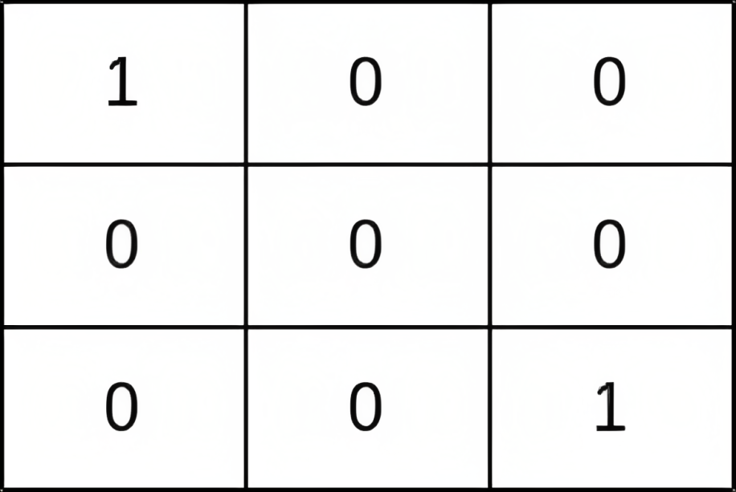
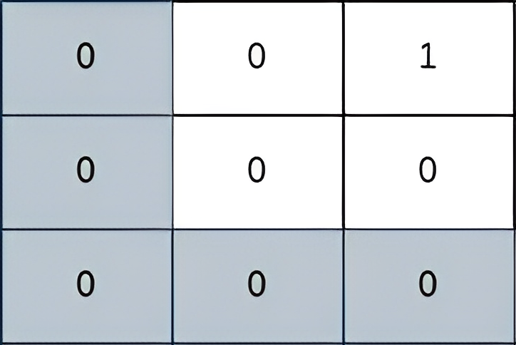

# 接近 O(n^2) 的做法：多源BFS+倒序枚举答案+并查集（Python/Java/C++/Go）

> **[2812. 找出最安全路径](https://leetcode.cn/problems/find-the-safest-path-in-a-grid/solutions/2375565/jie-jin-on2-de-zuo-fa-duo-yuan-bfsdao-xu-r5um/) · Medium · 难度分 2154**

> **所属题单**
> - [二分算法 · 二、二分答案](../../../刷题路径/灵神原版题单/二分算法/二、二分答案.md) · §2.5 最大化最小值
> - [常用数据结构 · 七、并查集](../../../刷题路径/灵神原版题单/常用数据结构/七、并查集.md) · §7.2 进阶
> - [网格图 · 二、网格图 BFS](../../../刷题路径/灵神原版题单/网格图/二、网格图%20BFS.md)

> **题目描述**
> 给你一个下标从 **0** 开始、大小为 `n x n` 的二维矩阵 `grid` ，其中 `(r, c)` 表示：
>
> - 如果 `grid[r][c] = 1` ，则表示一个存在小偷的单元格
>
> - 如果 `grid[r][c] = 0` ，则表示一个空单元格
>
> 你最开始位于单元格 `(0, 0)` 。在一步移动中，你可以移动到矩阵中的任一相邻单元格，包括存在小偷的单元格。
>
> 矩阵中路径的 **安全系数** 定义为：从路径中任一单元格到矩阵中任一小偷所在单元格的 **最小** 曼哈顿距离。
>
> 返回所有通向单元格 `(n - 1, n - 1)` 的路径中的 **最大安全系数** 。
>
> 单元格 `(r, c)` 的某个 **相邻** 单元格，是指在矩阵中存在的 `(r, c + 1)`、`(r, c - 1)`、`(r + 1, c)` 和 `(r - 1, c)` 之一。
>
> 两个单元格 `(a, b)` 和 `(x, y)` 之间的 **曼哈顿距离** 等于 `| a - x | + | b - y |` ，其中 `|val|` 表示 `val` 的绝对值。
>
> **示例 1：**
>
> 
>
> ```
>
> 输入：grid = [[1,0,0],[0,0,0],[0,0,1]]
> 输出：0
> 解释：从 (0, 0) 到 (n - 1, n - 1) 的每条路径都经过存在小偷的单元格 (0, 0) 和 (n - 1, n - 1) 。
> ```
>
> **示例 2：**
>
> 
>
> ```
>
> 输入：grid = [[0,0,1],[0,0,0],[0,0,0]]
> 输出：2
> 解释：
> 上图所示路径的安全系数为 2：
> - 该路径上距离小偷所在单元格（0，2）最近的单元格是（0，0）。它们之间的曼哈顿距离为 | 0 - 0 | + | 0 - 2 | = 2 。
> 可以证明，不存在安全系数更高的其他路径。
> ```
>
> **示例 3：**
>
> 
>
> ```
>
> 输入：grid = [[0,0,0,1],[0,0,0,0],[0,0,0,0],[1,0,0,0]]
> 输出：2
> 解释：
> 上图所示路径的安全系数为 2：
> - 该路径上距离小偷所在单元格（0，3）最近的单元格是（1，2）。它们之间的曼哈顿距离为 | 0 - 1 | + | 3 - 2 | = 2 。
> - 该路径上距离小偷所在单元格（3，0）最近的单元格是（3，2）。它们之间的曼哈顿距离为 | 3 - 3 | + | 0 - 2 | = 2 。
> 可以证明，不存在安全系数更高的其他路径。
> ```
>
> **提示：**
>
> - `1 <= grid.length == n <= 400`
>
> - `grid[i].length == n`
>
> - `grid[i][j]` 为 `0` 或 `1`
>
> - `grid` 至少存在一个小偷

> **题解**
> 设 $\textit{dis}[i][j]$ 是单元格 $(i,j)$ 到最近的 $1$ 的曼哈顿距离。
>
> 安全系数即从 $(0, 0)$ 到 $(n-1,n-1)$ 的路径上的最小的 $\textit{dis}[i][j]$。
>
> **从大到小枚举安全系数**。假设安全系数为 $d$，那么把所有 $\textit{dis}[i][j]\ge d$ 的格子与其四周 $\ge d$ 的格子用**并查集**连起来。如果 $(0,0)$ 和 $(n-1,n-1)$ 连通，那么答案为 $d$。
>
> 代码实现时，不需要对每个 $d$ 都遍历整个 $\textit{dis}$，而是**增量地**把恰好等于 $d$ 的 $\textit{dis}[i][j]$ 与其四周 $\ge d$ 的格子用并查集连起来。我们可以把相同的 $\textit{dis}[i][j]$ 分组（记在 $\textit{groups}$ 中），从而避免反复遍历整个 $\textit{dis}$。
>
> 计算 $\textit{dis}$ 可以从所有 $1$ 出发，跑一个**多源 BFS**。做法类似 [542. 01 矩阵](https://leetcode.cn/problems/01-matrix/)（那题是从所有 $0$ 出发）。
>
> [视频讲解](https://www.bilibili.com/video/BV1Yr4y1o7aP/) 第三题。
>
> ```python
> class Solution:
>     def maximumSafenessFactor(self, grid: List[List[int]]) -> int:
>         n = len(grid)
>         dis = [[-1] * n for _ in range(n)]
>         q = []
>         for i, row in enumerate(grid):
>             for j, x in enumerate(row):
>                 if x == 1:
>                     dis[i][j] = 0
>                     q.append((i, j))
>
>         groups = [q]
>         # 多源 BFS
>         while q:  
>             tmp = q
>             q = []
>             for i, j in tmp:
>                 for x, y in (i + 1, j), (i - 1, j), (i, j + 1), (i, j - 1):
>                     if 0 <= x < n and 0 <= y < n and dis[x][y] < 0:
>                         dis[x][y] = len(groups)
>                         q.append((x, y))
>             groups.append(q)  # 相同 dis 分组记录
>
>         # 并查集模板
>         fa = list(range(n * n))
>         def find(x: int) -> int:
>             if fa[x] != x:
>                 fa[x] = find(fa[x])
>             return fa[x]
>
>         # 从大到小枚举答案
>         for d in range(len(groups) - 2, 0, -1):
>             for i, j in groups[d]:
>                 for x, y in (i + 1, j), (i - 1, j), (i, j + 1), (i, j - 1):
>                     if 0 <= x < n and 0 <= y < n and dis[x][y] >= d:
>                         fa[find(x * n + y)] = find(i * n + j)
>             if find(0) == find(n * n - 1):  # 写这里判断更快些
>                 return d
>         return 0
> ```
>
>
> #### 复杂度分析
>
> - 时间复杂度：$\mathcal{O}(n^2\log n)$ 或者 $\mathcal{O}(n^2)$，其中 $n$ 是 $\textit{grid}$ 的长度。时间复杂度取决于并查集的实现，加上按秩合并的话，均摊地说并查集的操作可视作 $\mathcal{O}(1)$。
> - 空间复杂度：$\mathcal{O}(n^2)$。
>
> ## 专题训练
>
> 1. 网格图题单的「**二、网格图 BFS**」。
> 2. 数据结构题单的「**七、并查集**」。
> 3. 二分题单的「**§2.5 最大化最小值**」。
>
> ## 分类题单
>
> [如何科学刷题？](https://leetcode.cn/circle/discuss/RvFUtj/)
>
> 1. [滑动窗口与双指针（定长/不定长/单序列/双序列/三指针/分组循环）](https://leetcode.cn/circle/discuss/0viNMK/)
> 2. [二分算法（二分答案/最小化最大值/最大化最小值/第K小）](https://leetcode.cn/circle/discuss/SqopEo/)
> 3. [单调栈（基础/矩形面积/贡献法/最小字典序）](https://leetcode.cn/circle/discuss/9oZFK9/)
> 4. [网格图（DFS/BFS/综合应用）](https://leetcode.cn/circle/discuss/YiXPXW/)
> 5. [位运算（基础/性质/拆位/试填/恒等式/思维）](https://leetcode.cn/circle/discuss/dHn9Vk/)
> 6. [图论算法（DFS/BFS/拓扑排序/基环树/最短路/最小生成树/网络流）](https://leetcode.cn/circle/discuss/01LUak/)
> 7. [动态规划（入门/背包/划分/状态机/区间/状压/数位/数据结构优化/树形/博弈/概率期望）](https://leetcode.cn/circle/discuss/tXLS3i/)
> 8. [常用数据结构（前缀和/差分/栈/队列/堆/字典树/并查集/树状数组/线段树）](https://leetcode.cn/circle/discuss/mOr1u6/)
> 9. [数学算法（数论/组合/概率期望/博弈/计算几何/随机算法）](https://leetcode.cn/circle/discuss/IYT3ss/)
> 10. [贪心与思维（基本贪心策略/反悔/区间/字典序/数学/思维/脑筋急转弯/构造）](https://leetcode.cn/circle/discuss/g6KTKL/)
> 11. [链表、树与回溯（前后指针/快慢指针/DFS/BFS/直径/LCA）](https://leetcode.cn/circle/discuss/K0n2gO/)
> 12. [字符串（KMP/Z函数/Manacher/字符串哈希/AC自动机/后缀数组/子序列自动机）](https://leetcode.cn/circle/discuss/SJFwQI/)
>
> [我的题解精选（已分类）](https://github.com/EndlessCheng/codeforces-go/blob/master/leetcode/SOLUTIONS.md)
>
> 欢迎关注 [B站@灵茶山艾府](https://space.bilibili.com/206214)
