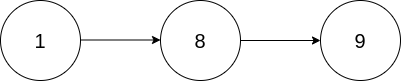

# 2816. 翻倍以链表形式表示的数字

Medium · [力扣原题](https://leetcode.cn/problems/double-a-number-represented-as-a-linked-list/)

所在刷题路径：灵神题单·链表树与回溯

| 作者 | 题解 | 动画讲解 |
|---|---|---|
| 灵茶山艾府 | [📄 题解](灵茶山艾府.md) | [▶︎ 动画（GIF）](2816%20翻倍以链表形式表示的数字%20·%20灵茶山艾府.gif) · [mp4 文件](2816%20翻倍以链表形式表示的数字%20·%20灵茶山艾府.mp4) |
| yiduobo | [📄 题解](yiduobo.md) | [▶︎ 动画（GIF）](2816%20翻倍以链表形式表示的数字%20·%20yiduobo.gif) · [mp4 文件](2816%20翻倍以链表形式表示的数字%20·%20yiduobo.mp4) |

## 动画讲解

> 动图会循环播放；想暂停、拖进度条请下载上面表格里的 mp4 文件。

### 灵茶山艾府


### yiduobo


## 题目描述

给你一个 **非空** 链表的头节点 `head` ，表示一个不含前导零的非负数整数。

将链表 **翻倍** 后，返回头节点 `head` 。

**示例 1：**



```

输入：head = [1,8,9]
输出：[3,7,8]
解释：上图中给出的链表，表示数字 189 。返回的链表表示数字 189 * 2 = 378 。
```

**示例 2：**


```

输入：head = [9,9,9]
输出：[1,9,9,8]
解释：上图中给出的链表，表示数字 999 。返回的链表表示数字 999 * 2 = 1998 。
```

**提示：**

- 链表中节点的数目在范围 `[1, 10⁴]` 内

- `0 <= Node.val <= 9`

- 生成的输入满足：链表表示一个不含前导零的数字，除了数字 `0` 本身。

---
[↑ 返回 2800-2899](../README.md) · [总索引](../../../索引.md) · [仓库首页](../../../README.md)
