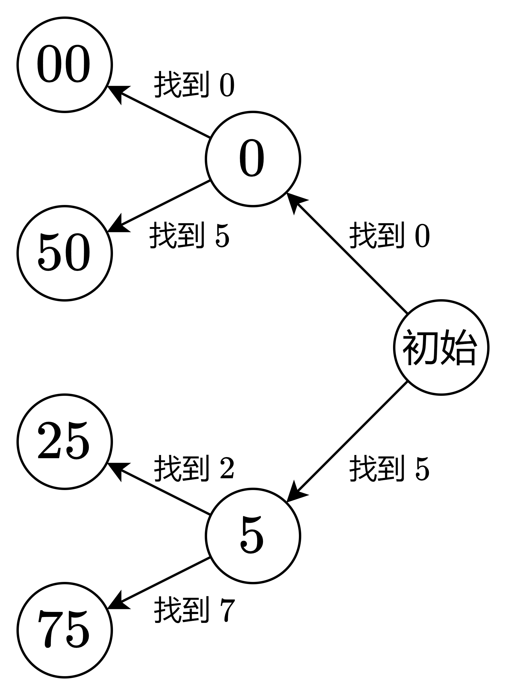

# 两种方法：枚举末尾 / 一次遍历（Python/Java/C++/C/Go/JS/Rust）

> **[2844. 生成特殊数字的最少操作](https://leetcode.cn/problems/minimum-operations-to-make-a-special-number/solutions/2424068/mei-ju-shan-chu-hou-yi-00255075-jie-wei-zhjlu/) · Medium · 难度分 1588**

> **所属题单**
> - [贪心算法 · 五、思维题](../../../刷题路径/灵神原版题单/贪心算法/五、思维题.md) · §5.8 分类讨论

> **题目描述**
> 给你一个下标从 **0** 开始的字符串 `num` ，表示一个非负整数。
>
> 在一次操作中，您可以选择 `num` 的任意一位数字并将其删除。请注意，如果你删除 `num` 中的所有数字，则 `num` 变为 `0`。
>
> 返回最少需要多少次操作可以使 `num` 变成特殊数字。
>
> 如果整数 `x` 能被 `25` 整除，则该整数 `x` 被认为是特殊数字。
>
> **示例 1：**
>
> ```
>
> 输入：num = "2245047"
> 输出：2
> 解释：删除数字 num[5] 和 num[6] ，得到数字 "22450" ，可以被 25 整除。
> 可以证明要使数字变成特殊数字，最少需要删除 2 位数字。
> ```
>
> **示例 2：**
>
> ```
>
> 输入：num = "2908305"
> 输出：3
> 解释：删除 num[3]、num[4] 和 num[6] ，得到数字 "2900" ，可以被 25 整除。
> 可以证明要使数字变成特殊数字，最少需要删除 3 位数字。
> ```
>
> **示例 3：**
>
> ```
>
> 输入：num = "10"
> 输出：1
> 解释：删除 num[0] ，得到数字 "0" ，可以被 25 整除。
> 可以证明要使数字变成特殊数字，最少需要删除 1 位数字。
> ```
>
> **提示**
>
> - `1 <= num.length <= 100`
>
> - `num` 仅由数字 `'0'` 到 `'9'` 组成
>
> - `num` 不含任何前导零

> **题解**
> ## 前言
>
> 一个数能被 $25$ 整除，有如下五种情况：
>
> - 这个数是 $0$。
> - 这个数的末尾是 $00$，例如 $100$。
> - 这个数的末尾是 $25$，例如 $225$。
> - 这个数的末尾是 $50$，例如 $350$。
> - 这个数的末尾是 $75$，例如 $475$。
>
> ## 方法一：枚举末尾
>
> 设 $\textit{num}$ 的长度为 $n$。
>
> 首先，根据题目说的，我们可以把 $\textit{num}$ 中的所有数字都删除，得到 $0$，这需要删除 $n$ 次。但如果 $\textit{num}$ 中有 $0$，那么删除 $n-1$ 也可以得到 $0$。
>
> 接下来，以示例 1 为例，看能否删除成末尾是 $50$ 的数：
>
> 1. **从右往左**遍历 $\textit{num}$，找最右边的 $0$。如果没有找到，或者最右边的 $0$ 的下标是 $0$，则说明无法做到。
> 2. **继续向左**遍历，找最右边的 $5$，设其下标为 $i$。如果没有找到，则说明无法做到。
> 3. 删除这个 $5$ 右边的所有非 $0$ 数字，这样就得到了一个以 $50$ 结尾的字符串。
> 4. 删除次数为 $n-i-2$。例如示例 1 中 $5$ 的下标是 $i=3$，需要删除 $7-3-2=2$ 次。
>
> 其余 $00,25,75$ 的计算方式同理，取 $n-i-2$ 的最小值作为答案。
>
> 请看 [视频讲解](https://www.bilibili.com/video/BV1Nj411178Z/) 第二题。
>
> ### 答疑
>
> **问**：如果删除后只得到 $00$，产生了前导零，这就不合法了呀？
>
> **答**：不可能在删除后只得到 $00$，因为题目保证 $\textit{num}$ 不含前导零，如果有多个 $0$，任何 $0$ 的左侧必然有非 $0$ 数字。
>
> ```python
> class Solution:
>     def minimumOperations(self, num: str) -> int:
>         n = len(num)
>         def f(tail: str) -> int:
>             i = num.rfind(tail[1])
>             if i <= 0:
>                 return n
>             # 也可以写 num[:i].rfind(tail[0])，但切片需要额外空间
>             i = num.rfind(tail[0], 0, i)
>             return n if i < 0 else n - i - 2
>         return min(n - ('0' in num), f("00"), f("25"), f("50"), f("75"))
> ```
>
>
> #### 复杂度分析
>
> - 时间复杂度：$\mathcal{O}(n)$，其中 $n$ 为 $\textit{num}$ 的长度。
> - 空间复杂度：$\mathcal{O}(1)$。仅用到若干额外变量。
>
> ## 方法二：一次遍历
>
> 方法一需要多次遍历 $\textit{num}$，能否只遍历一次呢？
>
> 方法一的寻找过程，可以合并成下图：
>
> 
>
> 根据该图，在**从右往左**遍历的过程中：
>
> - 在之前找到 $0$ 的情况下，如果当前数字 $\textit{num}[i]$ 是 $0$ 或者 $5$，则立刻返回 $n-i-2$。
> - 在之前找到 $5$ 的情况下，如果当前数字 $\textit{num}[i]$ 是 $2$ 或者 $7$，则立刻返回 $n-i-2$。
> - 否则，如果 $\textit{num}[i]$ 是 $0$，标记我们找到了 $0$。
> - 否则，如果 $\textit{num}[i]$ 是 $5$，标记我们找到了 $5$。
> - 如果循环中没有返回，则最后返回 $n$ 或者 $n-1$，取决于我们是否找到了 $0$。
>
> ```python
> class Solution:
>     def minimumOperations(self, num: str) -> int:
>         n = len(num)
>         found0 = found5 = False
>         for i in range(n - 1, -1, -1):
>             c = num[i]
>             if found0 and c in "05" or found5 and c in "27":
>                 return n - i - 2
>             if c == '0':
>                 found0 = True
>             elif c == '5':
>                 found5 = True
>         return n - found0
> ```
>
>
> #### 复杂度分析
>
> - 时间复杂度：$\mathcal{O}(n)$，其中 $n$ 为 $\textit{num}$ 的长度。
> - 空间复杂度：$\mathcal{O}(1)$。仅用到若干额外变量。
>
> ## 分类题单
>
> [如何科学刷题？](https://leetcode.cn/circle/discuss/RvFUtj/)
>
> 1. [滑动窗口（定长/不定长/多指针）](https://leetcode.cn/circle/discuss/0viNMK/)
> 2. [二分算法（二分答案/最小化最大值/最大化最小值/第K小）](https://leetcode.cn/circle/discuss/SqopEo/)
> 3. [单调栈（基础/矩形面积/贡献法/最小字典序）](https://leetcode.cn/circle/discuss/9oZFK9/)
> 4. [网格图（DFS/BFS/综合应用）](https://leetcode.cn/circle/discuss/YiXPXW/)
> 5. [位运算（基础/性质/拆位/试填/恒等式/思维）](https://leetcode.cn/circle/discuss/dHn9Vk/)
> 6. [图论算法（DFS/BFS/拓扑排序/最短路/最小生成树/二分图/基环树/欧拉路径）](https://leetcode.cn/circle/discuss/01LUak/)
> 7. [动态规划（入门/背包/状态机/划分/区间/状压/数位/数据结构优化/树形/博弈/概率期望）](https://leetcode.cn/circle/discuss/tXLS3i/)
> 8. [常用数据结构（前缀和/差分/栈/队列/堆/字典树/并查集/树状数组/线段树）](https://leetcode.cn/circle/discuss/mOr1u6/)
> 9. [数学算法（数论/组合/概率期望/博弈/计算几何/随机算法）](https://leetcode.cn/circle/discuss/IYT3ss/)
> 10. [贪心算法（基本贪心策略/反悔/区间/字典序/数学/思维/脑筋急转弯/构造）](https://leetcode.cn/circle/discuss/g6KTKL/)
>
> [我的题解精选（已分类）](https://github.com/EndlessCheng/codeforces-go/blob/master/leetcode/SOLUTIONS.md)
>
> 欢迎关注 [B站@灵茶山艾府](https://space.bilibili.com/206214)
