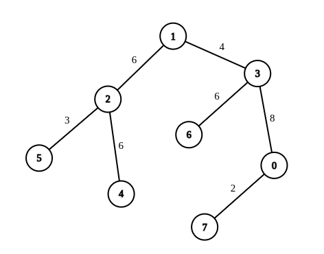

# 2846. 边权重均等查询

Hard · 难度分 2508 · [力扣原题](https://leetcode.cn/problems/minimum-edge-weight-equilibrium-queries-in-a-tree/)

所在刷题路径：灵神题单·常用数据结构、灵神题单·链表树与回溯

| 作者 | 题解 | 动画讲解 |
|---|---|---|
| 灵茶山艾府 | [📄 题解](灵茶山艾府.md) | [▶︎ 动画（GIF）](2846%20边权重均等查询%20·%20灵茶山艾府.gif) · [mp4 文件](2846%20边权重均等查询%20·%20灵茶山艾府.mp4) |
| yiduobo | [📄 题解](yiduobo.md) | [▶︎ 动画（GIF）](2846%20边权重均等查询%20·%20yiduobo.gif) · [mp4 文件](2846%20边权重均等查询%20·%20yiduobo.mp4) |

## 动画讲解

> 动图会循环播放；想暂停、拖进度条请下载上面表格里的 mp4 文件。

### 灵茶山艾府


### yiduobo


## 题目描述

现有一棵由 `n` 个节点组成的无向树，节点按从 `0` 到 `n - 1` 编号。给你一个整数 `n` 和一个长度为 `n - 1` 的二维整数数组 `edges` ，其中 `edges[i] = [u_i, v_i, w_i]` 表示树中存在一条位于节点 `u_i` 和节点 `v_i` 之间、权重为 `w_i` 的边。

另给你一个长度为 `m` 的二维整数数组 `queries` ，其中 `queries[i] = [a_i, b_i]` 。对于每条查询，请你找出使从 `a_i` 到 `b_i` 路径上每条边的权重相等所需的 **最小操作次数** 。在一次操作中，你可以选择树上的任意一条边，并将其权重更改为任意值。

**注意：**

- 查询之间 **相互独立** 的，这意味着每条新的查询时，树都会回到 **初始状态** 。

- 从 `a_i` 到 `b_i`的路径是一个由 **不同** 节点组成的序列，从节点 `a_i` 开始，到节点 `b_i` 结束，且序列中相邻的两个节点在树中共享一条边。

返回一个长度为 `m` 的数组 `answer` ，其中 `answer[i]` 是第 `i` 条查询的答案。

**示例 1：**


```

输入：n = 7, edges = [[0,1,1],[1,2,1],[2,3,1],[3,4,2],[4,5,2],[5,6,2]], queries = [[0,3],[3,6],[2,6],[0,6]]
输出：[0,0,1,3]
解释：第 1 条查询，从节点 0 到节点 3 的路径中的所有边的权重都是 1 。因此，答案为 0 。
第 2 条查询，从节点 3 到节点 6 的路径中的所有边的权重都是 2 。因此，答案为 0 。
第 3 条查询，将边 [2,3] 的权重变更为 2 。在这次操作之后，从节点 2 到节点 6 的路径中的所有边的权重都是 2 。因此，答案为 1 。
第 4 条查询，将边 [0,1]、[1,2]、[2,3] 的权重变更为 2 。在这次操作之后，从节点 0 到节点 6 的路径中的所有边的权重都是 2 。因此，答案为 3 。
对于每条查询 queries[i] ，可以证明 answer[i] 是使从 a_i 到 b_i 的路径中的所有边的权重相等的最小操作次数。
```

**示例 2：**



```

输入：n = 8, edges = [[1,2,6],[1,3,4],[2,4,6],[2,5,3],[3,6,6],[3,0,8],[7,0,2]], queries = [[4,6],[0,4],[6,5],[7,4]]
输出：[1,2,2,3]
解释：第 1 条查询，将边 [1,3] 的权重变更为 6 。在这次操作之后，从节点 4 到节点 6 的路径中的所有边的权重都是 6 。因此，答案为 1 。
第 2 条查询，将边 [0,3]、[3,1] 的权重变更为 6 。在这次操作之后，从节点 0 到节点 4 的路径中的所有边的权重都是 6 。因此，答案为 2 。
第 3 条查询，将边 [1,3]、[5,2] 的权重变更为 6 。在这次操作之后，从节点 6 到节点 5 的路径中的所有边的权重都是 6 。因此，答案为 2 。
第 4 条查询，将边 [0,7]、[0,3]、[1,3] 的权重变更为 6 。在这次操作之后，从节点 7 到节点 4 的路径中的所有边的权重都是 6 。因此，答案为 3 。
对于每条查询 queries[i] ，可以证明 answer[i] 是使从 a_i 到 b_i 的路径中的所有边的权重相等的最小操作次数。
```

**提示：**

- `1 <= n <= 10⁴`

- `edges.length == n - 1`

- `edges[i].length == 3`

- `0 <= u_i, v_i < n`

- `1 <= w_i <= 26`

- 生成的输入满足 `edges` 表示一棵有效的树

- `1 <= queries.length == m <= 2 * 10⁴`

- `queries[i].length == 2`

- `0 <= a_i, b_i < n`

---
[↑ 返回 2800-2899](../README.md) · [总索引](../../../索引.md) · [仓库首页](../../../README.md)
