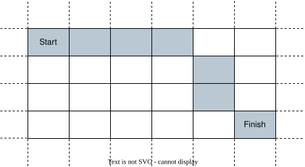
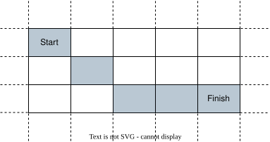

# 先斜着走再直走，然后在终点绕圈圈（Python/Java/C++/Go/JS）

> **[2849. 判断能否在给定时间到达单元格](https://leetcode.cn/problems/determine-if-a-cell-is-reachable-at-a-given-time/solutions/2435321/xian-xie-zhao-zou-zai-zhi-zou-ran-hou-za-lkxu/) · Medium**

> **题目描述**
> 给你四个整数 `sx`、`sy`、`fx`、`fy`  以及一个 **非负整数** `t` 。
>
> 在一个无限的二维网格中，你从单元格 `(sx, sy)` 开始出发。每一秒，你 **必须** 移动到任一与之前所处单元格相邻的单元格中。
>
> 如果你能在 **恰好** `t` **秒** 后到达单元格 `(fx, fy)` ，返回 `true` ；否则，返回  `false` 。
>
> 单元格的 **相邻单元格** 是指该单元格周围与其至少共享一个角的 8 个单元格。你可以多次访问同一个单元格。
>
> **示例 1：**
>
> 
>
> ```
>
> 输入：sx = 2, sy = 4, fx = 7, fy = 7, t = 6
> 输出：true
> 解释：从单元格 (2, 4) 开始出发，穿过上图标注的单元格，可以在恰好 6 秒后到达单元格 (7, 7) 。
> ```
>
> **示例 2：**
>
> 
>
> ```
>
> 输入：sx = 3, sy = 1, fx = 7, fy = 3, t = 3
> 输出：false
> 解释：从单元格 (3, 1) 开始出发，穿过上图标注的单元格，至少需要 4 秒后到达单元格 (7, 3) 。 因此，无法在 3 秒后到达单元格 (7, 3) 。
> ```
>
> **提示：**
>
> - `1 <= sx, sy, fx, fy <= 10⁹`
>
> - `0 <= t <= 10⁹`

> **题解**
> 由于可以往 $8$ 个方向走，那么最快可以在
>
> $$
> \max\{|sx-fx|, |sy-fy|\}
> $$
>
> 秒后到达终点（先斜着走再直走）。
>
> 上式只要小于等于 $t$ 就能恰好到达终点。因为我们可以在到达终点附近时，在终点周围不断「绕圈」消耗时间，这样可以直到最后一秒才走到终点。
>
> **特殊情况**：如果起点和终点重合，那么 $t=1$ 的情况是无法回到起点的；如果 $t\ne 1$，我们可以同样地在起点不断「绕圈」，最后回到起点。
>
> 请看 [视频讲解](https://www.bilibili.com/video/BV1U34y1N7Pe/) 第二题。
>
> ```python
> class Solution:
>     def isReachableAtTime(self, sx: int, sy: int, fx: int, fy: int, t: int) -> bool:
>         if sx == fx and sy == fy:
>             return t != 1
>         return max(abs(sx - fx), abs(sy - fy)) <= t
> ```
>
>
> #### 复杂度分析
>
> - 时间复杂度：$\mathcal{O}(1)$。
> - 空间复杂度：$\mathcal{O}(1)$。
>
> ## 思考题
>
> 如果改成只能往 $4$ 个方向走呢？
>
> ## 分类题单
>
> [如何科学刷题？](https://leetcode.cn/circle/discuss/RvFUtj/)
>
> 1. [滑动窗口（定长/不定长/多指针）](https://leetcode.cn/circle/discuss/0viNMK/)
> 2. [二分算法（二分答案/最小化最大值/最大化最小值/第K小）](https://leetcode.cn/circle/discuss/SqopEo/)
> 3. [单调栈（基础/矩形面积/贡献法/最小字典序）](https://leetcode.cn/circle/discuss/9oZFK9/)
> 4. [网格图（DFS/BFS/综合应用）](https://leetcode.cn/circle/discuss/YiXPXW/)
> 5. [位运算（基础/性质/拆位/试填/恒等式/思维）](https://leetcode.cn/circle/discuss/dHn9Vk/)
> 6. [图论算法（DFS/BFS/拓扑排序/最短路/最小生成树/二分图/基环树/欧拉路径）](https://leetcode.cn/circle/discuss/01LUak/)
> 7. [动态规划（入门/背包/状态机/划分/区间/状压/数位/数据结构优化/树形/博弈/概率期望）](https://leetcode.cn/circle/discuss/tXLS3i/)
> 8. [常用数据结构（前缀和/差分/栈/队列/堆/字典树/并查集/树状数组/线段树）](https://leetcode.cn/circle/discuss/mOr1u6/)
> 9. [数学算法（数论/组合/概率期望/博弈/计算几何/随机算法）](https://leetcode.cn/circle/discuss/IYT3ss/)
> 10. [贪心算法（基本贪心策略/反悔/区间/字典序/数学/思维/脑筋急转弯/构造）](https://leetcode.cn/circle/discuss/g6KTKL/)
> 11. [链表、二叉树与一般树（前后指针/快慢指针/DFS/BFS/直径/LCA）](https://leetcode.cn/circle/discuss/K0n2gO/)
>
> [我的题解精选（已分类）](https://github.com/EndlessCheng/codeforces-go/blob/master/leetcode/SOLUTIONS.md)
>
> 欢迎关注 [B站@灵茶山艾府](https://space.bilibili.com/206214)
