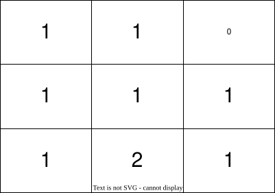
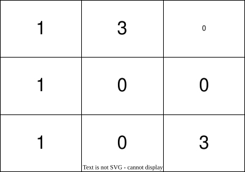

# 2850. 将石头分散到网格图的最少移动次数

Medium · 难度分 2001 · [力扣原题](https://leetcode.cn/problems/minimum-moves-to-spread-stones-over-grid/)

所在刷题路径：灵神题单·图论算法、灵神题单·动态规划、灵神题单·链表树与回溯

| 作者 | 题解 | 动画讲解 |
|---|---|---|
| 灵茶山艾府 | [📄 题解](灵茶山艾府.md) | [▶︎ 动画（GIF）](2850%20将石头分散到网格图的最少移动次数%20·%20灵茶山艾府.gif) · [mp4 文件](2850%20将石头分散到网格图的最少移动次数%20·%20灵茶山艾府.mp4) |
| yiduobo | [📄 题解](yiduobo.md) | [▶︎ 动画（GIF）](2850%20将石头分散到网格图的最少移动次数%20·%20yiduobo.gif) · [mp4 文件](2850%20将石头分散到网格图的最少移动次数%20·%20yiduobo.mp4) |

## 动画讲解

> 动图会循环播放；想暂停、拖进度条请下载上面表格里的 mp4 文件。

### 灵茶山艾府


### yiduobo


## 题目描述

给你一个大小为 `3 * 3` ，下标从 **0** 开始的二维整数矩阵 `grid` ，分别表示每一个格子里石头的数目。网格图中总共恰好有 `9` 个石头，一个格子里可能会有 **多个** 石头。

每一次操作中，你可以将一个石头从它当前所在格子移动到一个至少有一条公共边的相邻格子。

请你返回每个格子恰好有一个石头的 **最少移动次数** 。

**示例 1：**



```

输入：grid = [[1,1,0],[1,1,1],[1,2,1]]
输出：3
解释：让每个格子都有一个石头的一个操作序列为：
1 - 将一个石头从格子 (2,1) 移动到 (2,2) 。
2 - 将一个石头从格子 (2,2) 移动到 (1,2) 。
3 - 将一个石头从格子 (1,2) 移动到 (0,2) 。
总共需要 3 次操作让每个格子都有一个石头。
让每个格子都有一个石头的最少操作次数为 3 。
```

**示例 2：**



```

输入：grid = [[1,3,0],[1,0,0],[1,0,3]]
输出：4
解释：让每个格子都有一个石头的一个操作序列为：
1 - 将一个石头从格子 (0,1) 移动到 (0,2) 。
2 - 将一个石头从格子 (0,1) 移动到 (1,1) 。
3 - 将一个石头从格子 (2,2) 移动到 (1,2) 。
4 - 将一个石头从格子 (2,2) 移动到 (2,1) 。
总共需要 4 次操作让每个格子都有一个石头。
让每个格子都有一个石头的最少操作次数为 4 。
```

**提示：**

- `grid.length == grid[i].length == 3`

- `0 <= grid[i][j] <= 9`

- `grid` 中元素之和为 `9` 。

---
[↑ 返回 2800-2899](../README.md) · [总索引](../../../索引.md) · [仓库首页](../../../README.md)
