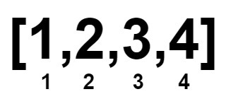
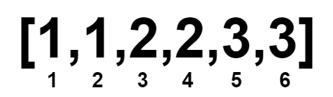
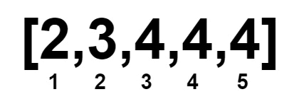

# 2856. 删除数对后的最小数组长度

Medium · 难度分 1750 · [力扣原题](https://leetcode.cn/problems/minimum-array-length-after-pair-removals/)

所在刷题路径：灵神题单·贪心与思维

| 作者 | 题解 | 动画讲解 |
|---|---|---|
| 灵茶山艾府 | [📄 题解](灵茶山艾府.md) | [▶︎ 2856 删除数对后的最小数组长度 · 灵茶山艾府.mp4](2856%20删除数对后的最小数组长度%20·%20灵茶山艾府.mp4) |
| yiduobo | [📄 题解](yiduobo.md) | [▶︎ 2856 删除数对后的最小数组长度 · yiduobo.mp4](2856%20删除数对后的最小数组长度%20·%20yiduobo.mp4) |

## 题目描述

给你一个下标从 **0** 开始的 **非递减** 整数数组 `nums` 。

你可以执行以下操作任意次：

- 选择 **两个** 下标 `i` 和 `j` ，满足 `nums[i] < nums[j]` 。

- 将 `nums` 中下标在 `i` 和 `j` 处的元素删除。剩余元素按照原来的顺序组成新的数组，下标也重新从 **0** 开始编号。

请你返回一个整数，表示执行以上操作任意次后（可以执行 **0** 次），`nums` 数组的 **最小** 数组长度。

**示例 1：**

**输入：**`nums = [1,2,3,4]`

**输出：**`0`

**解释：**

**示例 2：**

**输入：**`nums = [1,1,2,2,3,3]`

**输出：**`0`

**解释：**

**示例 3：**

**输入：**`nums = [1000000000,1000000000]`

**输出：**`2`

**解释：**

由于两个数字相等，不能删除它们。

**示例 4：**

**输入：**`nums = [2,3,4,4,4]`

**输出：**`1`

**解释：**

**提示：**

- `1 <= nums.length <= 10⁵`

- `1 <= nums[i] <= 10⁹`

- `nums` 是 **非递减** 数组。

---
[↑ 返回 2800-2899](../README.md) · [总索引](../../../索引.md) · [仓库首页](../../../README.md)
