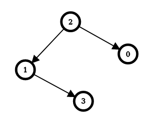

# 2858. 可以到达每一个节点的最少边反转次数

Hard · 难度分 2295 · [力扣原题](https://leetcode.cn/problems/minimum-edge-reversals-so-every-node-is-reachable/)

所在刷题路径：灵神题单·动态规划

| 作者 | 题解 | 动画讲解 |
|---|---|---|
| 灵茶山艾府 | [📄 题解](灵茶山艾府.md) | [▶︎ 2858 可以到达每一个节点的最少边反转次数 · 灵茶山艾府.mp4](2858%20可以到达每一个节点的最少边反转次数%20·%20灵茶山艾府.mp4) |
| yiduobo | [📄 题解](yiduobo.md) | [▶︎ 2858 可以到达每一个节点的最少边反转次数 · yiduobo.mp4](2858%20可以到达每一个节点的最少边反转次数%20·%20yiduobo.mp4) |

## 题目描述

给你一个 `n` 个点的 **简单有向图** （没有重复边的有向图），节点编号为 `0` 到 `n - 1` 。如果这些边是双向边，那么这个图形成一棵 **树** 。

给你一个整数 `n` 和一个 **二维** 整数数组 `edges` ，其中 `edges[i] = [u_i, v_i]` 表示从节点 `u_i` 到节点 `v_i` 有一条 **有向边** 。

**边反转** 指的是将一条边的方向反转，也就是说一条从节点 `u_i` 到节点 `v_i` 的边会变为一条从节点 `v_i` 到节点 `u_i` 的边。

对于范围 `[0, n - 1]` 中的每一个节点 `i` ，你的任务是分别 **独立** 计算 **最少** 需要多少次 **边反转** ，从节点 `i` 出发经过 **一系列有向边** ，可以到达所有的节点。

请你返回一个长度为 `n` 的整数数组 `answer` ，其中 `answer[i]`表示从节点 `i` 出发，可以到达所有节点的 **最少边反转** 次数。

**示例 1：**



```

输入：n = 4, edges = [[2,0],[2,1],[1,3]]
输出：[1,1,0,2]
解释：上图表示了与输入对应的简单有向图。
对于节点 0 ：反转 [2,0] ，从节点 0 出发可以到达所有节点。
所以 answer[0] = 1 。
对于节点 1 ：反转 [2,1] ，从节点 1 出发可以到达所有节点。
所以 answer[1] = 1 。
对于节点 2 ：不需要反转就可以从节点 2 出发到达所有节点。
所以 answer[2] = 0 。
对于节点 3 ：反转 [1,3] 和 [2,1] ，从节点 3 出发可以到达所有节点。
所以 answer[3] = 2 。
```

**示例 2：**


```

输入：n = 3, edges = [[1,2],[2,0]]
输出：[2,0,1]
解释：上图表示了与输入对应的简单有向图。
对于节点 0 ：反转 [2,0] 和 [1,2] ，从节点 0 出发可以到达所有节点。
所以 answer[0] = 2 。
对于节点 1 ：不需要反转就可以从节点 2 出发到达所有节点。
所以 answer[1] = 0 。
对于节点 2 ：反转 [1,2] ，从节点 2 出发可以到达所有节点。
所以 answer[2] = 1 。
```

**提示：**

- `2 <= n <= 10⁵`

- `edges.length == n - 1`

- `edges[i].length == 2`

- `0 <= u_i == edges[i][0] < n`

- `0 <= v_i == edges[i][1] < n`

- `u_i != v_i`

- 输入保证如果边是双向边，可以得到一棵树。

---
[↑ 返回 2800-2899](../README.md) · [总索引](../../../索引.md) · [仓库首页](../../../README.md)
