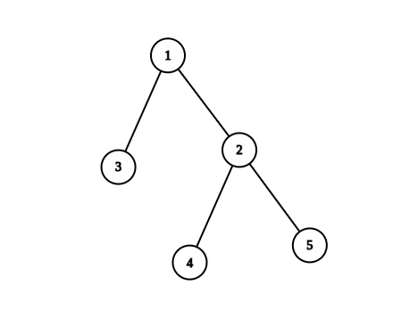
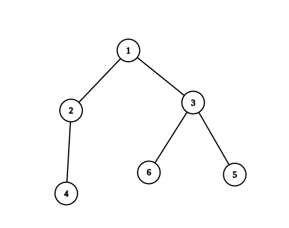
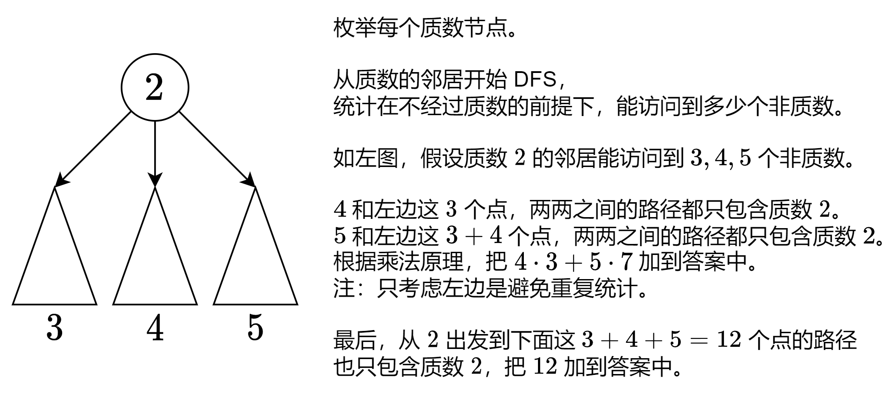

# 【图解】O(n) 线性做法（Python/Java/C++/Go）

> **[2867. 统计树中的合法路径数目](https://leetcode.cn/problems/count-valid-paths-in-a-tree/solutions/2456716/tu-jie-on-xian-xing-zuo-fa-pythonjavacgo-tjz2/) · Hard · 难度分 2428**

> **所属题单**
> - [常用数据结构 · 零、常用枚举技巧](../../../刷题路径/灵神原版题单/常用数据结构/零、常用枚举技巧.md) · §0.2 枚举中间 · §0.2.2 进阶
> - [常用数据结构 · 七、并查集](../../../刷题路径/灵神原版题单/常用数据结构/七、并查集.md) · §7.2 进阶
> - [链表、二叉树与回溯 · 三、一般树](../../../刷题路径/灵神原版题单/链表、二叉树与回溯/三、一般树.md) · §3.13 其他
> - [数学算法 · 二、组合数学](../../../刷题路径/灵神原版题单/数学算法/二、组合数学.md) · §2.1 乘法原理

> **题目描述**
> 给你一棵 `n` 个节点的无向树，节点编号为 `1` 到 `n` 。给你一个整数 `n` 和一个长度为 `n - 1` 的二维整数数组 `edges` ，其中 `edges[i] = [u_i, v_i]` 表示节点 `u_i` 和 `v_i` 在树中有一条边。
>
> 请你返回树中的 **合法路径数目** 。
>
> 如果在节点 `a` 到节点 `b` 之间 **恰好有一个** 节点的编号是质数，那么我们称路径 `(a, b)` 是 **合法的** 。
>
> **注意：**
>
> - 路径 `(a, b)` 指的是一条从节点 `a` 开始到节点 `b` 结束的一个节点序列，序列中的节点 **互不相同** ，且相邻节点之间在树上有一条边。
>
> - 路径 `(a, b)` 和路径 `(b, a)` 视为 **同一条** 路径，且只计入答案 **一次** 。
>
> **示例 1：**
>
> 
>
> ```
>
> 输入：n = 5, edges = [[1,2],[1,3],[2,4],[2,5]]
> 输出：4
> 解释：恰好有一个质数编号的节点路径有：
> - (1, 2) 因为路径 1 到 2 只包含一个质数 2 。
> - (1, 3) 因为路径 1 到 3 只包含一个质数 3 。
> - (1, 4) 因为路径 1 到 4 只包含一个质数 2 。
> - (2, 4) 因为路径 2 到 4 只包含一个质数 2 。
> 只有 4 条合法路径。
> ```
>
> **示例 2：**
>
> 
>
> ```
>
> 输入：n = 6, edges = [[1,2],[1,3],[2,4],[3,5],[3,6]]
> 输出：6
> 解释：恰好有一个质数编号的节点路径有：
> - (1, 2) 因为路径 1 到 2 只包含一个质数 2 。
> - (1, 3) 因为路径 1 到 3 只包含一个质数 3 。
> - (1, 4) 因为路径 1 到 4 只包含一个质数 2 。
> - (1, 6) 因为路径 1 到 6 只包含一个质数 3 。
> - (2, 4) 因为路径 2 到 4 只包含一个质数 2 。
> - (3, 6) 因为路径 3 到 6 只包含一个质数 3 。
> 只有 6 条合法路径。
> ```
>
> **提示：**
>
> - `1 <= n <= 10⁵`
>
> - `edges.length == n - 1`
>
> - `edges[i].length == 2`
>
> - `1 <= u_i, v_i <= n`
>
> - 输入保证 `edges` 形成一棵合法的树。

> **题解**
> [视频讲解](https://www.bilibili.com/video/BV1yu4y1z7sE/) 第四题。
>
> 
>
> 代码实现时，为避免反复 DFS 同一个非质数连通块，可以把每个非质数所处的连通块的大小记录下来（类似记忆化搜索）。如果之前计算过，就无需再次 DFS。
>
> ```python
> # 标记 10**5 以内的质数
> MX = 10 ** 5 + 1
> is_prime = [True] * MX
> is_prime[1] = False
> for i in range(2, isqrt(MX) + 1):
>     if is_prime[i]:
>         for j in range(i * i, MX, i):
>             is_prime[j] = False
>
> class Solution:
>     def countPaths(self, n: int, edges: List[List[int]]) -> int:
>         g = [[] for _ in range(n + 1)]
>         for x, y in edges:
>             g[x].append(y)
>             g[y].append(x)
>
>         nodes = []
>         def dfs(x: int, fa: int) -> None:
>             nodes.append(x)
>             for y in g[x]:
>                 if y != fa and not is_prime[y]:
>                     dfs(y, x)
>
>         ans = 0
>         size = [0] * (n + 1)
>         for x in range(1, n + 1):
>             if not is_prime[x]:  # 跳过非质数
>                 continue
>             s = 0
>             for y in g[x]:  # 质数 x 把这棵树分成了若干个连通块
>                 if is_prime[y]:
>                     continue
>                 if size[y] == 0:  # 尚未计算过
>                     nodes.clear()
>                     dfs(y, -1)  # 遍历 y 所在连通块，在不经过质数的前提下，统计有多少个非质数
>                     for z in nodes:
>                         size[z] = len(nodes)
>                 # 这 size[y] 个非质数与之前遍历到的 s 个非质数，两两之间的路径只包含质数 x
>                 ans += size[y] * s
>                 s += size[y]
>             ans += s  # 从 x 出发的路径
>         return ans
> ```
>
>
> #### 复杂度分析
>
> - 时间复杂度：$\mathcal{O}(n)$。预处理的时间不计入。
> - 空间复杂度：$\mathcal{O}(n)$。
>
> ## 相似题目
>
> 这题本质上是求一种类似于「非质数-质数-非质数」的路径个数。
>
> 这让我想到了另外一道题目 [2242. 节点序列的最大得分](https://leetcode.cn/problems/maximum-score-of-a-node-sequence/)。
>
> 这两题的共同点在于「枚举中间」，请读者细细品味。
