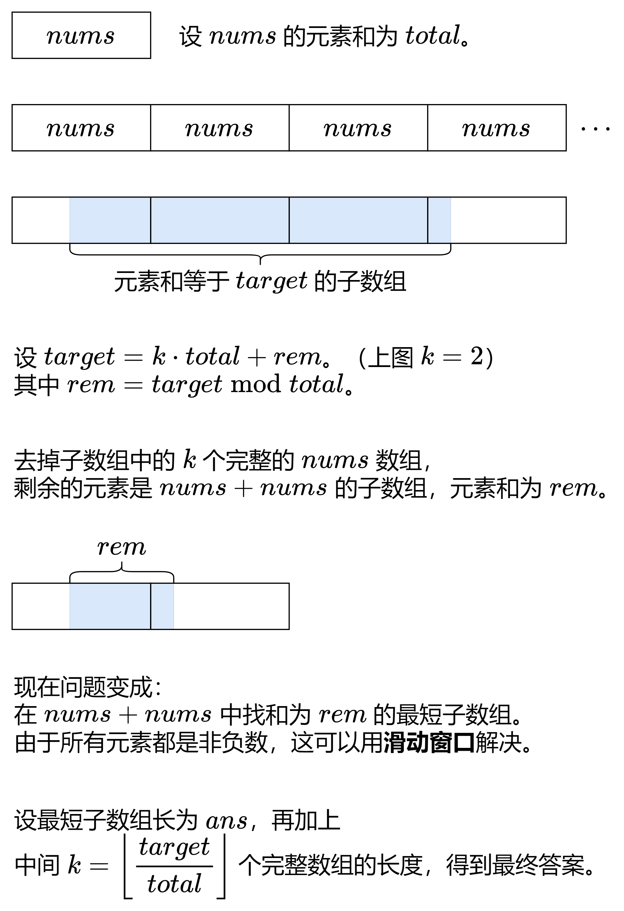
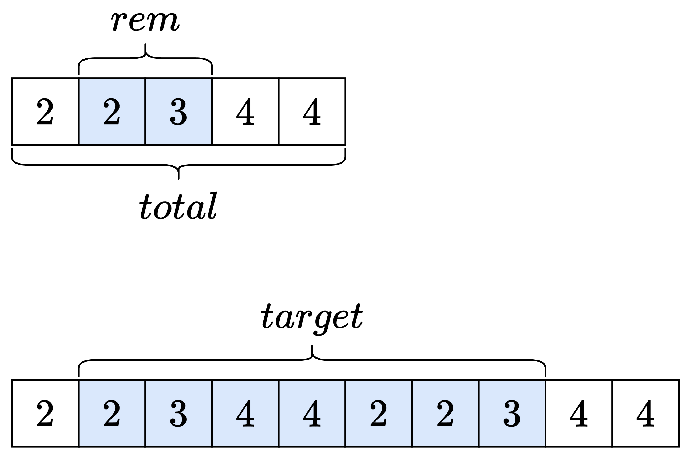

# 【图解】滑动窗口（Python/Java/C++/C/Go/JS/Rust）

> **[2875. 无限数组的最短子数组](https://leetcode.cn/problems/minimum-size-subarray-in-infinite-array/solutions/2464878/hua-dong-chuang-kou-on-shi-jian-o1-kong-cqawc/) · Medium · 难度分 1914**

> **所属题单**
> - [滑动窗口与双指针 · 二、不定长滑动窗口](../../../刷题路径/灵神原版题单/滑动窗口与双指针/二、不定长滑动窗口.md) · §2.2 越长越合法/求最短/最小

> **题目描述**
> 给你一个下标从 **0** 开始的数组 `nums` 和一个整数 `target` 。
>
> 下标从 **0** 开始的数组 `infinite_nums` 是通过无限地将 nums 的元素追加到自己之后生成的。
>
> 请你从 `infinite_nums` 中找出满足 **元素和** 等于 `target` 的 **最短** 子数组，并返回该子数组的长度。如果不存在满足条件的子数组，返回 `-1` 。
>
> **示例 1：**
>
> ```
>
> 输入：nums = [1,2,3], target = 5
> 输出：2
> 解释：在这个例子中 infinite_nums = [1,2,3,1,2,3,1,2,...] 。
> 区间 [1,2] 内的子数组的元素和等于 target = 5 ，且长度 length = 2 。
> 可以证明，当元素和等于目标值 target = 5 时，2 是子数组的最短长度。
> ```
>
> **示例 2：**
>
> ```
>
> 输入：nums = [1,1,1,2,3], target = 4
> 输出：2
> 解释：在这个例子中 infinite_nums = [1,1,1,2,3,1,1,1,2,3,1,1,...].
> 区间 [4,5] 内的子数组的元素和等于 target = 4 ，且长度 length = 2 。
> 可以证明，当元素和等于目标值 target = 4 时，2 是子数组的最短长度。
> ```
>
> **示例 3：**
>
> ```
>
> 输入：nums = [2,4,6,8], target = 3
> 输出：-1
> 解释：在这个例子中 infinite_nums = [2,4,6,8,2,4,6,8,...] 。
> 可以证明，不存在元素和等于目标值 target = 3 的子数组。
> ```
>
> **提示：**
>
> - `1 <= nums.length <= 10⁵`
>
> - `1 <= nums[i] <= 10⁵`
>
> - `1 <= target <= 10⁹`

> **题解**
> {:width=650px}
>
> 关于滑动窗口的原理，请看视频 [滑动窗口【基础算法精讲 03】](https://www.bilibili.com/video/BV1hd4y1r7Gq/)。
>
> ## 答疑
>
> **问**：去掉中间 $k$ 个 $\textit{nums}$ 后，剩余元素的个数是否会 $\ge n$？
>
> **答**：不会。如果 $\ge n$，说明剩余元素包含了 $\textit{nums}$ 中的每个数，所以剩余元素之和 $\textit{rem}\ge \textit{total}$，这与 $\textit{rem}=\textit{target}\bmod \textit{total} < \textit{total}$ 相矛盾。这也解释了为什么只需要在 $\textit{nums}+\textit{nums}$ 中滑窗，而不需要在 $\textit{nums}+\textit{nums}+\textit{nums}$ 这样更长的数组中滑窗。
>
> **问**：如果 $\textit{rem}$ 对应的子数组在 $\textit{nums}$ 的中间，没有横跨两个 $\textit{nums}$ 呢？
>
> **答**：例如 $\textit{nums}=[2,2,3,4,4]$，$\textit{target}=20$。此时 $\textit{total}=15$，$\textit{rem}=5$，滑动窗口算出的子数组在 $\textit{nums}$ 的中间，即 $[2,3]$。为了得到和为 $\textit{target}$ 的子数组，我们可以拼接 $\textit{nums}$ 的一个循环同构数组（循环右移后的数组），即 $[4,4,2,2,3]$。结果为 $[2,3] + [4,4,2,2,3] = [2,3,4,4,2,2,3]$，该数组是无穷序列的子数组。
>
> {:width=500px}
>
> **问**：是否需要特判 $\textit{rem} = 0$ 这种情况？
>
> **答**：无需特判。如果 $\textit{rem} = 0$，那么和为 $0$ 的最短子数组，就是空数组，长度为 $0$。此时答案为 $\left\lfloor\dfrac{target}{total}\right\rfloor\cdot n$。
>
> ```python
> class Solution:
>     def minSizeSubarray(self, nums: List[int], target: int) -> int:
>         total = sum(nums)
>         n = len(nums)
>         ans = inf
>         left = s = 0
>         rem = target % total
>         for right in range(n * 2):
>             s += nums[right % n]
>             while s > rem:
>                 s -= nums[left % n]
>                 left += 1
>             if s == rem:
>                 ans = min(ans, right - left + 1)
>         return ans + target // total * n if ans < inf else -1
> ```
>
>
> #### 复杂度分析
>
> - 时间复杂度：$\mathcal{O}(n)$，其中 $n$ 为 $\textit{nums}$ 的长度。
> - 空间复杂度：$\mathcal{O}(1)$。
>
> ## 分类题单
>
> [如何科学刷题？](https://leetcode.cn/discuss/post/3141566/ru-he-ke-xue-shua-ti-by-endlesscheng-q3yd/)
>
> 1. [滑动窗口与双指针（定长/不定长/单序列/双序列/三指针/分组循环）](https://leetcode.cn/discuss/post/3578981/ti-dan-hua-dong-chuang-kou-ding-chang-bu-rzz7/)
> 2. [二分算法（二分答案/最小化最大值/最大化最小值/第K小）](https://leetcode.cn/discuss/post/3579164/ti-dan-er-fen-suan-fa-er-fen-da-an-zui-x-3rqn/)
> 3. [单调栈（基础/矩形面积/贡献法/最小字典序）](https://leetcode.cn/discuss/post/3579480/ti-dan-dan-diao-zhan-ju-xing-xi-lie-zi-d-u4hk/)
> 4. [网格图（DFS/BFS/综合应用）](https://leetcode.cn/discuss/post/3580195/fen-xiang-gun-ti-dan-wang-ge-tu-dfsbfszo-l3pa/)
> 5. [位运算（基础/性质/拆位/试填/恒等式/思维）](https://leetcode.cn/discuss/post/3580371/fen-xiang-gun-ti-dan-wei-yun-suan-ji-chu-nth4/)
> 6. [图论算法（DFS/BFS/拓扑排序/基环树/最短路/最小生成树/网络流）](https://leetcode.cn/discuss/post/3581143/fen-xiang-gun-ti-dan-tu-lun-suan-fa-dfsb-qyux/)
> 7. [动态规划（入门/背包/划分/状态机/区间/状压/数位/数据结构优化/树形/博弈/概率期望）](https://leetcode.cn/discuss/post/3581838/fen-xiang-gun-ti-dan-dong-tai-gui-hua-ru-007o/)
> 8. [常用数据结构（前缀和/差分/栈/队列/堆/字典树/并查集/树状数组/线段树）](https://leetcode.cn/discuss/post/3583665/fen-xiang-gun-ti-dan-chang-yong-shu-ju-j-bvmv/)
> 9. [数学算法（数论/组合/概率期望/博弈/计算几何/随机算法）](https://leetcode.cn/discuss/post/3584388/fen-xiang-gun-ti-dan-shu-xue-suan-fa-shu-gcai/)
> 10. [贪心与思维（基本贪心策略/反悔/区间/字典序/数学/思维/脑筋急转弯/构造）](https://leetcode.cn/discuss/post/3091107/fen-xiang-gun-ti-dan-tan-xin-ji-ben-tan-k58yb/)
> 11. [链表、树与回溯（前后指针/快慢指针/DFS/BFS/直径/LCA）](https://leetcode.cn/discuss/post/3142882/fen-xiang-gun-ti-dan-lian-biao-er-cha-sh-6srp/)
> 12. [字符串（KMP/Z函数/Manacher/字符串哈希/AC自动机/后缀数组/子序列自动机）](https://leetcode.cn/discuss/post/3144832/fen-xiang-gun-ti-dan-zi-fu-chuan-kmpzhan-ugt4/)
>
> [我的题解精选（已分类）](https://github.com/EndlessCheng/codeforces-go/blob/master/leetcode/SOLUTIONS.md)
>
> 欢迎关注 [B站@灵茶山艾府](https://space.bilibili.com/206214)
