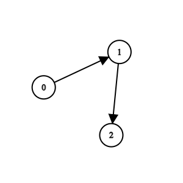
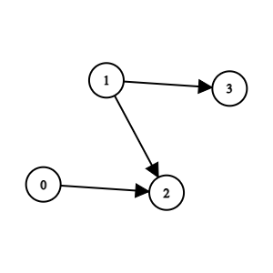

# 不在 edges[i][1] 中的唯一编号（Python/Java/C++/C/Go/JS/Rust）

> **[2924. 找到冠军 II](https://leetcode.cn/problems/find-champion-ii/solutions/2513144/bu-zai-edgesi1-zhong-de-wei-yi-bian-hao-44ur6/) · Medium**

> **题目描述**
> 一场比赛中共有 `n` 支队伍，按从 `0` 到  `n - 1` 编号。每支队伍也是 **有向无环图（DAG）** 上的一个节点。
>
> 给你一个整数 `n` 和一个下标从 **0** 开始、长度为 `m` 的二维整数数组 `edges` 表示这个有向无环图，其中 `edges[i] = [u_i, v_i]` 表示图中存在一条从 `u_i` 队到 `v_i` 队的有向边。
>
> 从 `a` 队到 `b` 队的有向边意味着 `a` 队比 `b` 队 **强** ，也就是 `b` 队比 `a` 队 **弱** 。
>
> 在这场比赛中，如果不存在某支强于 `a` 队的队伍，则认为 `a` 队将会是 **冠军** 。
>
> 如果这场比赛存在 **唯一** 一个冠军，则返回将会成为冠军的队伍。否则，返回 `-1` <em>。</em>
>
> **注意**
>
> - **环** 是形如 `a₁, a₂, ..., a_n, a_(n+1)` 的一个序列，且满足：节点 `a₁` 与节点 `a_(n+1)` 是同一个节点；节点 `a₁, a₂, ..., a_n` 互不相同；对于范围 `[1, n]` 中的每个 `i` ，均存在一条从节点 `a_i` 到节点 `a_(i+1)` 的有向边。
>
> - **有向无环图** 是不存在任何环的有向图。
>
> **示例 1：**
>
> 
>
> ```
>
> 输入：n = 3, edges = [[0,1],[1,2]]
> 输出：0
> 解释：1 队比 0 队弱。2 队比 1 队弱。所以冠军是 0 队。
> ```
>
> **示例 2：**
>
> 
>
> ```
>
> 输入：n = 4, edges = [[0,2],[1,3],[1,2]]
> 输出：-1
> 解释：2 队比 0 队和 1 队弱。3 队比 1 队弱。但是 1 队和 0 队之间不存在强弱对比。所以答案是 -1 。
> ```
>
> **提示：**
>
> - `1 <= n <= 100`
>
> - `m == edges.length`
>
> - `0 <= m <= n * (n - 1) / 2`
>
> - `edges[i].length == 2`
>
> - `0 <= edge[i][j] <= n - 1`
>
> - `edges[i][0] != edges[i][1]`
>
> - 生成的输入满足：如果 `a` 队比 `b` 队强，就不存在 `b` 队比 `a` 队强
>
> - 生成的输入满足：如果 `a` 队比 `b` 队强，`b` 队比 `c` 队强，那么 `a` 队比 `c` 队强

> **题解**
> 标记所有 $\textit{edges}[i][1]$，这些队伍都不是冠军。
>
> 然后遍历每个节点 $i$，如果恰好有一个 $i$ 没有被标记，说明没有可以击败 $i$ 的队伍，$i$ 队是冠军。否则返回 $-1$。
>
> 附：[视频讲解](https://www.bilibili.com/video/BV1Fc411R7xA/) 第二题。
>
> ```python
> class Solution:
>     def findChampion(self, n: int, edges: List[List[int]]) -> int:
>         is_weak = [False] * n
>         for _, y in edges:
>             is_weak[y] = True  # 不是冠军
>
>         ans = -1
>         for i, weak in enumerate(is_weak):
>             if weak:
>                 continue
>             if ans != -1:
>                 return -1  # 冠军只能有一个
>             ans = i
>         return ans
> ```
>
>
> #### 复杂度分析
>
> - 时间复杂度：$\mathcal{O}(n+m)$，其中 $m$ 为 $\textit{edges}$ 的长度。
> - 空间复杂度：$\mathcal{O}(n)$。
>
> ## 分类题单
>
> 1. [滑动窗口（定长/不定长/多指针）](https://leetcode.cn/circle/discuss/0viNMK/)
> 2. [二分算法（二分答案/最小化最大值/最大化最小值/第K小）](https://leetcode.cn/circle/discuss/SqopEo/)
> 3. [单调栈（矩形系列/字典序最小/贡献法）](https://leetcode.cn/circle/discuss/9oZFK9/)
> 4. [网格图（DFS/BFS/综合应用）](https://leetcode.cn/circle/discuss/YiXPXW/)
> 5. [位运算（基础/性质/拆位/试填/恒等式/贪心/脑筋急转弯）](https://leetcode.cn/circle/discuss/dHn9Vk/)
> 6. [图论算法（DFS/BFS/拓扑排序/最短路/最小生成树/二分图/基环树/欧拉路径）](https://leetcode.cn/circle/discuss/01LUak/)
> 7. [动态规划（入门/背包/状态机/划分/区间/状压/数位/数据结构优化/树形/博弈/概率期望）](https://leetcode.cn/circle/discuss/tXLS3i/)
>
> 更多题单，点我个人主页 - 讨论发布。
>
> 欢迎关注 [B站@灵茶山艾府](https://space.bilibili.com/206214)
>
> [往期题解精选（已分类）](https://github.com/EndlessCheng/codeforces-go/blob/master/leetcode/SOLUTIONS.md)
