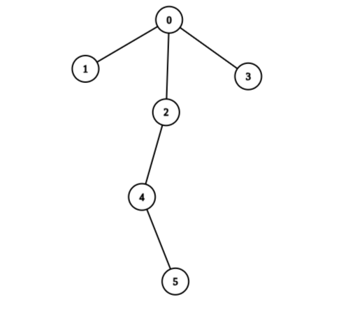
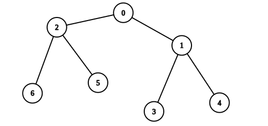

# 2925. 在树上执行操作以后得到的最大分数

Medium · 难度分 1940 · [力扣原题](https://leetcode.cn/problems/maximum-score-after-applying-operations-on-a-tree/)

所在刷题路径：灵神题单·动态规划

| 作者 | 题解 | 动画讲解 |
|---|---|---|
| 灵茶山艾府 | [📄 题解](灵茶山艾府.md) | [▶︎ 动画（GIF）](2925%20在树上执行操作以后得到的最大分数%20·%20灵茶山艾府.gif) · [mp4 文件](2925%20在树上执行操作以后得到的最大分数%20·%20灵茶山艾府.mp4) |
| yiduobo | [📄 题解](yiduobo.md) | [▶︎ 动画（GIF）](2925%20在树上执行操作以后得到的最大分数%20·%20yiduobo.gif) · [mp4 文件](2925%20在树上执行操作以后得到的最大分数%20·%20yiduobo.mp4) |

## 动画讲解

> 动图会循环播放；想暂停、拖进度条请下载上面表格里的 mp4 文件。

### 灵茶山艾府


### yiduobo


## 题目描述

有一棵 `n` 个节点的无向树，节点编号为 0 到 `n - 1` ，根节点编号为 0 。给你一个长度为 `n - 1` 的二维整数数组 `edges` 表示这棵树，其中 `edges[i] = [a_i, b_i]` 表示树中节点 `a_i` 和 `b_i` 有一条边。

同时给你一个长度为 `n` 下标从 **0** 开始的整数数组 `values` ，其中 `values[i]` 表示第 `i` 个节点的值。

一开始你的分数为 0。在一次操作中，你选择一个节点 `i`，将 `values[i]` 的值 **加** 到你的得分上，然后将 `values[i]` **设置** 为 0。这三个步骤作为一个单一操作同时发生。

如果从根节点出发，到 **任意** 叶子节点经过的路径上的节点值之和都 **不等于** 0 ，那么我们称这棵树是 **健康的** 。

你可以对这棵树执行任意次操作，但要求执行完所有操作以后树是 **健康的** ，请你返回你可以获得的 **最大分数** 。

**示例 1：**



```

输入：edges = [[0,1],[0,2],[0,3],[2,4],[4,5]], values = [5,2,5,2,1,1]
输出：11
解释：我们对节点 1、2、3、4 和 5 进行操作，因此值变为 [5,0,0,0,0,0]。叶子节点是节点 1、3 和 5。
- 从 0 到 1 的路径上值的总和等于 5。
- 从 0 到 3 的路径上值的总和等于 5。
- 从 0 到 5 的路径上值的总和等于 5。
每个叶子节点都有非零的路径和，所以树是健康的。得分是所选节点的原始值的总和：2 + 5 + 2 + 1 + 1 = 11。
可以证明 11 是通过在树上执行任何数量的操作所能获得的最大分数。
```

**示例 2：**



```

输入：edges = [[0,1],[0,2],[1,3],[1,4],[2,5],[2,6]], values = [20,10,9,7,4,3,5]
输出：40
解释：我们对节点 0、2、3 和 4 进行操作，因此值变为 [0,10,0,0,0,3,5]。叶子节点是节点 3、4、5 和 6。
- 从 0 到 3 的路径上值的总和等于 10。
- 从 0 到 4 的路径上值的总和等于 10。
- 从 0 到 5 的路径上值的总和等于 3。
- 从 0 到 6 的路径上值的总和等于 5。
每个叶子节点都有非零的路径和，所以树是健康的。得分是所选节点原始值的总和：20 + 9 + 7 + 4 = 40。
可以证明 40 是通过在树上执行任何数量的操作所能获得的最高分数。
```

**提示：**

- `2 <= n <= 2 * 10⁴`

- `edges.length == n - 1`

- `edges[i].length == 2`

- `0 <= a_i, b_i < n`

- `values.length == n`

- `1 <= values[i] <= 10⁹`

- 输入保证 `edges` 构成一棵合法的树。

---
[↑ 返回 2900-2999](../README.md) · [总索引](../../../索引.md) · [仓库首页](../../../README.md)
