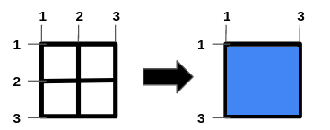
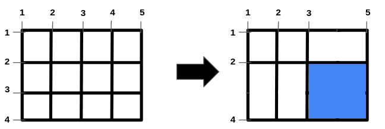

# 不排序，线性时间复杂度（Python/Java/C++/Go）

> **[2943. 最大化网格图中正方形空洞的面积](https://leetcode.cn/problems/maximize-area-of-square-hole-in-grid/solutions/2542812/heng-shu-fen-bie-tong-ji-fen-zu-xun-huan-nboj/) · Medium**

> **题目描述**
> 给你两个整数 `n` 和 `m`，以及两个整数数组 `hBars` 和 `vBars`。网格由 `n + 2` 条水平线和 `m + 2` 条竖直线组成，形成 1x1 的单元格。网格中的线条从 `1` 开始编号。
>
> 你可以从 `hBars` 中 **删除** 一些水平线条，并从 `vBars` 中删除一些竖直线条。注意，其他线条是固定的，无法删除。
>
> 返回一个整数表示移除一些线条（可以不移除任何线条）后，网格中 **正方形空洞的最大面积** 。
>
> **示例 1：**
>
> 
>
> **输入:** `n = 2, m = 1, hBars = [2,3], vBars = [2]`
>
> **输出:** `4`
>
> **解释:**
>
> 左侧图片展示了网格的初始状态。水平线是 `[1,2,3,4]`，竖直线是 `[1,2,3]`。
>
> 构造最大正方形空洞的一种方法是移除水平线 2 和竖直线 2。
>
> **示例 2：**
>
> 
>
> **输入:** `n = 1, m = 1, hBars = [2], vBars = [2]`
>
> **输出:** `4`
>
> **解释:**
>
> 移除水平线 2 和竖直线 2，可以得到最大正方形空洞。
>
> **示例 3：**
>
> 
>
> **输入:** `n = 2, m = 3, hBars = [2,3], vBars = [2,4]`
>
> **输出:** `4`
>
> **解释:**
>
> 构造最大正方形空洞的一种方法是移除水平线 3 和竖直线 4。
>
> **提示：**
>
> - `1 <= n <= 10⁹`
>
> - `1 <= m <= 10⁹`
>
> - `1 <= hBars.length <= 100`
>
> - `2 <= hBars[i] <= n + 1`
>
> - `1 <= vBars.length <= 100`
>
> - `2 <= vBars[i] <= m + 1`
>
> - `hBars` 中所有值互不相同。
>
> - `vBars` 中所有值互不相同。

> **题解**
> 阅读理解题，难度在读题上。
>
> 贪心地，删的线段越多，面积越大，那就先把所有能删的线段都删掉，计算最大的矩形，长宽分别是多少。
>
> 取长宽的最小值，即为正方形的边长（多删的线段撤销删除）。
>
> 以 $\textit{hBars}$ 为例：
>
> - 不删，最长长度是 $1$。
> - 删除一条线段，最长长度是 $2$。
> - 删除两条编号相邻的线段，最长长度是 $3$。
> - 删除三条编号连续的线段（例如 $2,3,4$），最长长度是 $4$。
> - 依此类推。
>
> 所以本题要做的是，把数组排序后，求**最长连续递增子数组的长度**加一。
>
> 正方形的边长是长宽的最小值，其平方即为正方形的面积。
>
> ## 优化前
>
> ```python
> class Solution:
>     # 返回 a 排序后的最长连续递增子数组的长度
>     def f(self, a: List[int]) -> int:
>         a.sort()
>         mx = cnt = 0
>         for i, x in enumerate(a):
>             if i > 0 and x == a[i - 1] + 1:
>                 cnt += 1
>             else:
>                 cnt = 1  # 重新计数
>             mx = max(mx, cnt)
>         return mx
>
>     def maximizeSquareHoleArea(self, n: int, m: int, hBars: List[int], vBars: List[int]) -> int:
>         side = min(self.f(hBars), self.f(vBars)) + 1
>         return side * side
> ```
>
>
> #### 复杂度分析
>
> - 时间复杂度：$\mathcal{O}(h\log h+v\log v)$，其中 $h$ 为 $\textit{hBars}$ 的长度，$v$ 为 $\textit{vBars}$ 的长度。
> - 空间复杂度：$\mathcal{O}(1)$。忽略排序的栈开销。
>
> ## 优化
>
> 用 [128. 最长连续序列](https://leetcode.cn/problems/longest-consecutive-sequence/) 的技巧优化，见 [我的题解](../../0100-0199/0128%20最长连续序列/灵茶山艾府.md)。
>
> ```python
> class Solution:
>     # 128. 最长连续序列
>     def longestConsecutive(self, nums: List[int]) -> int:
>         st = set(nums)  # 把 nums 转成哈希集合
>         ans = 0
>         for x in st:  # 遍历哈希集合
>             if x - 1 in st:  # 如果 x 不是序列的起点，直接跳过
>                 continue
>             # x 是序列的起点
>             y = x + 1
>             while y in st:  # 不断查找下一个数是否在哈希集合中
>                 y += 1
>             # 循环结束后，y-1 是最后一个在哈希集合中的数
>             ans = max(ans, y - x)  # 从 x 到 y-1 一共 y-x 个数
>         return ans
>
>     def maximizeSquareHoleArea(self, n: int, m: int, hBars: List[int], vBars: List[int]) -> int:
>         side = min(self.longestConsecutive(hBars), self.longestConsecutive(vBars)) + 1
>         return side * side
> ```
>
>
> #### 复杂度分析
>
> - 时间复杂度：$\mathcal{O}(h+v)$，其中 $h$ 为 $\textit{hBars}$ 的长度，$v$ 为 $\textit{vBars}$ 的长度。
> - 空间复杂度：$\mathcal{O}(h+v)$。
>
> ## 相似题目
>
> - [1465. 切割后面积最大的蛋糕](https://leetcode.cn/problems/maximum-area-of-a-piece-of-cake-after-horizontal-and-vertical-cuts/)
> - [2975. 移除栅栏得到的正方形田地的最大面积](https://leetcode.cn/problems/maximum-square-area-by-removing-fences-from-a-field/)
>
> ## 分类题单
>
> [如何科学刷题？](https://leetcode.cn/circle/discuss/RvFUtj/)
>
> 1. [滑动窗口与双指针（定长/不定长/单序列/双序列/三指针/分组循环）](https://leetcode.cn/circle/discuss/0viNMK/)
> 2. [二分算法（二分答案/最小化最大值/最大化最小值/第K小）](https://leetcode.cn/circle/discuss/SqopEo/)
> 3. [单调栈（基础/矩形面积/贡献法/最小字典序）](https://leetcode.cn/circle/discuss/9oZFK9/)
> 4. [网格图（DFS/BFS/综合应用）](https://leetcode.cn/circle/discuss/YiXPXW/)
> 5. [位运算（基础/性质/拆位/试填/恒等式/思维）](https://leetcode.cn/circle/discuss/dHn9Vk/)
> 6. [图论算法（DFS/BFS/拓扑排序/基环树/最短路/最小生成树/网络流）](https://leetcode.cn/circle/discuss/01LUak/)
> 7. [动态规划（入门/背包/划分/状态机/区间/状压/数位/数据结构优化/树形/博弈/概率期望）](https://leetcode.cn/circle/discuss/tXLS3i/)
> 8. [常用数据结构（前缀和/差分/栈/队列/堆/字典树/并查集/树状数组/线段树）](https://leetcode.cn/circle/discuss/mOr1u6/)
> 9. [数学算法（数论/组合/概率期望/博弈/计算几何/随机算法）](https://leetcode.cn/circle/discuss/IYT3ss/)
> 10. [贪心与思维（基本贪心策略/反悔/区间/字典序/数学/思维/脑筋急转弯/构造）](https://leetcode.cn/circle/discuss/g6KTKL/)
> 11. [链表、树与回溯（前后指针/快慢指针/DFS/BFS/直径/LCA）](https://leetcode.cn/circle/discuss/K0n2gO/)
> 12. [字符串（KMP/Z函数/Manacher/字符串哈希/AC自动机/后缀数组/子序列自动机）](https://leetcode.cn/circle/discuss/SJFwQI/)
>
> [我的题解精选（已分类）](https://github.com/EndlessCheng/codeforces-go/blob/master/leetcode/SOLUTIONS.md)
>
> 欢迎关注 [B站@灵茶山艾府](https://space.bilibili.com/206214)
