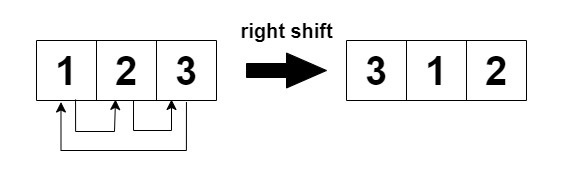
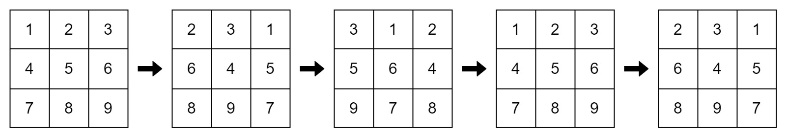

# 2946. 循环移位后的矩阵相似检查

Easy · 难度分 1406 · [力扣原题](https://leetcode.cn/problems/matrix-similarity-after-cyclic-shifts/)

所在刷题路径：灵神题单·贪心与思维

| 作者 | 题解 | 动画讲解 |
|---|---|---|
| 灵茶山艾府 | [📄 题解](灵茶山艾府.md) | [▶︎ 动画（GIF）](2946%20循环移位后的矩阵相似检查%20·%20灵茶山艾府.gif) · [mp4 文件](2946%20循环移位后的矩阵相似检查%20·%20灵茶山艾府.mp4) |
| yiduobo | [📄 题解](yiduobo.md) | [▶︎ 动画（GIF）](2946%20循环移位后的矩阵相似检查%20·%20yiduobo.gif) · [mp4 文件](2946%20循环移位后的矩阵相似检查%20·%20yiduobo.mp4) |

## 动画讲解

> 动图会循环播放；想暂停、拖进度条请下载上面表格里的 mp4 文件。

### 灵茶山艾府

### yiduobo

## 题目描述

给你一个**下标从 0 开始**且大小为 `m x n` 的整数矩阵 `mat` 和一个整数 `k` 。矩阵行的下标是从 0 开始的。

进行下面操作 `k` 次：

- **偶数行**（0, 2, 4, ...）循环向左移动。

- **奇数行**（1, 3, 5, ...）循环向右移动。

如果经过 `k` 步后的最终修改矩阵与原始矩阵相同，则返回 `true`，否则返回 `false`。

**示例 1：**

**输入：**`mat = [[1,2,3],[4,5,6],[7,8,9]], k = 4`

**输出：**`false`

**解释：**

在每一步中，行 0 和行 2（偶数下标）进行左移，行 1（奇数下标）进行右移。

**示例 2：**

**输入：**`mat = [[1,2,1,2],[5,5,5,5],[6,3,6,3]], k = 2`

**输出：**`true`

**解释：**

**示例 3：**

**输入：**`mat = [[2,2],[2,2]], k = 3`

**输出：**`true`

**解释：**

矩阵中的所有值都相等，即使进行循环移位，矩阵也会保持不变。

**提示：**

- `1 <= mat.length <= 25`

- `1 <= mat[i].length <= 25`

- `1 <= mat[i][j] <= 25`

- `1 <= k <= 50`

---
[↑ 返回 2900-2999](../README.md) · [总索引](../../../索引.md) · [仓库首页](../../../README.md)
