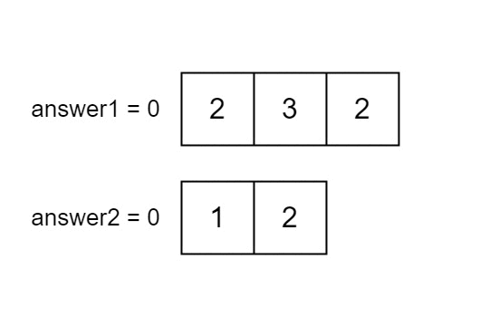

# 线性做法（Python/Java/C++/Go/JS/Rust）

> **[2956. 找到两个数组中的公共元素](https://leetcode.cn/problems/find-common-elements-between-two-arrays/solutions/2560724/xian-xing-zuo-fa-pythonjavacgo-by-endles-e04u/) · Easy**

> **题目描述**
> 给你两个下标从 **0** 开始的整数数组 `nums1` 和 `nums2` ，它们分别含有 `n` 和 `m` 个元素。请你计算以下两个数值：
>
> - `answer1`：使得 `nums1[i]` 在 `nums2` 中出现的下标 `i` 的数量。
>
> - `answer2`：使得 `nums2[i]` 在 `nums1` 中出现的下标 `i` 的数量。
>
> 返回 `[answer1, answer2]`。
>
> **示例 1：**
>
> **输入：**`nums1 = [2,3,2], nums2 = [1,2]`
>
> **输出：**`[2,1]`
>
> **解释：**
>
> 
>
> **示例 2：**
>
> **输入：**`nums1 = [4,3,2,3,1], nums2 = [2,2,5,2,3,6]`
>
> **输出：**`[3,4]`
>
> **解释：**
>
> `nums1` 中下标在 1，2，3 的元素在 `nums2` 中也存在。所以 `answer1` 为 3。
>
> `nums2` 中下标在 0，1，3，4 的元素在 `nums1` 中也存在。所以 `answer2` 为 4。
>
> **示例 3：**
>
> **输入：**`nums1 = [3,4,2,3], nums2 = [1,5]`
>
> **输出：**`[0,0]`
>
> **解释：**
>
> `nums1` 和 `nums2` 中没有相同的数字，所以答案是 [0,0]。
>
> **提示：**
>
> - `n == nums1.length`
>
> - `m == nums2.length`
>
> - `1 <= n, m <= 100`
>
> - `1 <= nums1[i], nums2[i] <= 100`

> **题解**
> 把数组转成哈希集合，就可以 $\mathcal{O}(1)$ 判断元素是否在数组中了。
>
> 1. 把 $\textit{nums}_1$ 中的元素加入哈希集合 $\textit{set}_1$ 中。
> 2. 把 $\textit{nums}_2$ 中的元素加入哈希集合 $\textit{set}_2$ 中。
> 3. 遍历 $\textit{nums}_1$，统计在 $\textit{set}_2$ 中的元素个数，即为 $\textit{answer}[0]$。
> 4. 遍历 $\textit{nums}_2$，统计在 $\textit{set}_1$ 中的元素个数，即为 $\textit{answer}[1]$。
>
> ```python
> class Solution:
>     def findIntersectionValues(self, nums1: List[int], nums2: List[int]) -> List[int]:
>         set1 = set(nums1)
>         set2 = set(nums2)
>         return [sum(x in set2 for x in nums1),
>                 sum(x in set1 for x in nums2)]
> ```
>
>
> #### 复杂度分析
>
> - 时间复杂度：$\mathcal{O}(n+m)$，其中 $n$ 为 $\textit{nums}_1$ 的长度，$m$ 为 $\textit{nums}_2$ 的长度。
> - 空间复杂度：$\mathcal{O}(n+m)$。
>
> ## 分类题单
>
> [如何科学刷题？](https://leetcode.cn/circle/discuss/RvFUtj/)
>
> 1. [滑动窗口（定长/不定长/多指针）](https://leetcode.cn/circle/discuss/0viNMK/)
> 2. [二分算法（二分答案/最小化最大值/最大化最小值/第K小）](https://leetcode.cn/circle/discuss/SqopEo/)
> 3. [单调栈（基础/矩形面积/贡献法/最小字典序）](https://leetcode.cn/circle/discuss/9oZFK9/)
> 4. [网格图（DFS/BFS/综合应用）](https://leetcode.cn/circle/discuss/YiXPXW/)
> 5. [位运算（基础/性质/拆位/试填/恒等式/思维）](https://leetcode.cn/circle/discuss/dHn9Vk/)
> 6. [图论算法（DFS/BFS/拓扑排序/最短路/最小生成树/二分图/基环树/欧拉路径）](https://leetcode.cn/circle/discuss/01LUak/)
> 7. [动态规划（入门/背包/状态机/划分/区间/状压/数位/数据结构优化/树形/博弈/概率期望）](https://leetcode.cn/circle/discuss/tXLS3i/)
> 8. [常用数据结构（前缀和/差分/栈/队列/堆/字典树/并查集/树状数组/线段树）](https://leetcode.cn/circle/discuss/mOr1u6/)
> 9. [数学算法（数论/组合/概率期望/博弈/计算几何/随机算法）](https://leetcode.cn/circle/discuss/IYT3ss/)
> 10. [贪心算法（基本贪心策略/反悔/区间/字典序/数学/思维/脑筋急转弯/构造）](https://leetcode.cn/circle/discuss/g6KTKL/)
>
> [我的题解精选（已分类）](https://github.com/EndlessCheng/codeforces-go/blob/master/leetcode/SOLUTIONS.md)
>
> 欢迎关注 [B站@灵茶山艾府](https://space.bilibili.com/206214)
