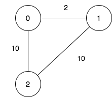
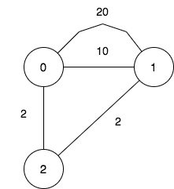

# 两种方法：二进制枚举 / 状压 DP（Python/Java/C++/Go）

> **[2959. 关闭分部的可行集合数目](https://leetcode.cn/problems/number-of-possible-sets-of-closing-branches/solutions/2560722/er-jin-zhi-mei-ju-floydgao-xiao-xie-fa-f-t7ou/) · Hard · 难度分 2077**

> **所属题单**
> - [链表、二叉树与回溯 · 四、回溯](../../../刷题路径/灵神原版题单/链表、二叉树与回溯/四、回溯.md) · §4.2 子集型回溯
> - [图论算法 · 三、最短路](../../../刷题路径/灵神原版题单/图论算法/三、最短路.md) · §3.2 全源最短路：Floyd 算法

> **题目描述**
> 一个公司在全国有 `n` 个分部，它们之间有的有道路连接。一开始，所有分部通过这些道路两两之间互相可以到达。
>
> 公司意识到在分部之间旅行花费了太多时间，所以它们决定关闭一些分部（**也可能不关闭任何分部**），同时保证剩下的分部之间两两互相可以到达且最远距离不超过 `maxDistance` 。
>
> 两个分部之间的 **距离** 是通过道路长度之和的 **最小值** 。
>
> 给你整数 `n` ，`maxDistance` 和下标从 **0** 开始的二维整数数组 `roads` ，其中 `roads[i] = [u_i, v_i, w_i]` 表示一条从 `u_i` 到 `v_i` 长度为 `w_i`的 **无向** 道路。
>
> 请你返回关闭分部的可行方案数目，满足每个方案里剩余分部之间的最远距离不超过 `maxDistance`。
>
> **注意**，关闭一个分部后，与之相连的所有道路不可通行。
>
> **注意**，两个分部之间可能会有多条道路。
>
> **示例 1：**
>
> 
>
> ```
>
> 输入：n = 3, maxDistance = 5, roads = [[0,1,2],[1,2,10],[0,2,10]]
> 输出：5
> 解释：可行的关闭分部方案有：
> - 关闭分部集合 [2] ，剩余分部为 [0,1] ，它们之间的距离为 2 。
> - 关闭分部集合 [0,1] ，剩余分部为 [2] 。
> - 关闭分部集合 [1,2] ，剩余分部为 [0] 。
> - 关闭分部集合 [0,2] ，剩余分部为 [1] 。
> - 关闭分部集合 [0,1,2] ，关闭后没有剩余分部。
> 总共有 5 种可行的关闭方案。
> ```
>
> **示例 2：**
>
> 
>
> ```
>
> 输入：n = 3, maxDistance = 5, roads = [[0,1,20],[0,1,10],[1,2,2],[0,2,2]]
> 输出：7
> 解释：可行的关闭分部方案有：
> - 关闭分部集合 [] ，剩余分部为 [0,1,2] ，它们之间的最远距离为 4 。
> - 关闭分部集合 [0] ，剩余分部为 [1,2] ，它们之间的距离为 2 。
> - 关闭分部集合 [1] ，剩余分部为 [0,2] ，它们之间的距离为 2 。
> - 关闭分部集合 [0,1] ，剩余分部为 [2] 。
> - 关闭分部集合 [1,2] ，剩余分部为 [0] 。
> - 关闭分部集合 [0,2] ，剩余分部为 [1] 。
> - 关闭分部集合 [0,1,2] ，关闭后没有剩余分部。
> 总共有 7 种可行的关闭方案。
> ```
>
> **示例 3：**
>
> ```
>
> 输入：n = 1, maxDistance = 10, roads = []
> 输出：2
> 解释：可行的关闭分部方案有：
> - 关闭分部集合 [] ，剩余分部为 [0] 。
> - 关闭分部集合 [0] ，关闭后没有剩余分部。
> 总共有 2 种可行的关闭方案。
> ```
>
> **提示：**
>
> - `1 <= n <= 10`
>
> - `1 <= maxDistance <= 10⁵`
>
> - `0 <= roads.length <= 1000`
>
> - `roads[i].length == 3`
>
> - `0 <= u_i, v_i <= n - 1`
>
> - `u_i != v_i`
>
> - `1 <= w_i <= 1000`
>
> - 一开始所有分部之间通过道路互相可以到达。

> **题解**
> ## 方法一：二进制枚举 + Floyd
>
> 根据 [从集合论到位运算](https://leetcode.cn/circle/discuss/CaOJ45/) 中「枚举集合」的技巧，枚举 $\{0,1,2,\cdots,n-1\}$ 的所有子集 $S$，作为保留的节点集合，关闭（删除）不在 $S$ 中的节点。
>
> 然后用[【模板讲解】带你发明 Floyd 算法：从记忆化搜索到递推](../../1300-1399/1334%20阈值距离内邻居最少的城市/灵茶山艾府.md) 求出任意两点之间的最短路。如果保留的节点之间的最短路均不超过 $\textit{maxDistance}$，则把答案加一。
>
> 代码实现时，可以先预处理原图的邻接矩阵 $g$，这样无需每次枚举子集都要遍历一次 $\textit{roads}$，直接拷贝一份 $g$ 中保留的节点即可。
>
> ```python
> class Solution:
>     def numberOfSets(self, n: int, maxDistance: int, roads: List[List[int]]) -> int:
>         g = [[inf] * n for _ in range(n)]
>         for x, y, wt in roads:
>             g[x][y] = min(g[x][y], wt)
>             g[y][x] = min(g[y][x], wt)
>
>         f = [None] * n
>         def check(s: int) -> int:
>             for i, row in enumerate(g):
>                 if s >> i & 1:  # i 在集合 s 中
>                     f[i] = row.copy()
>
>             # Floyd 算法（只考虑在 s 中的节点）
>             for k in range(n):
>                 if (s >> k & 1) == 0:  # k 不在集合 s 中
>                     continue
>                 for i in range(n):
>                     if (s >> i & 1) == 0 or f[i][k] == inf:
>                         continue
>                     for j in range(n):
>                         f[i][j] = min(f[i][j], f[i][k] + f[k][j])
>
>             # 判断保留的节点之间的最短路是否均不超过 maxDistance
>             for i, di in enumerate(f):
>                 if (s >> i & 1) == 0:  # i 不在集合 s 中
>                     continue
>                 for j, dij in enumerate(di[:i]):
>                     if s >> j & 1 and dij > maxDistance:
>                         return 0
>             return 1
>
>         # 枚举子集 s，作为保留的节点，判断这些节点否满足要求
>         return sum(check(s) for s in range(1 << n))
> ```
>
>
> #### 复杂度分析
>
> - 时间复杂度：$\mathcal{O}(m + n^3\cdot 2^n)$，其中 $m$ 为 $\textit{roads}$ 的长度。
> - 空间复杂度：$\mathcal{O}(n^2)$。
>
> ## 方法二：状压 DP + Floyd
>
> 请先阅读：[【模板讲解】带你发明 Floyd 算法：从记忆化搜索到递推](../../1300-1399/1334%20阈值距离内邻居最少的城市/灵茶山艾府.md)
>
> 在三维 Floyd DP 的基础上加以修改。
>
> 原来的定义是：$f[k][i][j]$ 表示从 $i$ 到 $j$ 的最短路长度，并且这条最短路的**中间节点**编号都 $\le k$。
>
> 为了方便在子集之间转移，把定义改成：$f[S][i][j]$ 表示从 $i$ 到 $j$ 的最短路长度，并且这条最短路的**中间节点**编号在集合 $S$ 中。
>
> 假设现在计算出了 $T=\{0,1,3\}$ 的 $f[T]$，现在要计算 $S=\{0,1,2,3\}$ 的 $f[S]$，我们可以在 $T$ 的基础上，添加节点 $k=2$，考虑节点 $k=2$ 带来的影响：
>
> - 不影响 $i$ 到 $j$ 的最短路：$f[S][i][j] = f[T][i][j]$；
> - 影响 $i$ 到 $j$ 的最短路，也就是从 $i$ 到 $k$ 再到 $j$ 更短：$[S][i][j] = f[T][i][k] + f[T][k][j]$。 
>
> 二者取最小值，得
>
> $$
> f[S][i][j] = \min(f[T][i][j], f[T][i][k] + f[T][k][j])
> $$
>
> 初始值和原来的 Floyd 算法一样：$f[\varnothing][i][j] = g[i][j]$，也就是 $\textit{roads}$ 中的 $i$ 到 $j$ 这条边的长度。
>
> > 上述方法意味着，我们只需要 $\mathcal{O}(n^2)$ 的时间，就可以「增量地」算出一个集合任意点对的最短路，而不是方法一中的 $\mathcal{O}(n^3)$。
>
> ⚠注意：该计算过程不需要保证 $i$ 和 $j$ 都是 $S$ 中的元素，$S$ 只是中间节点的编号集合，不是保留的编号集合。但是，设 $i$ 和 $j$ 都是 $S$ 中的元素，从点 $i$ 到点 $j$，在只经过 $S$ 中的节点的情况下，最短路长度就是 $f[S][i][j]$。所以在「$i$ 和 $j$ 都是 $S$ 中的元素」的前提下，$S$ 也可以作为当前保留的节点集合，$f[S][i][j]$ 可以用来与 $\textit{maxDistance}$ 比大小。
>
> 代码实现时，节点 $k$ 可以是 $S$ 中的任一元素（比如最小元素或最大元素）。
>
> ```python
> class Solution:
>     def numberOfSets(self, n: int, maxDistance: int, roads: List[List[int]]) -> int:
>         g = [[inf] * n for _ in range(n)]
>         for x, y, wt in roads:
>             g[x][y] = min(g[x][y], wt)
>             g[y][x] = min(g[y][x], wt)
>
>         ans = 1  # s=0 一定满足要求
>         f = [[[inf] * n for _ in range(n)] for _ in range(1 << n)]
>         f[0] = g
>         for s in range(1, 1 << n):
>             k = s.bit_length() - 1
>             t = s ^ (1 << k)
>             ok = 1
>             for i in range(n):
>                 for j in range(n):
>                     f[s][i][j] = min(f[t][i][j], f[t][i][k] + f[t][k][j])  # 手动求 min 可以更快
>                     if ok and j < i and s >> i & 1 and s >> j & 1 and f[s][i][j] > maxDistance:
>                         ok = 0
>             ans += ok
>         return ans
> ```
>
>
> #### 复杂度分析
>
> - 时间复杂度：$\mathcal{O}(m + n^2\cdot 2^n)$，其中 $m$ 为 $\textit{roads}$ 的长度。
> - 空间复杂度：$\mathcal{O}(n^2\cdot 2^n)$。
>
> ## 同类题目
>
> #### Floyd
>
> - [2642. 设计可以求最短路径的图类](https://leetcode.cn/problems/design-graph-with-shortest-path-calculator/) 1811
> - [1334. 阈值距离内邻居最少的城市](https://leetcode.cn/problems/find-the-city-with-the-smallest-number-of-neighbors-at-a-threshold-distance/) 1855
> - [2976. 转换字符串的最小成本 I](https://leetcode.cn/problems/minimum-cost-to-convert-string-i/) 1882
> - [2977. 转换字符串的最小成本 II](https://leetcode.cn/problems/minimum-cost-to-convert-string-ii/) 2696
>
> #### 二进制枚举
>
> - [78. 子集](https://leetcode.cn/problems/subsets/)
> - [77. 组合](https://leetcode.cn/problems/combinations/)
> - [1286. 字母组合迭代器](https://leetcode.cn/problems/iterator-for-combination/) 1591
> - [2397. 被列覆盖的最多行数](https://leetcode.cn/problems/maximum-rows-covered-by-columns/) 1719
> - [2212. 射箭比赛中的最大得分](https://leetcode.cn/problems/maximum-points-in-an-archery-competition/) 1869
> - [2151. 基于陈述统计最多好人数](https://leetcode.cn/problems/maximum-good-people-based-on-statements/) 1980
> - [1601. 最多可达成的换楼请求数目](https://leetcode.cn/problems/maximum-number-of-achievable-transfer-requests/) 2119
> - [1617. 统计子树中城市之间最大距离](https://leetcode.cn/problems/count-subtrees-with-max-distance-between-cities/) 2309
> - [320. 列举单词的全部缩写](https://leetcode.cn/problems/generalized-abbreviation/)（会员题）
>
> ## 分类题单
>
> [如何科学刷题？](https://leetcode.cn/circle/discuss/RvFUtj/)
>
> 1. [滑动窗口（定长/不定长/多指针）](https://leetcode.cn/circle/discuss/0viNMK/)
> 2. [二分算法（二分答案/最小化最大值/最大化最小值/第K小）](https://leetcode.cn/circle/discuss/SqopEo/)
> 3. [单调栈（基础/矩形面积/贡献法/最小字典序）](https://leetcode.cn/circle/discuss/9oZFK9/)
> 4. [网格图（DFS/BFS/综合应用）](https://leetcode.cn/circle/discuss/YiXPXW/)
> 5. [位运算（基础/性质/拆位/试填/恒等式/思维）](https://leetcode.cn/circle/discuss/dHn9Vk/)
> 6. [图论算法（DFS/BFS/拓扑排序/最短路/最小生成树/二分图/基环树/欧拉路径）](https://leetcode.cn/circle/discuss/01LUak/)
> 7. [动态规划（入门/背包/状态机/划分/区间/状压/数位/数据结构优化/树形/博弈/概率期望）](https://leetcode.cn/circle/discuss/tXLS3i/)
> 8. [常用数据结构（前缀和/差分/栈/队列/堆/字典树/并查集/树状数组/线段树）](https://leetcode.cn/circle/discuss/mOr1u6/)
> 9. [数学算法（数论/组合/概率期望/博弈/计算几何/随机算法）](https://leetcode.cn/circle/discuss/IYT3ss/)
> 10. [贪心算法（基本贪心策略/反悔/区间/字典序/数学/思维/脑筋急转弯/构造）](https://leetcode.cn/circle/discuss/g6KTKL/)
>
> [我的题解精选（已分类）](https://github.com/EndlessCheng/codeforces-go/blob/master/leetcode/SOLUTIONS.md)
>
> 欢迎关注 [B站@灵茶山艾府](https://space.bilibili.com/206214)
