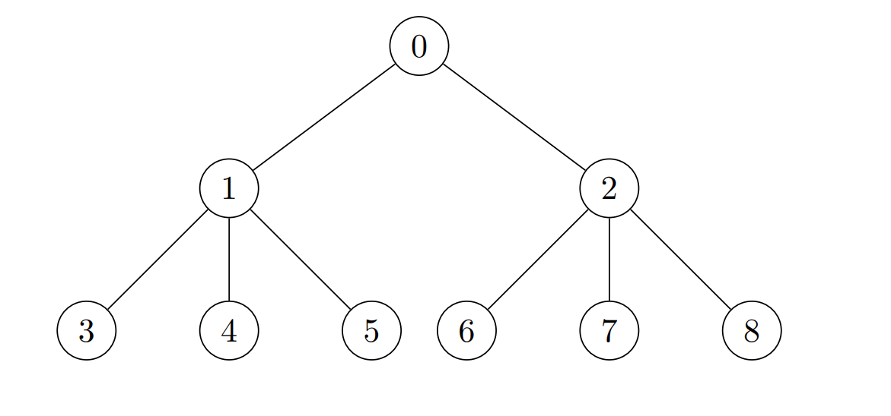
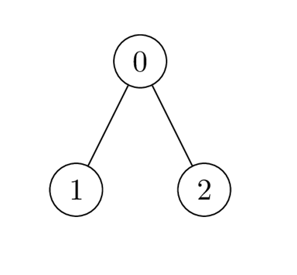

# 贪心（Python/Java/C++/Go）

> **[2973. 树中每个节点放置的金币数目](https://leetcode.cn/problems/find-number-of-coins-to-place-in-tree-nodes/solutions/2577675/tan-xin-pythonjavacgo-by-endlesscheng-j58c/) · Hard · 难度分 2277**

> **所属题单**
> - [链表、二叉树与回溯 · 三、一般树](../../../刷题路径/灵神原版题单/链表、二叉树与回溯/三、一般树.md) · §3.3 自底向上 DFS

> **题目描述**
> 给你一棵 `n` 个节点的 **无向** 树，节点编号为 `0` 到 `n - 1` ，树的根节点在节点 `0` 处。同时给你一个长度为 `n - 1` 的二维整数数组 `edges` ，其中 `edges[i] = [a_i, b_i]` 表示树中节点 `a_i` 和 `b_i` 之间有一条边。
>
> 给你一个长度为 `n` 下标从 **0** 开始的整数数组 `cost` ，其中 `cost[i]` 是第 `i` 个节点的 **开销** 。
>
> 你需要在树中每个节点都放置金币，在节点 `i` 处的金币数目计算方法如下：
>
> - 如果节点 `i` 对应的子树中的节点数目小于 `3` ，那么放 `1` 个金币。
>
> - 否则，计算节点 `i` 对应的子树内 `3` 个不同节点的开销乘积的 **最大值** ，并在节点 `i` 处放置对应数目的金币。如果最大乘积是 **负数** ，那么放置 `0` 个金币。
>
> 请你返回一个长度为 `n` 的数组 `coin` ，`coin[i]`是节点 `i` 处的金币数目。
>
> **示例 1：**
>
> 
>
> ```
>
> 输入：edges = [[0,1],[0,2],[0,3],[0,4],[0,5]], cost = [1,2,3,4,5,6]
> 输出：[120,1,1,1,1,1]
> 解释：在节点 0 处放置 6 * 5 * 4 = 120 个金币。所有其他节点都是叶子节点，子树中只有 1 个节点，所以其他每个节点都放 1 个金币。
> ```
>
> **示例 2：**
>
> 
>
> ```
>
> 输入：edges = [[0,1],[0,2],[1,3],[1,4],[1,5],[2,6],[2,7],[2,8]], cost = [1,4,2,3,5,7,8,-4,2]
> 输出：[280,140,32,1,1,1,1,1,1]
> 解释：每个节点放置的金币数分别为：
> - 节点 0 处放置 8 * 7 * 5 = 280 个金币。
> - 节点 1 处放置 7 * 5 * 4 = 140 个金币。
> - 节点 2 处放置 8 * 2 * 2 = 32 个金币。
> - 其他节点都是叶子节点，子树内节点数目为 1 ，所以其他每个节点都放 1 个金币。
> ```
>
> **示例 3：**
>
> 
>
> ```
>
> 输入：edges = [[0,1],[0,2]], cost = [1,2,-2]
> 输出：[0,1,1]
> 解释：节点 1 和 2 都是叶子节点，子树内节点数目为 1 ，各放置 1 个金币。节点 0 处唯一的开销乘积是 2 * 1 * -2 = -4 。所以在节点 0 处放置 0 个金币。
> ```
>
> **提示：**
>
> - `2 <= n <= 2 * 10⁴`
>
> - `edges.length == n - 1`
>
> - `edges[i].length == 2`
>
> - `0 <= a_i, b_i < n`
>
> - `cost.length == n`
>
> - `1 <= |cost[i]| <= 10⁴`
>
> - `edges` 一定是一棵合法的树。

> **题解**
> [本题视频讲解](https://www.bilibili.com/video/BV1jg4y1y7PA/)
>
> 首先来看如下问题：
>
> 给你一个长度 $\ge 3$ 的数组，返回**三数之积**的最大值，如果最大值是负数，返回 $0$。
>
> - 如果只考虑正数，显然最大的三个数的乘积是最大的。
> - 如果把负数也考虑进来，那么最小的两个负数乘最大的正数也可能是最大值。
>
> 这两种情况再和 $0$ 取最大值，即为返回值。
>
> 由上述讨论可知，只需要知道 $5$ 个数，就能算出三数之积的最大值。每棵子树只需要返回它最小的 $2$ 个 $\textit{cost}$ 值和最大的 $3$ 个 $\textit{cost}$ 值就行，其余数字可以舍弃。
>
> 对于一棵子树，把它的所有儿子子树的返回值与当前节点的 $\textit{cost}$ 值排序后，按照三数之积的方法，就得到了当前节点的答案。
>
> ```python
> class Solution:
>     def placedCoins(self, edges: List[List[int]], cost: List[int]) -> List[int]:
>         n = len(cost)
>         g = [[] for _ in range(n)]
>         for x, y in edges:
>             g[x].append(y)
>             g[y].append(x)
>
>         ans = [1] * n
>         def dfs(x: int, fa: int) -> List[int]:
>             a = [cost[x]]
>             for y in g[x]:
>                 if y != fa:
>                     a.extend(dfs(y, x))
>             a.sort()
>             m = len(a)
>             if m >= 3:
>                 ans[x] = max(a[-3] * a[-2] * a[-1], a[0] * a[1] * a[-1], 0)
>             if m > 5:
>                 a = a[:2] + a[-3:]
>             return a
>         dfs(0, -1)
>         return ans
> ```
>
>
> #### 复杂度分析
>
> - 时间复杂度：$\mathcal{O}(n\log n)$，其中 $n$ 为 $\textit{nums}$ 的长度。瓶颈在排序上，如果手动维护最小的两个数和最大的三个数可以做到 $\mathcal{O}(n)$。
> - 空间复杂度：$\mathcal{O}(n)$。
>
> ## 分类题单
>
> [如何科学刷题？](https://leetcode.cn/circle/discuss/RvFUtj/)
>
> 1. [滑动窗口（定长/不定长/多指针）](https://leetcode.cn/circle/discuss/0viNMK/)
> 2. [二分算法（二分答案/最小化最大值/最大化最小值/第K小）](https://leetcode.cn/circle/discuss/SqopEo/)
> 3. [单调栈（基础/矩形面积/贡献法/最小字典序）](https://leetcode.cn/circle/discuss/9oZFK9/)
> 4. [网格图（DFS/BFS/综合应用）](https://leetcode.cn/circle/discuss/YiXPXW/)
> 5. [位运算（基础/性质/拆位/试填/恒等式/思维）](https://leetcode.cn/circle/discuss/dHn9Vk/)
> 6. [图论算法（DFS/BFS/拓扑排序/最短路/最小生成树/二分图/基环树/欧拉路径）](https://leetcode.cn/circle/discuss/01LUak/)
> 7. [动态规划（入门/背包/状态机/划分/区间/状压/数位/数据结构优化/树形/博弈/概率期望）](https://leetcode.cn/circle/discuss/tXLS3i/)
> 8. [常用数据结构（前缀和/差分/栈/队列/堆/字典树/并查集/树状数组/线段树）](https://leetcode.cn/circle/discuss/mOr1u6/)
> 9. [数学算法（数论/组合/概率期望/博弈/计算几何/随机算法）](https://leetcode.cn/circle/discuss/IYT3ss/)
> 10. [贪心算法（基本贪心策略/反悔/区间/字典序/数学/思维/脑筋急转弯/构造）](https://leetcode.cn/circle/discuss/g6KTKL/)
>
> [我的题解精选（已分类）](https://github.com/EndlessCheng/codeforces-go/blob/master/leetcode/SOLUTIONS.md)
>
> 欢迎关注 [B站@灵茶山艾府](https://space.bilibili.com/206214)
