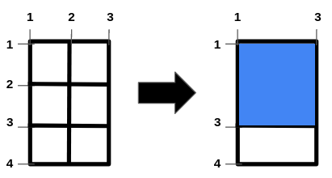
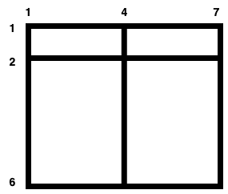

# 2975. 移除栅栏得到的正方形田地的最大面积

Medium · [力扣原题](https://leetcode.cn/problems/maximum-square-area-by-removing-fences-from-a-field/)

| 作者 | 题解 | 动画讲解 |
|---|---|---|
| 灵茶山艾府 | [📄 题解](灵茶山艾府.md) | [▶︎ 动画（GIF）](2975%20移除栅栏得到的正方形田地的最大面积%20·%20灵茶山艾府.gif) · [mp4 文件](2975%20移除栅栏得到的正方形田地的最大面积%20·%20灵茶山艾府.mp4) |
| yiduobo | [📄 题解](yiduobo.md) | [▶︎ 动画（GIF）](2975%20移除栅栏得到的正方形田地的最大面积%20·%20yiduobo.gif) · [mp4 文件](2975%20移除栅栏得到的正方形田地的最大面积%20·%20yiduobo.mp4) |

## 动画讲解

> 动图会循环播放；想暂停、拖进度条请下载上面表格里的 mp4 文件。

### 灵茶山艾府


### yiduobo


## 题目描述

有一个大型的 `(m - 1) x (n - 1)` 矩形田地，其两个对角分别是 `(1, 1)` 和 `(m, n)` ，田地内部有一些水平栅栏和垂直栅栏，分别由数组 `hFences` 和 `vFences` 给出。

水平栅栏为坐标 `(hFences[i], 1)` 到 `(hFences[i], n)`，垂直栅栏为坐标 `(1, vFences[i])` 到 `(m, vFences[i])` 。

返回通过 **移除** 一些栅栏（**可能不移除**）所能形成的最大面积的 **正方形** 田地的面积，或者如果无法形成正方形田地则返回 `-1`。

由于答案可能很大，所以请返回结果对 `10⁹ + 7` **取余** 后的值。

**注意：**田地外围两个水平栅栏（坐标 `(1, 1)` 到 `(1, n)` 和坐标 `(m, 1)` 到 `(m, n)` ）以及两个垂直栅栏（坐标 `(1, 1)` 到 `(m, 1)` 和坐标 `(1, n)` 到 `(m, n)` ）所包围。这些栅栏 **不能** 被移除。

**示例 1：**



```

输入：m = 4, n = 3, hFences = [2,3], vFences = [2]
输出：4
解释：移除位于 2 的水平栅栏和位于 2 的垂直栅栏将得到一个面积为 4 的正方形田地。
```

**示例 2：**



```

输入：m = 6, n = 7, hFences = [2], vFences = [4]
输出：-1
解释：可以证明无法通过移除栅栏形成正方形田地。
```

**提示：**

- `3 <= m, n <= 10⁹`

- `1 <= hFences.length, vFences.length <= 600`

- `1 < hFences[i] < m`

- `1 < vFences[i] < n`

- `hFences` 和 `vFences` 中的元素是唯一的。

---
[↑ 返回 2900-2999](../README.md) · [总索引](../../../索引.md) · [仓库首页](../../../README.md)
