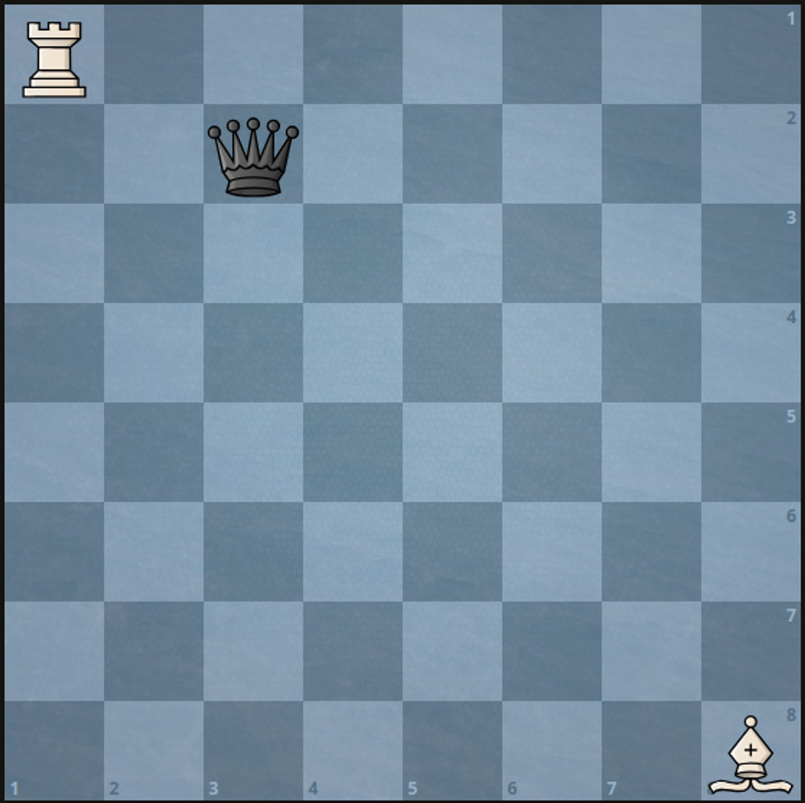
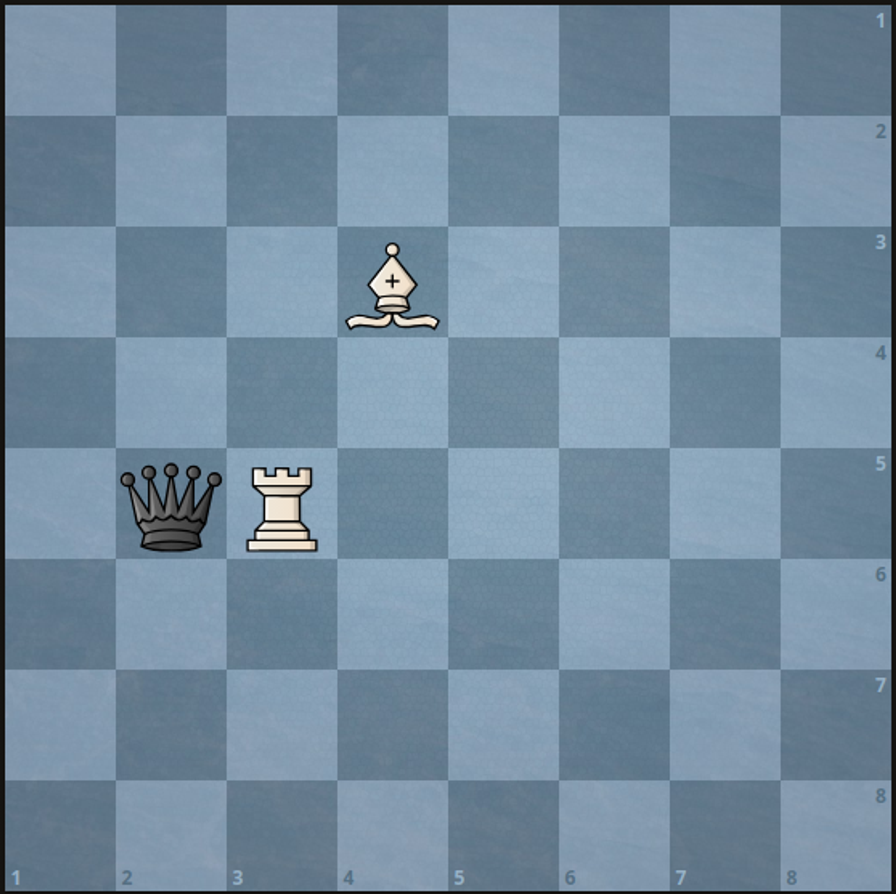

# 分类讨论+简洁写法（Python/Java/C++/C/Go/JS/Rust）

> **[3001. 捕获黑皇后需要的最少移动次数](https://leetcode.cn/problems/minimum-moves-to-capture-the-queen/solutions/2594432/fen-lei-tao-lun-jian-ji-xie-fa-pythonjav-aoa8/) · Medium · 难度分 1797**

> **所属题单**
> - [贪心算法 · 五、思维题](../../../刷题路径/灵神原版题单/贪心算法/五、思维题.md) · §5.8 分类讨论

> **题目描述**
> 现有一个下标从 **1** 开始的 `8 x 8` 棋盘，上面有 `3` 枚棋子。
>
> 给你 `6` 个整数 `a` 、`b` 、`c` 、`d` 、`e` 和 `f` ，其中：
>
> - `(a, b)` 表示白色车的位置。
>
> - `(c, d)` 表示白色象的位置。
>
> - `(e, f)` 表示黑皇后的位置。
>
> 假定你只能移动白色棋子，返回捕获黑皇后所需的**最少**移动次数。
>
> **请注意**：
>
> - 车可以向垂直或水平方向移动任意数量的格子，但不能跳过其他棋子。
>
> - 象可以沿对角线方向移动任意数量的格子，但不能跳过其他棋子。
>
> - 如果车或象能移向皇后所在的格子，则认为它们可以捕获皇后。
>
> - 皇后不能移动。
>
> **示例 1：**
>
> 
>
> ```
>
> 输入：a = 1, b = 1, c = 8, d = 8, e = 2, f = 3
> 输出：2
> 解释：将白色车先移动到 (1, 3) ，然后移动到 (2, 3) 来捕获黑皇后，共需移动 2 次。
> 由于起始时没有任何棋子正在攻击黑皇后，要想捕获黑皇后，移动次数不可能少于 2 次。
> ```
>
> **示例 2：**
>
> 
>
> ```
>
> 输入：a = 5, b = 3, c = 3, d = 4, e = 5, f = 2
> 输出：1
> 解释：可以通过以下任一方式移动 1 次捕获黑皇后：
> - 将白色车移动到 (5, 2) 。
> - 将白色象移动到 (5, 2) 。
> ```
>
> **提示：**
>
> - `1 <= a, b, c, d, e, f <= 8`
>
> - 两枚棋子不会同时出现在同一个格子上。

> **题解**
> 分类讨论：
>
> - 如果车能直接攻击到皇后，答案是 $1$。
> - 如果象能直接攻击到皇后，答案是 $1$。
> - 其他情况，答案一定是 $2$：
>     - 如果车能攻击到皇后，但被象挡住，那么移走象，车就可以攻击到皇后，答案是 $2$。小知识：这在国际象棋中叫做「闪击」。
>     - 如果象能攻击到皇后，但被车挡住，那么移走车，象就可以攻击到皇后，答案是 $2$。
>     - 如果车不能攻击到皇后，那么车可以水平移动或者垂直移动，其中一种方式必定不会被象挡住，可以攻击到皇后，答案是 $2$。
>
> 判断能否直接攻击到：
>
> - 对于车，如果和皇后在同一行或者同一列，且中间没有象，那么就可以直接攻击到皇后。
> - 对于象，如果和皇后在同一斜线，且中间没有车，那么就可以直接攻击到皇后。判断的技巧我在[【基础算法精讲 16】](https://www.bilibili.com/video/BV1mY411D7f6/) 中有讲到，欢迎收看。
>
> ```python
> class Solution:
>     def minMovesToCaptureTheQueen(self, a: int, b: int, c: int, d: int, e: int, f: int) -> int:
>         # m 在 l 和 r 之间（写不写等号都可以）
>         def in_between(l: int, m: int, r: int) -> bool:
>             return min(l, r) < m < max(l, r)
>
>         # 车直接攻击到皇后 or 象直接攻击到皇后
>         if a == e and (c != e or not in_between(b, d, f)) or \
>            b == f and (d != f or not in_between(a, c, e)) or \
>            c + d == e + f and (a + b != e + f or not in_between(c, a, e)) or \
>            c - d == e - f and (a - b != e - f or not in_between(c, a, e)):
>             return 1
>         return 2
> ```
>
>
> 另一种写法，如果 $(m-l)\cdot(m-r) > 0$，那么整数 $m$ 不在整数 $l$ 和 $r$ 之间，
>
> ```python
> class Solution:
>     def minMovesToCaptureTheQueen(self, a: int, b: int, c: int, d: int, e: int, f: int) -> int:
>         # 车直接攻击到皇后 or 象直接攻击到皇后
>         if a == e and (c != e or (d - b) * (d - f) > 0) or \
>            b == f and (d != f or (c - a) * (c - e) > 0) or \
>            c + d == e + f and (a + b != e + f or (a - c) * (a - e) > 0) or \
>            c - d == e - f and (a - b != e - f or (a - c) * (a - e) > 0):
>             return 1
>         return 2
> ```
>
>
> #### 复杂度分析
>
> - 时间复杂度：$\mathcal{O}(1)$。
> - 空间复杂度：$\mathcal{O}(1)$。
>
> ## 思考题
>
> 如果要输出具体移动方案呢？
>
> ## 分类题单
>
> [如何科学刷题？](https://leetcode.cn/circle/discuss/RvFUtj/)
>
> 1. [滑动窗口与双指针（定长/不定长/单序列/双序列/三指针）](https://leetcode.cn/circle/discuss/0viNMK/)
> 2. [二分算法（二分答案/最小化最大值/最大化最小值/第K小）](https://leetcode.cn/circle/discuss/SqopEo/)
> 3. [单调栈（基础/矩形面积/贡献法/最小字典序）](https://leetcode.cn/circle/discuss/9oZFK9/)
> 4. [网格图（DFS/BFS/综合应用）](https://leetcode.cn/circle/discuss/YiXPXW/)
> 5. [位运算（基础/性质/拆位/试填/恒等式/思维）](https://leetcode.cn/circle/discuss/dHn9Vk/)
> 6. [图论算法（DFS/BFS/拓扑排序/最短路/最小生成树/二分图/基环树/欧拉路径）](https://leetcode.cn/circle/discuss/01LUak/)
> 7. [动态规划（入门/背包/状态机/划分/区间/状压/数位/数据结构优化/树形/博弈/概率期望）](https://leetcode.cn/circle/discuss/tXLS3i/)
> 8. [常用数据结构（前缀和/差分/栈/队列/堆/字典树/并查集/树状数组/线段树）](https://leetcode.cn/circle/discuss/mOr1u6/)
> 9. [数学算法（数论/组合/概率期望/博弈/计算几何/随机算法）](https://leetcode.cn/circle/discuss/IYT3ss/)
> 10. [贪心与思维（基本贪心策略/反悔/区间/字典序/数学/思维/脑筋急转弯/构造）](https://leetcode.cn/circle/discuss/g6KTKL/)
> 11. [链表、二叉树与回溯（前后指针/快慢指针/DFS/BFS/直径/LCA/一般树）](https://leetcode.cn/circle/discuss/K0n2gO/)
> 12. [字符串（KMP/Z函数/Manacher/字符串哈希/AC自动机/后缀数组/子序列自动机）](https://leetcode.cn/circle/discuss/SJFwQI/)
>
> [我的题解精选（已分类）](https://github.com/EndlessCheng/codeforces-go/blob/master/leetcode/SOLUTIONS.md)
>
> 欢迎关注 [B站@灵茶山艾府](https://space.bilibili.com/206214)
