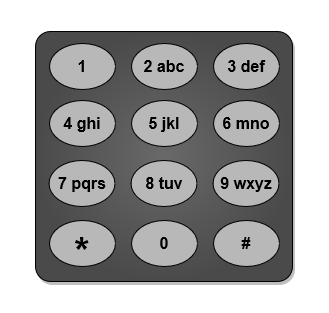
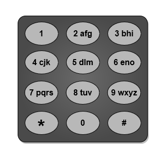
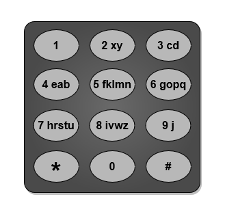

# 3014. 输入单词需要的最少按键次数 I

Easy · [力扣原题](https://leetcode.cn/problems/minimum-number-of-pushes-to-type-word-i/)

| 作者 | 题解 | 动画讲解 |
|---|---|---|
| 灵茶山艾府 | [📄 题解](灵茶山艾府.md) | [▶︎ 动画（GIF）](3014%20输入单词需要的最少按键次数%20I%20·%20灵茶山艾府.gif) · [mp4 文件](3014%20输入单词需要的最少按键次数%20I%20·%20灵茶山艾府.mp4) |
| yiduobo | [📄 题解](yiduobo.md) | [▶︎ 动画（GIF）](3014%20输入单词需要的最少按键次数%20I%20·%20yiduobo.gif) · [mp4 文件](3014%20输入单词需要的最少按键次数%20I%20·%20yiduobo.mp4) |

## 动画讲解

> 动图会循环播放；想暂停、拖进度条请下载上面表格里的 mp4 文件。

### 灵茶山艾府


### yiduobo


## 题目描述

给你一个字符串 `word`，由 **不同** 小写英文字母组成。

电话键盘上的按键与 **不同** 小写英文字母集合相映射，可以通过按压按键来组成单词。例如，按键 `2` 对应 `["a","b","c"]`，我们需要按一次键来输入 `"a"`，按两次键来输入 `"b"`，按三次键来输入 `"c"`<em>。</em>

现在允许你将编号为 `2` 到 `9` 的按键重新映射到 **不同** 字母集合。每个按键可以映射到 **任意数量** 的字母，但每个字母 **必须** **恰好** 映射到 **一个** 按键上。你需要找到输入字符串 `word` 所需的 **最少** 按键次数。

返回重新映射按键后输入 `word` 所需的 **最少** 按键次数。

下面给出了一种电话键盘上字母到按键的映射作为示例。注意 `1`，`*`，`#` 和 `0` **不** 对应任何字母。



**示例 1：**



```

输入：word = "abcde"
输出：5
解释：图片中给出的重新映射方案的输入成本最小。
"a" -> 在按键 2 上按一次
"b" -> 在按键 3 上按一次
"c" -> 在按键 4 上按一次
"d" -> 在按键 5 上按一次
"e" -> 在按键 6 上按一次
总成本为 1 + 1 + 1 + 1 + 1 = 5 。
可以证明不存在其他成本更低的映射方案。
```

**示例 2：**



```

输入：word = "xycdefghij"
输出：12
解释：图片中给出的重新映射方案的输入成本最小。
"x" -> 在按键 2 上按一次
"y" -> 在按键 2 上按两次
"c" -> 在按键 3 上按一次
"d" -> 在按键 3 上按两次
"e" -> 在按键 4 上按一次
"f" -> 在按键 5 上按一次
"g" -> 在按键 6 上按一次
"h" -> 在按键 7 上按一次
"i" -> 在按键 8 上按一次
"j" -> 在按键 9 上按一次
总成本为 1 + 2 + 1 + 2 + 1 + 1 + 1 + 1 + 1 + 1 = 12 。
可以证明不存在其他成本更低的映射方案。
```

**提示：**

- `1 <= word.length <= 26`

- `word` 仅由小写英文字母组成。

- `word` 中的所有字母互不相同。

---
[↑ 返回 3000-3099](../README.md) · [总索引](../../../索引.md) · [仓库首页](../../../README.md)
