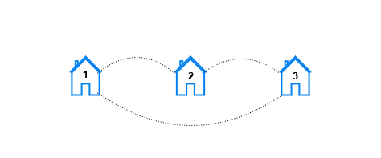
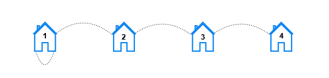

# 非暴力做法：差分数组+分类讨论（Python/Java/C++/Go）

> **[3015. 按距离统计房屋对数目 I](https://leetcode.cn/problems/count-the-number-of-houses-at-a-certain-distance-i/solutions/2613421/fei-bao-li-zuo-fa-chai-fen-shu-zu-fen-le-g6wo/) · Medium · 难度分 1658**

> **所属题单**
> - [图论算法 · 一、图的遍历](../../../刷题路径/灵神原版题单/图论算法/一、图的遍历.md) · §1.2 广度优先搜索（BFS）

> **题目描述**
> 给你三个 **正整数** `n` 、`x` 和 `y` 。
>
> 在城市中，存在编号从 `1` 到 `n` 的房屋，由 `n` 条街道相连。对所有 `1 <= i < n` ，都存在一条街道连接编号为 `i` 的房屋与编号为 `i + 1` 的房屋。另存在一条街道连接编号为 `x` 的房屋与编号为 `y` 的房屋。
>
> 对于每个 `k`（`1 <= k <= n`），你需要找出所有满足要求的 **房屋对** `[house₁, house₂]` ，即从 `house₁` 到 `house₂` 需要经过的 **最少** 街道数为 `k` 。
>
> 返回一个下标从 **1** 开始且长度为 `n` 的数组 `result` ，其中 `result[k]` 表示所有满足要求的房屋对的数量，即从一个房屋到另一个房屋需要经过的 **最少** 街道数为 `k` 。
>
> **注意**，`x` 与 `y` 可以 **相等** 。
>
> **示例 1：**
>
> 
>
> ```
>
> 输入：n = 3, x = 1, y = 3
> 输出：[6,0,0]
> 解释：让我们检视每个房屋对
> - 对于房屋对 (1, 2)，可以直接从房屋 1 到房屋 2。
> - 对于房屋对 (2, 1)，可以直接从房屋 2 到房屋 1。
> - 对于房屋对 (1, 3)，可以直接从房屋 1 到房屋 3。
> - 对于房屋对 (3, 1)，可以直接从房屋 3 到房屋 1。
> - 对于房屋对 (2, 3)，可以直接从房屋 2 到房屋 3。
> - 对于房屋对 (3, 2)，可以直接从房屋 3 到房屋 2。
> ```
>
> **示例 2：**
>
> 
>
> ```
>
> 输入：n = 5, x = 2, y = 4
> 输出：[10,8,2,0,0]
> 解释：对于每个距离 k ，满足要求的房屋对如下：
> - 对于 k == 1，满足要求的房屋对有 (1, 2), (2, 1), (2, 3), (3, 2), (2, 4), (4, 2), (3, 4), (4, 3), (4, 5), 以及 (5, 4)。
> - 对于 k == 2，满足要求的房屋对有 (1, 3), (3, 1), (1, 4), (4, 1), (2, 5), (5, 2), (3, 5), 以及 (5, 3)。
> - 对于 k == 3，满足要求的房屋对有 (1, 5)，以及 (5, 1) 。
> - 对于 k == 4 和 k == 5，不存在满足要求的房屋对。
> ```
>
> **示例 3：**
>
> 
>
> ```
>
> 输入：n = 4, x = 1, y = 1
> 输出：[6,4,2,0]
> 解释：对于每个距离 k ，满足要求的房屋对如下：
> - 对于 k == 1，满足要求的房屋对有 (1, 2), (2, 1), (2, 3), (3, 2), (3, 4), 以及 (4, 3)。
> - 对于 k == 2，满足要求的房屋对有 (1, 3), (3, 1), (2, 4), 以及 (4, 2)。
> - 对于 k == 3，满足要求的房屋对有 (1, 4), 以及 (4, 1)。
> - 对于 k == 4，不存在满足要求的房屋对。
> ```
>
> **提示：**
>
> - `2 <= n <= 100`
>
> - `1 <= x, y <= n`

> **题解**
> 这场周赛的第二题和第四题是一样的，请看 [第四题题解](../3017%20按距离统计房屋对数目%20II/灵茶山艾府.md)。
