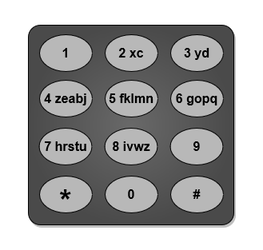
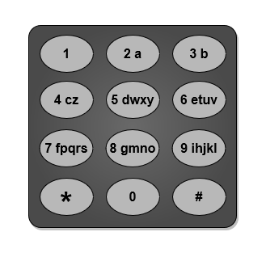

# 根据排序不等式贪心，简洁写法（Python/Java/C++/Go）

> **[3016. 输入单词需要的最少按键次数 II](https://leetcode.cn/problems/minimum-number-of-pushes-to-type-word-ii/solutions/2613399/tan-xin-jian-ji-xie-fa-pythonjavacgo-by-5l4je/) · Medium · 难度分 1534**

> **所属题单**
> - [贪心算法 · 四、数学贪心](../../../刷题路径/灵神原版题单/贪心算法/四、数学贪心.md) · §4.3 排序不等式

> **题目描述**
> 给你一个字符串 `word`，由小写英文字母组成。
>
> 电话键盘上的按键与 **不同** 小写英文字母集合相映射，可以通过按压按键来组成单词。例如，按键 `2` 对应 `["a","b","c"]`，我们需要按一次键来输入 `"a"`，按两次键来输入 `"b"`，按三次键来输入 `"c"`<em>。</em>
>
> 现在允许你将编号为 `2` 到 `9` 的按键重新映射到 **不同** 字母集合。每个按键可以映射到 **任意数量** 的字母，但每个字母 **必须** **恰好** 映射到 **一个** 按键上。你需要找到输入字符串 `word` 所需的 **最少** 按键次数。
>
> 返回重新映射按键后输入 `word` 所需的 **最少** 按键次数。
>
> 下面给出了一种电话键盘上字母到按键的映射作为示例。注意 `1`，`*`，`#` 和 `0` **不** 对应任何字母。
>
> 
>
> **示例 1：**
>
> 
>
> ```
>
> 输入：word = "abcde"
> 输出：5
> 解释：图片中给出的重新映射方案的输入成本最小。
> "a" -> 在按键 2 上按一次
> "b" -> 在按键 3 上按一次
> "c" -> 在按键 4 上按一次
> "d" -> 在按键 5 上按一次
> "e" -> 在按键 6 上按一次
> 总成本为 1 + 1 + 1 + 1 + 1 = 5 。
> 可以证明不存在其他成本更低的映射方案。
> ```
>
> **示例 2：**
>
> 
>
> ```
>
> 输入：word = "xyzxyzxyzxyz"
> 输出：12
> 解释：图片中给出的重新映射方案的输入成本最小。
> "x" -> 在按键 2 上按一次
> "y" -> 在按键 3 上按一次
> "z" -> 在按键 4 上按一次
> 总成本为 1 * 4 + 1 * 4 + 1 * 4 = 12 。
> 可以证明不存在其他成本更低的映射方案。
> 注意按键 9 没有映射到任何字母：不必让每个按键都存在与之映射的字母，但是每个字母都必须映射到按键上。
> ```
>
> **示例 3：**
>
> 
>
> ```
>
> 输入：word = "aabbccddeeffgghhiiiiii"
> 输出：24
> 解释：图片中给出的重新映射方案的输入成本最小。
> "a" -> 在按键 2 上按一次
> "b" -> 在按键 3 上按一次
> "c" -> 在按键 4 上按一次
> "d" -> 在按键 5 上按一次
> "e" -> 在按键 6 上按一次
> "f" -> 在按键 7 上按一次
> "g" -> 在按键 8 上按一次
> "h" -> 在按键 9 上按两次
> "i" -> 在按键 9 上按一次
> 总成本为 1 * 2 + 1 * 2 + 1 * 2 + 1 * 2 + 1 * 2 + 1 * 2 + 1 * 2 + 2 * 2 + 6 * 1 = 24 。
> 可以证明不存在其他成本更低的映射方案。
> ```
>
> **提示：**
>
> - `1 <= word.length <= 10⁵`
>
> - `word` 仅由小写英文字母组成。

> **题解**
> 统计每个字母的出现次数，按照出现次数从大到小排序。
>
> 根据 [排序不等式](https://baike.baidu.com/item/%E6%8E%92%E5%BA%8F%E4%B8%8D%E7%AD%89%E5%BC%8F/7775728)，出现次数前 $8$ 大的字母，只需要按一次；出现次数前 $9$ 到 $16$ 大的字母，需要按两次；依此类推。
>
> 把出现次数和对应的按键次数相乘再相加，得到的按键次数之和就是最小的。
>
> 请看 [视频讲解](https://www.bilibili.com/video/BV1Q5411C7mN/) 第三题，欢迎点赞关注~
>
> ```python
> class Solution:
>     def minimumPushes(self, word: str) -> int:
>         a = sorted(Counter(word).values(), reverse=True)
>         return sum(c * (i // 8 + 1) for i, c in enumerate(a))
> ```
>
>
> #### 复杂度分析
>
> - 时间复杂度：$\mathcal{O}(n+|\Sigma|\log |\Sigma|)$，其中 $n$ 是 $\textit{word}$ 的长度，$|\Sigma|=26$ 是字符集合的大小。
> - 空间复杂度：$O(|\Sigma|)$。
>
> ## 分类题单
>
> [如何科学刷题？](https://leetcode.cn/discuss/post/3141566/ru-he-ke-xue-shua-ti-by-endlesscheng-q3yd/)
>
> 1. [滑动窗口与双指针（定长/不定长/单序列/双序列/三指针/分组循环）](https://leetcode.cn/discuss/post/3578981/ti-dan-hua-dong-chuang-kou-ding-chang-bu-rzz7/)
> 2. [二分算法（二分答案/最小化最大值/最大化最小值/第K小）](https://leetcode.cn/discuss/post/3579164/ti-dan-er-fen-suan-fa-er-fen-da-an-zui-x-3rqn/)
> 3. [单调栈（基础/矩形面积/贡献法/最小字典序）](https://leetcode.cn/discuss/post/3579480/ti-dan-dan-diao-zhan-ju-xing-xi-lie-zi-d-u4hk/)
> 4. [网格图（DFS/BFS/综合应用）](https://leetcode.cn/discuss/post/3580195/fen-xiang-gun-ti-dan-wang-ge-tu-dfsbfszo-l3pa/)
> 5. [位运算（基础/性质/拆位/试填/恒等式/思维）](https://leetcode.cn/discuss/post/3580371/fen-xiang-gun-ti-dan-wei-yun-suan-ji-chu-nth4/)
> 6. [图论算法（DFS/BFS/拓扑排序/基环树/最短路/最小生成树/网络流）](https://leetcode.cn/discuss/post/3581143/fen-xiang-gun-ti-dan-tu-lun-suan-fa-dfsb-qyux/)
> 7. [动态规划（入门/背包/划分/状态机/区间/状压/数位/数据结构优化/树形/博弈/概率期望）](https://leetcode.cn/discuss/post/3581838/fen-xiang-gun-ti-dan-dong-tai-gui-hua-ru-007o/)
> 8. [常用数据结构（前缀和/差分/栈/队列/堆/字典树/并查集/树状数组/线段树）](https://leetcode.cn/discuss/post/3583665/fen-xiang-gun-ti-dan-chang-yong-shu-ju-j-bvmv/)
> 9. [数学算法（数论/组合/概率期望/博弈/计算几何/随机算法）](https://leetcode.cn/discuss/post/3584388/fen-xiang-gun-ti-dan-shu-xue-suan-fa-shu-gcai/)
> 10. [贪心与思维（基本贪心策略/反悔/区间/字典序/数学/思维/脑筋急转弯/构造）](https://leetcode.cn/discuss/post/3091107/fen-xiang-gun-ti-dan-tan-xin-ji-ben-tan-k58yb/)
> 11. [链表、树与回溯（前后指针/快慢指针/DFS/BFS/直径/LCA）](https://leetcode.cn/discuss/post/3142882/fen-xiang-gun-ti-dan-lian-biao-er-cha-sh-6srp/)
> 12. [字符串（KMP/Z函数/Manacher/字符串哈希/AC自动机/后缀数组/子序列自动机）](https://leetcode.cn/discuss/post/3144832/fen-xiang-gun-ti-dan-zi-fu-chuan-kmpzhan-ugt4/)
>
> [我的题解精选（已分类）](https://github.com/EndlessCheng/codeforces-go/blob/master/leetcode/SOLUTIONS.md)
>
> 欢迎关注 [B站@灵茶山艾府](https://space.bilibili.com/206214)
